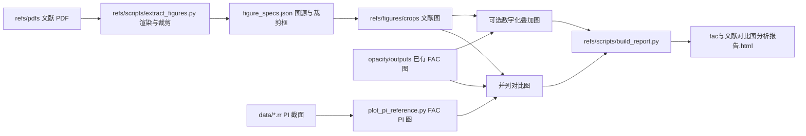

## User Requirements

用户要求在现有 FeL 不透明度示例基础上，制定“文献图像截取与 FAC 仿真图像对比”计划：从已整理的 6 篇文献 PDF 中截取关键图像，绘制与文献图像同类的 FAC 仿真图，用于验证 FAC 对 Fe-L 不透明度/光电离谱形、吸收带位置和关键物理趋势的复现能力。最终生成自包含的 `fac与文献对比图分析报告.html`。

## Product Overview

产出一个图像级对比工作流和一份 HTML 报告。报告并列展示文献截取图与 FAC 仿真图，并记录文献条件、FAC 条件、谱段对应关系、可比对程度与限制。对少数坐标轴清晰的图，可额外生成数字化叠加图。

## Core Features

- 从 6 篇文献 PDF 中定位并裁剪 Fe-L 不透明度、透过率、光电离截面相关图像。
- 复用 `opacity/outputs/` 已有 FAC 不透明度谱与透过率图。
- 新增 FAC 代表性能级 PI 截面图，用于对照 BPRM/RDW 类文献图。
- 生成并列对比图，必要时生成带“数字化近似”标注的叠加图。
- 输出 `figure_specs.json`、`figure_manifest.json` 和最终 HTML 分析报告。
- 明确不做自动回归；仅做定性/半定量图像对照与能力验证。

## Tech Stack Selection

- 文献处理：Python PyMuPDF/fitz、pdf2image、Pillow；命令行备用工具 `pdftoppm`、`pdftocairo`、`pdfimages` 已确认可用。
- 仿真图后处理：Python、matplotlib、numpy，沿用 `opacity/plots/plot_style.py` 的出版级样式。
- 报告生成：单文件 HTML + Base64 内嵌图片，样式参考现有 `FeL仿真报告.html`。
- 执行环境：本地 Windows 即可完成，无需 HPC。

## Implementation Approach

采用“图源登记 → 页面渲染 → 图注定位 → 人工复核裁剪 → FAC 同类图生成 → 并列/叠加对比 → HTML 报告”的流程。先用脚本根据 `FIG. N.` / `Figure N.` 自动定位候选图注并裁剪其上方区域，再把最终裁剪框写回 `figure_specs.json`，避免凭空假设页码或坐标。FAC 侧优先复用已生成的 4 张不透明度图；针对 Zhao 2024 类 PI 截面图，新增从 `data/Fe0{8,9,10}a.rr` 提取代表性 bound level 的 PI 曲线图。

关键决策：

- 只改新增目录和报告文件，不修改 PDF、原始文献 Markdown、FeL 产物和 `demo/FeL`。
- 文献图多为图件，无机器可读谱表，因此报告不声称数值回归通过。
- 叠加图只用于少数坐标轴清晰的图像，必须标为“数字化近似，非官方数据”。
- HTML 采用 Base64 内嵌图像，保证单文件可分享、无 broken image。

## Implementation Notes

- 使用 300 dpi 渲染 PDF 页面；裁剪图保存到 `refs/figures/crops/`，整页渲染保存到 `refs/figures/raw_pages/`。
- `figure_specs.json` 至少记录：文献 key、PDF 路径、页码、图号、caption、crop_box、fac_counterpart、comparison_mode、notes。
- `figure_manifest.json` 记录实际裁剪路径、文件大小、非空校验、对应 FAC 图是否存在。
- Zhang 2012、Jin 2009、Bailey 2015、Nagayama 2019 以谱形/能区/吸收带位置对照为主。
- Zhao 2024 以 PI 截面曲线对照为主，突出 FAC/RDW 背景截面方法学合理性。
- Zhou 2026 以 1200–1600 eV 增强区为定性说明，注意 FAC 默认 10–18 Å 仅部分重叠。
- 报告中必须写明：文献多为高密度 LTE/Z-pinch 条件，FAC 示例为 0D 光薄 CRM，不能逐点数值比对。

## Architecture Design



## Directory Structure

```text
scenarios/fac_demo/cases/FeL_single_node/
├── refs/
│   ├── pdfs/                                      # [EXISTING] 6 篇文献 PDF，只读
│   ├── mds/                                       # [EXISTING] Markdown 与 reading_notes.md
│   ├── figures/                                   # [NEW] 文献图像工作区
│   │   ├── raw_pages/                             # [GENERATED] 300 dpi 整页渲染 PNG
│   │   ├── crops/                                 # [GENERATED] 文献图裁剪 PNG
│   │   ├── digitized/                             # [GENERATED] 可选数字化坐标表
│   │   ├── figure_specs.json                      # [NEW] 候选图、页码、caption、裁剪框、FAC 对应图
│   │   └── figure_manifest.json                   # [GENERATED] 裁剪结果与校验状态
│   └── scripts/
│       ├── extract_figures.py                     # [NEW] 调用 PyMuPDF/pdftoppm 渲染并裁剪候选图
│       └── build_report.py                        # [NEW] 生成自包含 HTML 报告
├── opacity/
│   ├── plots/
│   │   ├── plot_pi_reference.py                   # [NEW] 从 RR 表绘制代表性能级 PI 截面图
│   │   └── plot_overlay.py                        # [NEW] 可选：在文献图坐标上叠加 FAC 曲线
│   └── figures/
│       ├── FeL_PI_crosssection_levels.png         # [GENERATED] FAC PI 截面对照图
│       └── comparison_overlays/                   # [GENERATED] 可选叠加图
├── fac与文献对比图分析报告.html                  # [NEW] 最终自包含 HTML 报告
└── README.md                                      # [MODIFY] 增加图像对比报告入口
```

## Key Contracts

- `extract_figures.py --spec figure_specs.json --out refs/figures`：按规格渲染 PDF、定位 caption、裁剪图像并生成 manifest。
- `plot_pi_reference.py --artifacts-dir ... --output-dir ...`：从 ASCII RR 表提取代表性能级 PI 截面，输出英文标注 PNG。
- `plot_overlay.py --figure-id ... --calibration ...`：按手动轴标定把 FAC 数据叠加到文献裁剪图，输出叠加图和标定说明。
- `build_report.py --spec ... --manifest ... --html ...`：生成自包含 HTML，内嵌所有图像并记录对照结论。

## 报告视觉方案

采用科研报告风格：白色背景、深蓝色标题、浅灰表格线、图像优先布局。每个对比单元包含“文献图 / FAC 图 / 对照说明”三栏或上下结构，图注简洁明确。叠加图使用高对比度半透明曲线，并在标题中标注“数字化近似”。整体保持单文件 HTML、打印友好、可离线查看。

## Agent Extensions

### Skill

- **pdf**
- Purpose: 读取、渲染和裁剪本地 PDF 文献中的候选图件。
- Expected outcome: 生成可复核的文献图裁剪 PNG、页码/caption/裁剪框记录和裁剪清单。