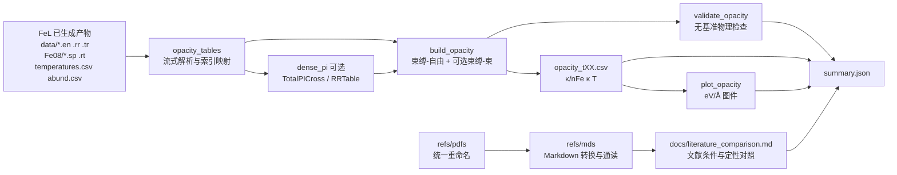

## 产品概述

在现有 FeL 单节点场景目录中新增“不透明度谱”示例，直接复用已生成的 FeL 仿真产物，输出随光子能量或波长变化的等离子体不透明度与透过率，并生成图件与验证摘要。

## 核心功能

- 复用 FeL 已生成的原子表、碰撞辐射布居、温度与丰度数据，不重跑 FeL 前置计算。
- 对 t00–t06 共 7 个温度点合成不透明度谱，输出每铁离子截面、按丰度加权的不透明度和指定路径长度下的透过率。
- 基线包含束缚-自由吸收；可选加入束缚-束吸收谱线贡献，展宽与筛选阈值可配置。
- 大体积谱表只提取必要布居与阈值以上数据，避免一次性占用过多资源。
- 提供可选高精度路径：当 6 点截面插值不足时，生成更密集的光电离网格数据。
- 先整理本地文献 PDF 命名、转换 Markdown 并通读，作为后续文献对照的输入。
- 整理可用于对比的文献清单与条件映射，明确哪些只能定性对照、哪些有数值表可人工核对。
- 提供无基准验证：文件完整性、能量网格单调性、非负性、布居归一、阈值行为、原始表往返一致性。
- 保持 FeL 原始产物与基准只读，所有新产物写入独立输出目录。

## 技术栈选择

- 复用现有 FAC/PFAC 场景体系：`scenarios/fac_demo/cases/FeL_single_node/` 的 `scene.json`、`run.py`、`plots/` 组织方式，以及 `scenarios/core/discovery.py` 的 `rglob("scene.json")` 自动发现机制。
- 新示例主体采用项目已有 Python 3.6+ 兼容风格；绘图沿用 `numpy` + `matplotlib` 和现有 Times New Roman 大字号风格。
- 基线后处理不需要 PFAC，可在 Windows 宿主或 WSL 直接运行；高密度 PI 接口 `fac.TotalPICross` 需要 PFAC，优先在已配置好的 HPC/WSL 环境执行。
- HPC 沿用项目已有提交入口 `python -m scenarios.run.hpc submit --scene <scene> --cores N --mpi M`，核数与 MPI 数分离；FeL 实测推荐组合为 24 核、16 MPI。
- 文献整理阶段使用本地 `pdftotext -layout` 或 Python PyMuPDF；产物为 UTF-8 Markdown，不依赖联网，不下载额外全文。

## 实现方案

### 总体策略

分四阶段落地：**Step 0（新增第一步）** 整理 `refs/pdfs/` 中的 6 篇 PDF：按统一规则重命名、逐篇转换为 Markdown 存入 `refs/mds/`、通读全部 Markdown 并形成阅读笔记；随后再进行第一阶段 ASCII 表粗网格不透明度合成、第二阶段 `TotalPICross` 密集 PI 网格、第三阶段必要时 `RRTable` 重算并提交 HPC。先完成文献通读，可确保后续谱段选择、对比口径和验证项有据可依。

### 执行顺序（2026-11-27 更新，原第一步之后顺延）

1. **PDF 规范化与通读（新的第一步）**

- 将 `scenarios/fac_demo/cases/FeL_single_node/refs/pdfs/` 中 6 个 PDF 统一重命名为 `{第一作者}{年份}{a/b/c}_{文献标题}.pdf`。
- 逐篇转换为 Markdown，输出到 `refs/mds/`，文件名与主 PDF 同名（仅扩展名不同）。
- 通读全部 Markdown，生成 `refs/mds/reading_notes.md` 与 `refs/mds/README.md` 索引。

2. 创建 `opacity/` 场景骨架、场景声明与配置文件。
3. 实现 RR/SP/TR 流式解析与能级映射。
4. 实现不透明度合成与无基准校验脚本。
5. 实现 opacity 绘图与 `summary.json` 汇总。
6. 实现密集 PI 与 HPC 提交模板。
7. 更新场景清单与 FeL 文档入口。
8. 端到端运行、记录耗时与产物验证。

### 关键决策与理由

- **先读文献再实现**：本地已具备 6 篇 PDF，先统一命名、转换 Markdown 并通读，避免后续谱段和对比口径凭空假设。
- **复用而非重算**：FeL 已完成约 8150.632 s 的高成本计算，产物完整（`summary.json.ok=true`）；基线只做后处理，避免重复小时级任务。
- **流式解析**：单个 `Fe08a_t??d0i3.sp` 约 480 MB，含约 571 万行，不能沿用 `plots/fac_tables.py:read_sp()` 的整文件读取；新解析器逐行扫描，只保留 `TYPE=0000000` 布居块与筛选后的谱线/截面数据。
- **PI 插值口径**：`Fe0{8,9,10}a.rr` 只有 6 个能量点（`python/atom.py:982-986` 默认重置网格）；基线在原始点间做对数插值并保留原点点值，避免伪造未测精度。
- **能级映射**：`.sp` 的 `(block, level)` 必须结合块内 `IBLK` 和 `.en` 的 `NLEV` 累积偏移映射到 `.rr` 的 `bound_index`；实现时做交叉校验，缺失映射则跳过并记录计数。
- **谱线贡献可选**：`.sp` 的 Stark 参数为 0，图谱线默认用高斯展宽；束缚-束吸收从 `.tr` 的 gf 与下能级布居合成，默认关闭以免把示例复杂化。
- **文献对照而非自动基准**：多数文献只提供图件或实验条件，不提供机器可读谱表；按 `skills/fac-demo-workflow/SKILL.md` 口径，只做产物完整性、正值性、布居归一、能量网格和趋势检查，文献对照写入专门文档，不声称自动回归通过。

### 性能与可靠性

- PDF 重命名与转换为轻量本地任务，预计秒级到分钟级；转换失败时保留原 PDF 并记录，不删除任何文件。
- 基线读取约 4.5 GB ASCII，单文件一次顺序扫描；复杂度约为 O(扫描字节数 + 保留数据量)，内存控制在紧凑数组量级，预计分钟级，耗时必须实测记录。
- 束缚-自由合成为 O(能量点数 × 选中的 PI 通道数)；对通道按离子与能级分组后向量化插值，避免逐通道重复读取文件。
- 束缚-束合成先按能量排序，只在高斯窗口 ±5σ 内累加，避免 N_E × N_lines 的全矩阵展开。
- `TotalPICross` 路径只处理覆盖 99.9% 布居的 top-N 能级，避免对数十万能级逐级调用。
- `RRTable` 重算与 FeL `fe.py` 同量级，参考 7213.612 s，必须 HPC；只归档 CSV/JSON/PNG，不回传 GB 级原始表。

## 文献对比依据（联网检索补充，2026-11-27）

> 检索目的：为该不透明度谱示例找到可对照的物理依据，并明确“可数值比对”与“仅定性对照”的边界。检索为只读联网检索，未下载受版权保护的全文数据。

### 本地 PDF 清单与重命名映射（新的第一步执行对象）

现有 `scenarios/fac_demo/cases/FeL_single_node/refs/pdfs/` 中共 6 个 PDF。重命名规则：`{第一作者}{年份}{a/b/c根据情况}_{文献标题}.pdf`；同一第一作者同一年份有多篇才使用 b/c，当前 6 篇均暂定 `a`。标题大小写按原文首页；文件名中的空格保留，斜杠等非法字符替换为短横线。

| 当前文件名 | 目标文件名 | 依据 |
| --- | --- | --- |
| `2308.14880.pdf` | `Zhao2024a_R-Matrix calculations for opacities IV Convergence completeness and comparison of relativistic R-matrix and distorted wave calculations for Fe XVII and Fe XVIII.pdf` | arXiv:2308.14880，期刊 2024 年 J. Phys. B |
| `2607.21238.pdf` | `Zhou2026a_Plasma screening and configuration interaction effects induced large enhancement on L-shell photoionization cross sections and opacity.pdf` | arXiv:2607.21238，2026 |
| `a-higher-than-predicted-measurement-of-iron-opacity-at-solar-4vx7wp39j8.pdf` | `Bailey2015a_A higher-than-predicted measurement of iron opacity at solar interior temperatures.pdf` | Nature 517, 56 (2015) |
| `jin2009.pdf` | `Jin2009a_Radiative opacity of iron studied using a detailed level accounting model.pdf` | ApJ 693, 597 (2009) |
| `PhysRevLett.122.235001-accepted.pdf` | `Nagayama2019a_Systematic study of L-shell opacity at stellar interior temperatures.pdf` | PRL 122, 235001 (2019) |
| `zhang2012.pdf` | `Zhang2012a_L- and M-shell absorption measurements of radiatively heated Fe plasma.pdf` | Phys. Plasmas 19(11), 2012 |


> 执行时需以 PDF 首页实际标题/作者/年份复核上表；若发现第一作者或年份不一致，按首页元数据修正后再重命名，并在 `refs/mds/README.md` 中记录差异。

### 文献对比表

| 文献 | 条件与能区 | 可用对比点 | 数据可用性与本项目边界 |
| --- | --- | --- | --- |
| Zhou et al. 2026, *Plasma screening and configuration interaction effects induced large enhancement on L-shell photoionization cross sections and opacity*, arXiv:2607.21238 | Fe XVI/Fe XVII 相关；Te≈180 eV，ne≈7.1e21–9.0e22 cm^-3；重点 1200–1600 eV、7–13 Å；Fe 总不透明度在 T=182 eV、ne=3.1e22 cm^-3 与 Bailey 2015 实验、OP 比较 | 预测 Fe L-shell 不透明度相对 SC/OP 增强 25–30%；其中 plasma screening 使 PI 截面增强 14–17%，CI 再增强约 8–10%；使用 FAC 做 CI 计算 | 仅有图线和公式，无机器可读谱表。本项目是 0D 光薄 CRM、Fe XVII–XIX、默认 10–18 Å（约 0.69–1.24 keV），与 180 eV LTE 稠密等离子体条件不同，只做谱形与增强区间的定性对照 |
| Jin et al. 2009, *Radiative Opacity of Iron Studied Using a Detailed Level Accounting Model*, ApJ 693 597, DOI:10.1088/0004-637X/693/1/597 | DLA 模型；Bailey 2007 Z-pinch Fe/Mg：T=150 eV、ne=8.5e21 cm^-3，800–1320 eV（L→M）与 990–1320 eV（L→N/O）；另有 T=20/19.3 eV 等温序列 | 透射谱形状、L-shell 吸收带位置；DLA 与 OPAL/LEDCOP 符合较好、高密度下与 OP 有差异；Table 4 给出 OP/DLA 的 ne 序列 | 正文提供图件和少量 ASCII 表（能级、ne），无公开透射谱数值文件。可作为“谱形/吸收带位置”人工对照，不进入 `check.py` |
| Zhang et al. 2012, *L- and M-shell absorption measurements of radiatively heated Fe plasma*, Phys. Plasmas 19(11), DOI:10.1063/1.4769103 | 辐射加热 Fe 等离子体；T=72±4 eV；光子能量 150–1200 eV；密度由 Multi-1D 模拟给出；与 DCA 模型比较 | 宽能区 L+M 吸收谱的总体形态；说明 L/M 吸收在该温区主导辐射输运 | OSTI 页面无原始数据下载。本项目只覆盖 Fe XVII–XIX 的 L 壳层，未包含完整电荷态平衡，不能逐点对照 |
| Zhao, Nahar & Pradhan 2024, *R-Matrix Calculations for Opacities: IV ... Fe XVII and Fe XVIII*, arXiv:2308.14880 / J. Phys. B, DOI:10.1088/1361-6455/ad45f6 | BPRM 与相对论扭曲波 RDW 比较；Fe XVII/Fe XVIII；背景 PI 截面一致；比较延伸至约 500 Ry 光电子能量；BCZ 背景 T=2.1e6 K、ne≈3.1e22 cm^-3 | 证明 FAC/RDW 类背景 PI 与 BPRM 在背景截面吻合良好；CI 对背景截面重要；top-up 高 nℓ 能级对 Rosseland 平均不透明度影响 <5% | 表 1/表 2 给出能级能量（可人工核对能级对应），但截面曲线仅为图，无 CSV。用于说明本项目 FAC 扭曲波 PI 的方法学合理性 |
| Bailey et al. 2015, Nature 517, 56；Nagayama et al. 2019, PRL 122, 235001 | Z-pinch 太阳对流区条件下 Fe/Cr/Ni L-shell 不透明度实验 | 提供“理论低于实验”的长期差异背景，以及 Zhou 2026 用于修正的基准 | 本项目不直接复现实验几何与 LTE 状态；仅在文献说明中引用为实验背景 |


补充口径说明：

- 现有 `plots_inputs/temperatures.csv` 的列名为 `T_K`，但数值 272.5 对应 `log10T=6.5` 的 eV 换算（`10^6.5 K / 11604.5 ≈ 272 eV`）；README 中必须标注“该列实为 eV”，避免把温度条件误写成 272 K。
- 文献对照产物写入 `opacity/docs/literature_comparison.md`，逐条列出“文献条件 / 本项目条件 / 可否数值比对 / 对照结论”。
- `refs/mds/reading_notes.md` 必须逐篇摘录：第一作者、年份、实验/计算条件、光子能量范围、对比模型、关键结论、是否有机器可读数据、对本示例的可用程度。
- 可在 `validate_opacity.py` 中增加一项轻量检查：确认 10–18 Å 默认窗口与 1200–1600 eV 增强区的重叠关系被正确记录；这不是回归断言，只是防止文档与配置脱节。

## 实现注意事项

- 不修改 `demo/FeL/*`、`artifacts/FeL_single_node_c24m16/*` 或任何基准文件。
- `refs/pdfs/` 中的 PDF 只重命名，不修改文件内容；重命名前核对首页元数据，转换失败时保留原 PDF 并记录。
- 配置中所有路径以 `artifacts/FeL_single_node_c24m16/` 为基准校验，拒绝越界绝对路径；HPC 路径由环境或凭证解析，不在场景中硬编码用户名。
- 复用现有 `run.py` 的参数风格：`--phase all|build|dense-pi|validate|plot`、`--artifacts-dir`、`--output-dir`、`--cores`、`--mpi`、`--dry-run`。
- 输出 `summary.json` 记录阶段、退出码、输入输出文件计数、墙钟时间、跳过映射数、缺失文件；未实测字段写“未记录”。
- 日志沿用现有场景的 stdout + HPC 作业日志；不打印敏感信息，不按行刷屏。
- 新增 `scene.json` 会被自动发现；`scene_manifest.json` 仅作展示补充。
- 现有 `plots/fac_tables.py` 保持不变，新解析逻辑独立放在 `opacity/scripts/opacity_tables.py`，避免回归影响原绘图。

## 系统架构



## 目录结构

```text
scenarios/fac_demo/cases/FeL_single_node/
├── refs/                                         # 文献原始 PDF 与转换产物（新的第一步在这里执行）
│   ├── pdfs/                                     # [EXISTING] 6 篇 PDF，统一重命名，不修改内容
│   └── mds/                                      # [GENERATED] 同名 Markdown
│       ├── README.md                             # [GENERATED] 文献索引与重命名映射
│       └── reading_notes.md                      # [GENERATED] 通读笔记：条件、能区、对比点、数据可用性
├── opacity/                                      # [NEW] 不透明度谱示例根目录，保持位于 FeL_single_node 内
│   ├── README.md                                 # [NEW] 说明复用产物、三阶段流程、运行命令、HPC 决策与无基准验证口径
│   ├── scene.json                                # [NEW] 场景声明：name=FeL_opacity，entry=run.py，archetype=opacity spectrum
│   ├── run.py                                    # [NEW] 场景入口，解析 --phase/--artifacts-dir/--output-dir/--cores/--mpi/--dry-run，调度各阶段
│   ├── config.json                               # [NEW] 温度索引、能量/波长网格、PI 插值方式、展宽、丰度列、路径长度、布居阈值、top-N 参数
│   ├── docs/
│   │   └── literature_comparison.md              # [NEW] 文献清单、对比条件、可数值/仅定性对照边界、温度单位口径说明
│   ├── scripts/
│   │   ├── opacity_tables.py                     # [NEW] 流式 RR/TR/SP 解析器；提取 TYPE=0000000 布居块；构建 (block,level,IBLK) 到 bound_index 映射
│   │   ├── build_opacity.py                      # [NEW] 合成 bf/bb 不透明度、丰度加权 κ、透过率 T=exp(-κL)，输出 opacity_tXX.csv
│   │   ├── dense_pi.py                           # [NEW] 可选密集 PI：调用 PFAC TotalPICross；保留 RRTable 重算接口供 HPC 阶段使用
│   │   └── validate_opacity.py                   # [NEW] 检查能量单调、κ 非负、布居归一、离子丰度一致、原始 6 点往返一致和文件完整性
│   ├── plots/
│   │   ├── plot_opacity.py                       # [NEW] 绘制 κ(E)、κ(λ)、T(E) 与 bf/bb 分量对比，英文标注
│   │   └── plot_style.py                         # [NEW] 薄封装；复用上级 plots/plot_style.py 的 Times New Roman 与字号设置
│   ├── hpc_jobs/
│   │   ├── opacity_dense_pi.sbatch               # [NEW] HPC 短作业模板，用于 TotalPICross；重算 RRTable 时改为 03:00:00 与 24c/16m
│   │   └── README.md                             # [NEW] 说明何时提交 HPC、提交命令、环境与归档规则
│   └── outputs/
│       ├── .gitkeep                              # [NEW] 保留输出目录
│       ├── tables/opacity_tXX.csv                 # [GENERATED] t00-t06 的不透明度谱表
│       ├── dense_pi/*.csv                         # [GENERATED] 可选密集 PI 网格结果
│       ├── figures/*.png                          # [GENERATED] 图件
│       └── summary.json                          # [GENERATED] 阶段状态、退出码、文件计数、耗时与验证结论
├── README.md                                     # [MODIFY] 增加 opacity/ 子场景入口、复用产物说明与 HPC 分支指引
└── ../scene_manifest.json                        # [MODIFY] 增加 FeL_opacity 展示条目，path=cases/FeL_single_node/opacity
```

注：`scenarios/fac_demo/scene_manifest.json` 的完整路径为 `scenarios/fac_demo/scene_manifest.json`；表中 `../scene_manifest.json` 相对 `FeL_single_node/` 目录。

## 关键接口约定

- `iter_rr(path)`：逐块返回 RR 表头、`bound_index`、`Delta E`、`EGRID` 与 `PI crosssection`，不做整文件载入。
- `iter_sp_populations(path, min_population)`：仅遍历 `TYPE=0000000` 块，返回 `(block, level, IBLK, energy, population)`。
- `build_level_map(en_path, rr_path)`：由 `.en` 的 `NLEV` 累积偏移生成 `(block, level)` 到 `bound_index` 的映射并统计失败项。
- `build_opacity(config)`：按温度循环输出 CSV，字段至少含 `energy_ev`、`wavelength_a`、`kappa_cm2_per_Fe`、`kappa_inv_cm`、`transmission`、`kappa_bf`、`kappa_bb`。