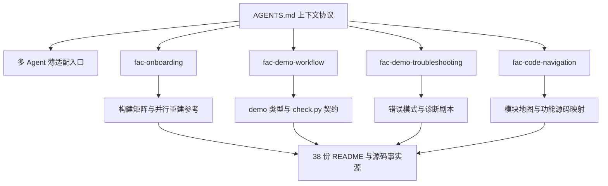

## 用户需求

- 在 `{fac/}` 项目中编写一套面向多种 Agent 的 skill 与上下文协议，覆盖 Codex、OpenCode、Cursor、Zed、Warp、Amp、Jules、VS Code、Claude Code、Workbuddy、CodeBuddy 等环境。
- 通读项目内全部 38 份 `README.md`，重点细读 `demo/` 下总览、示例与 `ref/` 文档；将 demo 抽象为通用模式，避免 skill 主体绑定具体案例。
- Skill 体系必须包含首次上手流程，并支持当前阶段的重新并行构建。
- Skill 体系必须包含 demo 示例常见问题的分类诊断与逐步解决步骤。
- Skill 体系必须包含 FAC 整体概述、源码快速定位、功能查找、API 调用链定位方法。
- 用户已将 `temp_test` 移至上一级目录；从 `{fac/}` 根看应使用 `../temp_test`，不能继续引用旧 `temp_test/...` 路径。

## Product Overview

形成一套可发现、可组合、可维护的项目级 Agent 文档体系：由统一上下文协议负责入口与触发规则，由多个精简 skill 负责具体工作流，由 references 承载详细知识，避免把 README 内容整块复制进 skill 主体。

## Core Features

- 建立跨 Agent 上下文入口：统一说明项目边界、路径约定、读取顺序、skill 触发规则与安全约束。
- 建立首次上手与并行构建 skill：环境准备、构建副本、并行编译、PFAC/PFac 模块验证、首次运行检查。
- 建立抽象 demo 工作流 skill：按问题类型、输入输出、依赖、回归方式、长耗时任务分类，不依赖具体示例名。
- 建立 demo 排障 skill：覆盖行尾、ABI、导入路径、前置产物、线程安全、比对失败、单位与列语义、无基准等通用问题。
- 建立源码导航 skill：提供 FAC 模块地图、功能到源码的查找路径、Python/PFAC 与 SFAC 接口映射、LSP 定位策略。

## Tech Stack Selection

- 文档格式：Markdown + YAML frontmatter，沿用现有中文 README 风格与表格表达。
- Skill 存放：项目级 `.codebuddy/skills/<skill-name>/SKILL.md`，参考 skill-creator 的分层结构。
- 跨 Agent 协议：项目根 `AGENTS.md` 作为通用入口，配合少量厂商适配文件指向同一协议，避免多份规则漂移。
- 源码定位：结合现有 README、文本检索与 LSP 语义分析，生成功能到源码的稳定映射。
- 不新增运行时依赖；不修改现有 README、源码、Makefile、`check.py`、`../temp_test` 或历史日志。

## Implementation Approach

采用“全量清单抽取 -> 通用模式抽象 -> skill 初始化 -> references 细化 -> 一致性校验”的流程。

关键决策：

- `AGENTS.md` 作为唯一上下文协议事实源；Cursor、Claude Code、VS Code 适配文件只做薄入口，不复制规则正文。
- `.codebuddy/skills/` 用于 CodeBuddy 自动发现；其他 Agent 通过 `AGENTS.md` 的 skill 索引按需读取 `SKILL.md`。
- SKILL.md 保持精简，正文只写触发条件、决策规则和操作流程；病句、命令细节、字段表、错误模式放入 `references/`。
- demo 内容按“原子数据、碰撞过程、CRM/谱、偏振、R 矩阵、底层诊断”等类型抽象；SKILL.md 不写具体示例名，references 只保留通用模板与中性分类。
- 首次上手 skill 明确“独立构建目录 + 原树只读 + 并行编译 + 串行关键步骤”的边界：行尾归一化、configure、模板补丁等前置步骤串行；可并行的编译与独立检查优先并行。

性能与可靠性：

- 文档规模约 38 份 README 加少量源码索引，复杂度近似 O(文档数 + 符号数)。
- 使用并行读取与并行子代理抽取素材；同一文件的写入串行，避免冲突。
- 主要瓶颈是模式抽象与交叉验证，不是 I/O；通过统一清单和 references 分层减少重复上下文加载。

## Implementation Notes

- 严格使用 `../temp_test` 表述已移动目录；所有新文档禁止出现旧 `temp_test/...` 路径。
- 使用 skill-creator 的 `init_skill.py` 初始化新 skill；删除生成的无用示例目录和示例文件。
- 每个 `SKILL.md` 必须具备 `name`、`description`；描述使用第三人称并明确触发场景，正文使用祈使/不定式风格。
- SKILL.md 正文控制在 5000 词以内；详细命令、字段表、容差、错误模式放入 references。
- `description` 需覆盖触发词，如首次构建、并行构建、demo 排障、check.py、源码定位、功能查找、API 调用链。
- 并行构建说明必须强调 PFAC 非线程安全、构建产物隔离、日志分文件、失败时保留现场；不要把 Python 多线程并发调用当成并行方案。
- 排障 skill 需体现“先分类、再复现、再定位、再验证”的固定顺序，避免 Agent 直接改物理参数或参考表。
- 校验阶段检查：frontmatter 合法性、相对链接、路径约定、代码围栏、skill 间交叉引用、无具体案例绑定、无旧 temp_test 路径。
- 不打包 zip，除非用户后续要求；本次目标是仓库内可直接使用。

## Architecture Design



数据流为：README 与源码事实源经并行抽取形成素材清单，经模式抽象后进入 references，最终由短 SKILL.md 暴露给 Agent；上下文协议负责按任务触发对应 skill。

## Directory Structure Summary

本次只新增 skills 与上下文协议文件，所有现有 README、源码、脚本、`../temp_test` 内容保持不动。

```text
{fac}/
├── AGENTS.md
│   # [NEW] 跨 Agent 上下文协议。定义项目边界、路径约定、原树只读规则、skill 索引、触发规则、并行策略与验证要求。
├── CLAUDE.md
│   # [NEW] Claude Code 薄入口。仅指向 AGENTS.md 并声明启动读取顺序，不复制协议正文。
├── .cursor/rules/fac-context.mdc
│   # [NEW] Cursor 规则薄入口。声明适用范围并指向 AGENTS.md 与 skill 索引。
├── .github/copilot-instructions.md
│   # [NEW] VS Code Copilot 薄入口。指向 AGENTS.md，要求按任务加载对应 skill。
├── .codebuddy/skills/
│   ├── fac-onboarding/
│   │   ├── SKILL.md
│   │   # [NEW] 首次上手与重新并行构建技能。说明何时触发、环境前置、独立构建目录、并行编译边界、验证清单。
│   │   ├── references/build-matrix.md
│   │   # [NEW] 构建环境矩阵。记录 WSL、gcc/gfortran、Python、CRLF、f2cFortran、PFAC 模块与 Windows 宿主限制。
│   │   ├── references/parallel-rebuild.md
│   │   # [NEW] 并行重建流程。定义串行前置、可并行阶段、日志隔离、失败保留现场与结果汇总方法。
│   │   └── references/first-run-checklist.md
│   │   # [NEW] 首次运行检查清单。覆盖 import、Makefile 目标、demo 冒烟测试、check.py 与产物完整性。
│   ├── fac-demo-workflow/
│   │   ├── SKILL.md
│   │   # [NEW] 抽象 demo 工作流技能。按输入依赖、计算类型、回归方式和资源消耗分类，禁止绑定具体案例。
│   │   ├── references/demo-archetypes.md
│   │   # [NEW] demo 原型表。抽象结构计算、碰撞过程、CRM/谱、偏振、R 矩阵、底层诊断等通用模式。
│   │   ├── references/checkpy-contract.md
│   │   # [NEW] check.py 通用契约。说明扩展名分派、容差思路、行序重排、死键风险、无基准处理与耗时口径。
│   │   └── references/table-units.md
│   │   # [NEW] 输出表单位与列语义。抽象 eV、Hartree、photons/s、截面单位、布居与发射强度的判读规则。
│   ├── fac-demo-troubleshooting/
│   │   ├── SKILL.md
│   │   # [NEW] demo 排障技能。提供分类、复现、定位、修复、回归的固定步骤与安全边界。
│   │   ├── references/error-patterns.md
│   │   # [NEW] 错误模式库。归纳 CRLF、ABI、导入路径、缺前置文件、MPI/OpenMP 差异、Python 2 兼容等通用问题。
│   │   ├── references/diagnostic-playbooks.md
│   │   # [NEW] 分步诊断剧本。给出构建失败、运行失败、比对失败、无 ref、长耗时、崩溃等场景的处理顺序。
│   │   └── references/known-limitations.md
│   │   # [NEW] 已知限制索引。记录非线程安全、死键、版本差异、弱线容差、注释与代码不一致等抽象限制。
│   └── fac-code-navigation/
│       ├── SKILL.md
│       # [NEW] FAC 概述与源码导航技能。说明如何按物理功能、API 名称、输出表类型快速定位实现。
│       ├── references/module-map.md
│       # [NEW] 模块地图。映射 faclib、python、sfac、coul、ionis、modqed、mpfun、ode 等目录职责。
│       ├── references/feature-to-source.md
│       # [NEW] 功能到源码映射。覆盖结构、跃迁、CE/CI/PI/RR/AI/DR、CRM、谱、偏振、R 矩阵等功能入口。
│       └── references/api-call-map.md
│       # [NEW] API 调用链地图。给出 PFAC 与 SFAC 两套接口的查找线索、典型调用顺序和验证方法。
```

## Agent Extensions

### Skill

- **skill-creator**
- Purpose: 指导项目级 skill 的初始化、SKILL.md 元数据和渐进披露结构。
- Expected outcome: 生成结构合法、触发清晰、references 分层合理的 skill 文件集。
- **lsp-code-analysis**
- Purpose: 辅助定位 FAC 核心函数、定义、引用和调用链。
- Expected outcome: 形成可验证的功能到源码映射和 API 调用链参考。

### SubAgent

- **code-explorer**
- Purpose: 并行通读全部 README 并抽取技能素材。
- Expected outcome: 得到 38 份 README 的结构化摘要、demo 通用模式、错误类型与源码线索。