## 用户要求
在 `scenarios/fac_demo/cases/FeL_single_node/` 中建立完整、自包含的 FeL 后处理体系：选择一个已完成的 HPC FeL 作业，回传其全部产物到本地子场景目录，编写 Python3 绘图脚本，生成全套 FeL 图像，并编写 `FeL仿真报告.html`。

## 产品概述
形成以 FeL 子场景为中心的“数据、脚本、图像、报告”一体目录。报告展示 FeL 光谱、电离平衡/丰度、速率系数、跃迁速率，以及核数/MPI 参数矩阵耗时对比；所有相关文件均位于该子场景目录内。

## 核心功能
- 从推荐作业 `(24 核, 16 MPI)`、JobID `4974613` 回传完整 FeL 产物。
- 在子场景目录中新增 Python3 绘图脚本，不使用旧 Python2 的 `cPickle/Numeric/biggles` 方案。
- 绘制全套 FeL 图：谱线光谱、多温度谱、电离平衡/丰度、速率系数、跃迁速率、矩阵耗时对比。
- 生成自包含静态 HTML 报告 `FeL仿真报告.html`，使用相对路径引用图片。
- 更新子场景 README、场景元数据和变更记录，确保目录可复现、可审计。


## 技术栈选择
- 回传层：复用 `scenarios/run/remote/session.py` 与 `scripts/credentials`；避免硬编码用户名，不打印敏感信息。
- 数据读取：Python3 标准库 `pathlib`、`json`、`pickle`、`csv`，配合 `numpy` 处理表格与曲线。
- 绘图：Python3 + `matplotlib`，输出 PNG/PDF 到子场景 `figures/`。
- 报告：单文件静态 HTML + 内嵌 CSS，图片使用相对路径。
- 文档门禁：复用 `scripts/04_audit/audit_readmes.py`、`audit_formula_underlines.py` 与场景审计。

## 实现思路
采用“先回传完整产物，再本地解析绘图，最后生成 HTML 报告”的链路。回传阶段优先在 HPC 端打包 `work/run` 为单个归档，再经 SFTP 下载并解包到本地子场景目录，避免逐文件传输大量小文件造成高延迟。绘图脚本不调用 FAC 运行时，直接读取 ASCII 表、`.plt`、`.sav`、`.dat` 与矩阵 JSON。

关键决策：
- 选用 JobID `4974613`，因为矩阵结果确认 `(24,16)` 为推荐组合，且产物一致性通过。
- 所有脚本、回传产物、图片和报告都放入 `scenarios/fac_demo/cases/FeL_single_node/`，不再向 `scenarios/fac_demo/outputs/` 生成第二套资料。
- 原始 HPC 产物体积大，默认不纳入 Git 跟踪；仅对报告所需图片增加窄范围例外，保证报告可展示。
- 旧 FeL 绘图脚本使用 Python2、biggles 和 Numeric，不能直接复用；新脚本只参考其物理含义与文件读取逻辑。
- `.sav` 文件使用 `pickle.load(..., encoding="latin1")` 兼容旧格式；缺失输入必须明确报错并列出缺失文件，不猜测数据。

## 性能与可靠性
- 回传前统计 HPC `work/run` 大小与本地可用空间；大文件打包传输，避免逐个 SFTP 往返。
- 生成 manifest：记录相对路径、文件大小、修改时间、关键文件数量；回传后校验。
- 绘图脚本对大表采用流式读取或按列读取，避免一次性加载不必要数据。
- 矩阵耗时图读取已回传的小 JSON，不重新提交或等待 HPC 作业。
- HTML 生成前检查所有图片路径存在；缺失图片时报告生成失败。

## 架构设计

```mermaid
flowchart LR
    A["HPC Job 4974613<br/>work/run 完整产物"] --> B["fetch_fel_artifacts.py<br/>打包与 SFTP 回传"]
    B --> C["FeL_single_node/artifacts/<br/>本地原始数据"]
    C --> D["plot_spec.py"]
    C --> E["plot_abund.py"]
    C --> F["plot_rates.py"]
    C --> G["plot_trates.py"]
    H["matrix_summary.json"] --> I["plot_matrix.py"]
    D --> J["figures/"]
    E --> J
    F --> J
    G --> J
    I --> J
    J --> K["FeL仿真报告.html"]
```


## 目录结构
```text
scenarios/fac_demo/cases/FeL_single_node/
├── README.md                         # [MODIFY] 补充回传、绘图、报告复现命令与文件索引
├── scene.json                        # [MODIFY] 增加 plots/report/artifacts 元数据
├── matrix.json                       # [KEEP] 参数矩阵配置保持不变
├── hpc_jobs/                         # [KEEP] 已有作业清单与日志
├── artifacts/
│   ├── README.md                     # [NEW] 说明回传作业、目录结构与数据用途
│   └── FeL_single_node_c24m16/       # [NEW] Job 4974613 全量产物本地副本
├── plots/
│   ├── README.md                     # [NEW] 绘图脚本使用说明
│   ├── common.py                     # [NEW] 路径解析、文件发现、安全 pickle、样式配置
│   ├── fetch_fel_artifacts.py        # [NEW] 从 HPC 回传 Job 4974613 完整产物
│   ├── plot_spec.py                  # [NEW] 绘制光谱与多温度谱图
│   ├── plot_abund.py                 # [NEW] 绘制电离平衡与丰度比图
│   ├── plot_rates.py                 # [NEW] 绘制 CE/CI/RR/AI 等速率系数图
│   ├── plot_trates.py                # [NEW] 绘制跃迁速率相关图
│   ├── plot_matrix.py                # [NEW] 绘制核数/MPI 矩阵耗时对比图
│   └── plot_all.py                   # [NEW] 统一调用绘图脚本并生成图片清单
├── figures/
│   ├── README.md                     # [NEW] 图片索引与命名规则
│   └── *.png / *.pdf                 # [NEW] 自动生成的 FeL 全套图像
└── FeL仿真报告.html                   # [NEW] 自包含静态报告，相对引用 figures 图片
```

## 关键执行细节
- `fetch_fel_artifacts.py` 默认从 `matrix_jobs.json` 解析 `(24,16)` 作业，并允许 `--job` 覆盖。
- 绘图脚本统一提供 `--artifacts-dir`、`--figures-dir`、`--help`。
- `plot_all.py` 汇总各脚本执行状态，输出 `figures/figure_manifest.json`。
- HTML 报告包含：数据来源、参数组合、矩阵结论、图像分区、物理合理性、产物统计、复现命令、已知限制。
- 更新 `.gitignore`：继续忽略原始大产物和日志；仅允许该子场景 `figures/*.png` 作为报告图片入库。


## FeL 报告视觉方案
采用现代科研报告风格：深蓝头部区域、浅色内容背景、卡片化图组、清晰表格与响应式网格。报告不依赖外部 CDN，CSS 内嵌，离线打开即可查看。

页面结构：
1. 顶部标题区：FeL 仿真报告、作业参数、推荐组合标识。
2. 摘要卡片区：JobID、核数/MPI、耗时、产物计数。
3. 图像分区：光谱、丰度、速率、跃迁速率、矩阵分析，每张图含图题与简要说明。
4. 结果表：矩阵组合、耗时、状态、产物一致性。
5. 复现与限制区：命令清单、数据路径、非致命警告说明。

## Agent Extensions
### SubAgent
- **code-explorer**
  - Purpose: 复核 FeL 原始 Python2 绘图脚本、当前子场景目录、矩阵结果文件与回传作业产物字段。
  - Expected outcome: 明确每类图表的输入文件、旧脚本物理含义、README 门禁影响和最小改动落点。
