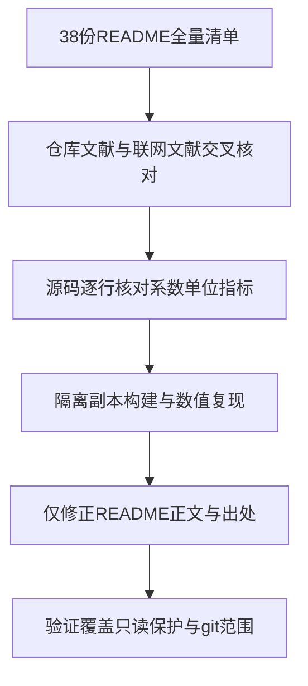

## User Requirements

对全部 38 份中文 README.md 进行第二轮公式深度核查，不限于上轮已修正或带不确定标注的文件。

## Product Overview

逐份检查所有公式、拟合式、单位换算与出处，结合仓库文献、联网权威资料和 FAC 源码实现进行三向核对。数值复现只能在隔离副本中进行，原源码只能读取和执行，不能修改。

## Core Features

- 全部 38 份 README 全量复核，其中含公式文档逐条核查，无公式文档确认无需公式。
- 搜索并交叉验证 doc/manual.tex、doc/papers/*.tex 与外部权威文献。
- 逐公式追踪源码具体语句、系数、单位换算、张量指标和归一化约定。
- 在隔离副本中构建并运行小型 demo 或独立数值脚本，核对关键数值。
- 发现错误仅直接修正 README，不产出新报告文档。
- 源码无字面实现的公式继续保留，但明确标注标准形式与源码实现差异。

## Tech Stack Selection

- 文档对象：FAC 源码树中的 38 份中文 README.md。
- 理论资料：仓库内 doc/manual.tex、doc/papers/*.tex，以及通过 web_search、web_fetch、必要时 agent-browser 获取的权威论文与教材资料。
- 源码分析：使用 code-explorer 批量检索，使用 lsp-code-analysis 辅助定位 C/Python 符号定义与引用，Fortran 源码以文本检索和文件阅读补充。
- 数值复现：在系统临时目录建立隔离源码副本，在副本中 configure、make 并运行少量 demo；不修改、不覆盖原工作区源码。

## Implementation Approach

采用“全量清单化 → 文献交叉核对 → 源码逐行核对 → 隔离副本数值复现 → 就地修正 → 最终验证”的流程。

关键决策：

- 源码优先：文献标准形式只用于发现错误和确认物理含义，最终写法以 FAC 源码实现为准。
- 标准式保留：对 R 矩阵、MBPT、二次 Stark 等源码无字面公式但物理上有效的标准形式，保留公式并补充源码实际算法、近似、归一化和单位差异。
- 数值复现受控：当前源码树无 libfac.a 和 .o 文件，必须先构建；所有构建产物只在隔离副本生成，结束后清理，避免污染原树和 git 状态。
- 小范围修改：只修正公式、系数、单位、出处、源码行号和说明文字，不重写整篇 README，不新增报告文件。

性能与可靠性：

- 公式条目为百级规模，先建立一次清单并复用，避免重复全量扫描。
- 源码定位按文件批量读取，优先聚焦 18 份带不确定标注的 README，同时完成其余文档的确认性复核。
- 完整构建只做一次，数值复现选取 structure、excitation、pirr、aidr、ionization、tests 等小算例或独立脚本；若环境不支持构建，则用参考数据与独立数值计算替代，不伪造结果。
- 复杂度近似为公式数加源码定位数加复现脚本数，主要瓶颈是 Fortran/C 编译，需用单次构建和多算例复用来摊薄成本。

## Implementation Notes

- 只写入 README.md；源码、.tex、.f、.c、.h、构建脚本、数据文件和旧 demo/README 均不得修改。
- 478 个非 README 原始文件当前为只读，核查过程中保持只读属性，不解除保护。
- 根 README 的英文原文附录已与 git HEAD 逐字一致，第二轮修正不得破坏该附录。
- 联网资料只作标准形式参考；静态页面优先 web_fetch，动态页面再用 agent-browser。
- 核查证据只作为执行上下文使用，不落盘为新的 Markdown 文档。
- 修改使用就地替换，保持原有中文风格、相对链接、逐文件说明和源码对应表结构。
- 最终验证：38 份 README 全部覆盖；错误公式无残留；源文件仍只读；git status 仅显示 README.md 变更；根 README 英文附录逐字一致；临时副本已清理。

## Architecture Design



## Directory Structure

本轮不新增文件，38 份 README 均为核查对象，按需要就地修正。

```text
fac/
├── README.md                         # [核查并按需修正] 总览公式索引、口径与出处
├── .circleci/README.md               # [确认] 确认无需公式
├── blas/README.md                    # [确认] 数值库接口说明，无需物理公式
├── ci/README.md                      # [确认] 环境配置说明，无需公式
├── coul/README.md                    # [核查并按需修正] 库仑波函数、连续态与特殊函数
├── faclib/README.md                  # [核查并按需修正] 核心物理效应公式与源码对应
├── ionis/README.md                   # [核查并按需修正] 电离平衡与拟合公式
├── lapack/README.md                  # [确认] 线性代数库说明，无需物理公式
├── minpack/README.md                 # [确认] 优化库说明，无需物理公式
├── modqed/README.md                  # [核查并按需修正] QED 公式、前因子与出处
├── mpfun/README.md                   # [核查并按需修正] 高精度与 Legendre 递推
├── ode/README.md                     # [确认] ODE 求解器说明，无需物理公式
├── python/README.md                  # [核查并按需修正] PFAC 接口中的物理公式
├── quadpack/README.md                # [确认] 积分库说明，无需物理公式
├── sfac/README.md                    # [核查并按需修正] 命令行接口中的物理公式
├── toms/README.md                    # [确认] TOMS 例程说明，无需物理公式
├── demo/
│   ├── README.md                     # [核查并按需修正] 示例总览公式索引
│   ├── aidr/README.md                # [核查并按需修正] 自电离与双电子复合
│   ├── aidr/ref/README.md            # [核查并按需修正] AI 数据物理量与单位
│   ├── excitation/README.md          # [核查并按需修正] 碰撞激发截面与速率
│   ├── excitation/ref/README.md      # [核查并按需修正] CE 表格列与归一化
│   ├── FeL/README.md                 # [核查并按需修正] Fe-L 壳谱形成与 CRM
│   ├── ionization/README.md          # [核查并按需修正] 碰撞电离截面与速率
│   ├── ionization/ref/README.md      # [核查并按需修正] CI 表格公式与单位
│   ├── NeL/README.md                 # [核查并按需修正] Ne VIII CRM 与谱合成
│   ├── NeL/ref/README.md             # [核查并按需修正] CRM 与谱数据公式
│   ├── pirr/README.md                # [核查并按需修正] 光电离与辐射复合
│   ├── pirr/ref/README.md            # [核查并按需修正] PI/RR 参考数据公式
│   ├── polariz/README.md             # [核查并按需修正] 谱线偏振公式
│   ├── polariz/ref/README.md         # [核查并按需修正] 偏振与布居数据公式
│   ├── rmatrix/README.md             # [核查并按需修正] R 矩阵标准式与源码差异
│   ├── structure/README.md           # [核查并按需修正] 原子结构与跃迁率
│   ├── structure/ref/README.md       # [核查并按需修正] 能级与跃迁表公式
│   ├── tests/README.md               # [核查并按需修正] 诊断脚本公式
│   └── tests/ref/README.md           # [核查并按需修正] 诊断数据公式
└── doc/
    ├── README.md                     # [核查并按需修正] 文档索引公式与源码归属
    ├── misc/README.md                # [确认] 开发工具说明，无需公式
    └── papers/README.md              # [核查并按需修正] 论文公式与理论索引
```

## Agent Extensions

### SubAgent

- **code-explorer**
- Purpose: 批量读取 38 份 README、仓库文献与源码，建立逐公式清单并核对源码实现。
- Expected outcome: 形成每条公式的 README 写法、文献依据、源码位置、系数单位差异和修正建议。

### Skill

- **agent-browser**
- Purpose: 在 web_fetch 无法处理的动态文献页面中检索和提取权威公式资料。
- Expected outcome: 为仓库内无法完全确认的标准公式提供外部交叉验证依据。

- **lsp-code-analysis**
- Purpose: 辅助定位 C/Python 核心函数、结构体和调用关系，提高源码逐行核对精度。
- Expected outcome: 明确公式对应符号的定义、引用与实现路径，减少仅靠文本搜索造成的误判。