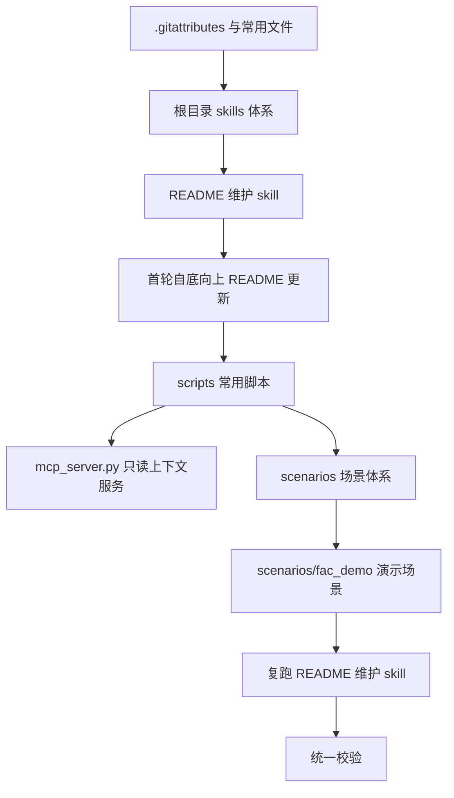

## 用户需求

在 FAC 项目中补齐工程化基础设施与 Agent 可发现资产：新增 `.gitattributes` 统一默认 LF，并补充常用项目文件与依赖关系说明；将 skill 作为 FAC 项目级资产放在根目录 `skills/`，不再放入 CodeBuddy 专用目录；新增 `mcp_server.py`，方便各类 Agent 以只读方式访问项目上下文。

编写 README.md 体系维护 skill：从底层脚本和源码向上阅读，为受管理文件夹补齐 README.md；仔细核查公式，若源码中找不到对应公式或实现依据，紧贴公式下方添加下划线注记。skill 完成后立即执行一次；在 `scripts/`、`scenarios/`、`scenarios/fac_demo` 和常用文件完成后再执行一次。

新建 `scripts/` 存放 FAC 常用 Python 脚本与 Windows 一键入口；新建 `scenarios/` 专注物理场景创建，参考 FLASH 场景系统的“位置优先、自包含、可手动整理、相对锚点”设计；新建 `scenarios/fac_demo`，按物理原型组织一键执行、输出产物阅读理解与绘图演示。

所有新增文档不得写死已移动工作目录的具体名称，统一使用相对路径或 `<WORK_ROOT>` 占位。

## 技术栈与总体方案

- 文档：Markdown + YAML frontmatter；沿用现有中文 README、表格、代码围栏与项目级 skill 约定。
- 脚本：Python 3 标准库优先；绘图依赖作为可选依赖集中在 `requirements-dev.txt`。
- Windows 一键入口：`.bat` 启动器，默认 LF 规则下在 `.gitattributes` 中对批处理文件设置 CRLF 例外。
- Skill 位置：唯一事实源改为项目根 `skills/<skill-name>/SKILL.md`；旧隐藏 skill 目录在迁移验证后移除，避免双份规则漂移。
- MCP：新增 `mcp_server.py`，实现只读、本地、最小权限的 Agent 上下文服务；优先标准库 JSON-RPC/stdio，必要时提供轻量 HTTP 入口；不提供任意命令执行。
- 场景：参考 FLASH 场景系统，但仅借鉴结构原则；FAC 场景不复制超算/HPC 能力，只保留场景发现、相对锚点、清单、自包含目录和一键执行。

## 实施方法

采用“基础规范先行 -> skill 迁移与新增 -> 首轮自底向上维护 -> 工具与场景建设 -> 复跑维护 -> 统一校验”的流程。

关键决策：

1. `.gitattributes` 先行，防止后续创建脚本文本时再次引入 CRLF 漂移。
2. 根目录 `skills/` 成为所有 Agent 共享入口，`AGENTS.md`、`CLAUDE.md`、Cursor 与 VS Code 薄入口统一指向该目录。
3. `mcp_server.py` 只暴露只读能力：列出 skills、读取 skill/context/README、审计报告、列出场景；不暴露文件写入或 shell 执行。
4. README 维护顺序固定为：数值支撑库 -> 物理支撑库 -> 核心库 -> PFAC/SFAC 接口 -> demo -> doc -> 根目录 -> scripts -> scenarios。
5. 公式证据优先级为：源码实现/输出器 -> 生成文件头与实测记录 -> 项目 README -> 历史注释；源码未命中的公式使用 `<u>源码未找到该公式，需人工核查</u>` 紧贴公式下方标注。
6. `scripts/` 只放场景无关工具；`scenarios/` 只做物理场景；两者通过相对清单和锚点解耦。
7. `scenarios/fac_demo` 按物理原型组织，避免绑定单一具体案例。

## 架构示意



## 实施注意事项

- `.gitattributes` 默认 `* text=auto eol=lf`；二进制扩展名设 `binary`；`.bat` 设 CRLF。
- 迁移 skill 时先复制到根 `skills/`，更新协议入口并验证，再删除旧隐藏目录中的副本。
- `mcp_server.py` 必须限制读取范围在项目根内，校验路径穿越，输出体积上限，避免泄露敏感文件。
- `scripts/` 每个脚本提供 `--help`、明确退出码、结构化摘要；长任务日志分文件。
- 场景脚本不得硬编码机器绝对路径；通过 `scene.json`、`scene_manifest.json`、`_scene_anchors.json` 进行发现。
- 每个新增目录和每个 `fac_demo/cases/` 子目录都应有 README.md；每个场景目录至少含 `README.md`、`scene.json`、`run.py`。
- 不修改现有源码、Makefile、`check.py`、构建脚本或已移动工作目录内容。

## 目录结构

```text
.gitattributes                  # [NEW] 默认 LF，二进制与 bat 例外
.gitignore                      # [NEW] 忽略缓存、运行产物和临时输出
.editorconfig                   # [NEW] UTF-8、LF、缩进与末尾换行规则
DEPENDENCIES.md                 # [NEW] 构建、Python 辅助、绘图、MCP 依赖说明
requirements-dev.txt            # [NEW] 可选辅助依赖
mcp_server.py                   # [NEW] 只读 Agent 上下文服务

skills/                         # [NEW/MOVE] 项目级 skill 唯一事实源
├── fac-onboarding/
├── fac-demo-workflow/
├── fac-demo-troubleshooting/
├── fac-code-navigation/
└── fac-readme-maintainer/      # [NEW] README 体系维护 skill

scripts/                        # [NEW] 场景无关工具与一键入口
├── README.md
├── env_check.py
├── build_parallel.py
├── smoke_check.py
├── check_tables.py
├── list_archetypes.py
├── audit_readmes.py
├── audit_scenarios.py
└── launchers/

scenarios/                      # [NEW] 物理场景体系
├── README.md
├── _scene_anchors.json
├── common/
├── core/
└── fac_demo/
    ├── README.md
    ├── scene_manifest.json
    ├── run_scene.py
    ├── cases/
    ├── outputs/
    └── plots/
```

## 验证标准

- 4 个迁移 skill 与新增维护 skill 均通过 `quick_validate.py`。
- `AGENTS.md` 与适配入口不再指向旧 skill 路径。
- 所有受管理文件夹存在 README.md，链接、代码围栏、公式下划线注记符合规则。
- `python mcp_server.py --help` 可运行，工具列表只读且路径穿越被拒绝。
- `scripts/*.py --help` 可运行；场景清单与锚点可解析。

## Agent Extensions

### Skill

- **skill-creator**
- Purpose: 迁移现有 skill 到项目根 `skills/`，创建 `fac-readme-maintainer`，并校验全部 SKILL.md 结构。
- Expected outcome: 项目级 skill 结构合法、frontmatter 完整、references 分层清晰，可被多种 Agent 直接读取。
- **lsp-code-analysis**
- Purpose: 在 README 公式核查阶段辅助定位源码符号、定义、引用和调用链。
- Expected outcome: 为公式是否存在源码实现提供可追溯证据，减少误标或漏标。

### SubAgent

- **code-explorer**
- Purpose: 批量读取目录、README、脚本与源码，生成自底向上维护清单、README 缺口和公式证据。
- Expected outcome: 得到完整目录清单、每个文件夹 README 状态、公式核查记录与下划线注记清单。