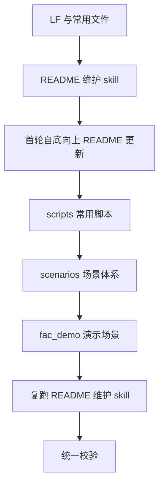

## User Requirements

- 新增 `.gitattributes`，统一文本文件默认 LF 换行，并为二进制和 Windows 批处理设置合理例外。
- 编写 README.md 体系维护 skill：从底层脚本和源码向上阅读，为项目管理的每个文件夹补齐 README.md，仔细核查公式；源码中未找到对应公式时，在公式下方添加下划线注记。
- README skill 编写完成后立即执行一次；在 `scripts/`、`scenarios/`、`scenarios/fac_demo` 和常用项目文件完成后再执行一次。
- 补充其他项目常用文件并说明依赖关系；评估 `mcp_server.py` 必要性，结论是不新增常驻 MCP 服务。
- 新建 `scripts/`，放 FAC 包常用 Python 脚本和 Windows 一键启动入口。
- 新建 `scenarios/`，只关注物理场景创建，参考已有 FLASH 场景系统的“位置优先、自包含、可手动整理、相对锚点”设计。
- 新建 `scenarios/fac_demo`，提供各示例原型的一键执行、输出表阅读理解、图像绘制脚本，并明确文件树设计。

## Product Overview

形成一套以 README 为事实入口、以 skill 为维护机制、以脚本和场景目录为可执行入口的 FAC 工程化文档与工具体系。目录可移动、脚本可复用、公式有证据、README 可持续再生。

## Core Features

- README 维护 skill：目录清单生成、自底向上阅读、公式核查、缺失公式下划线标记、统一模板和验证门禁。
- LF 与常用文件：`.gitattributes`、`.gitignore`、`.editorconfig`、`DEPENDENCIES.md`、`requirements-dev.txt`。
- 常用脚本：`scripts/` 下环境检查、并行构建辅助、冒烟回归、表检查、README 与场景审计、一键启动器。
- 场景体系：`scenarios/common/`、`scenarios/core/`、`scenarios/fac_demo/`，使用相对路径和清单发现，支持手动整理。
- 两轮 README 维护：skill 完成后首轮覆盖原源码体系；全部新增目录完成后复跑并纳入 `scripts/`、`scenarios/`。

## Tech Stack Selection

- 文档：Markdown + YAML frontmatter，沿用现有中文 README 风格、表格、代码围栏和项目级 skill 结构。
- 脚本：Python 3 标准库优先；可选依赖仅用于绘图，集中在 `requirements-dev.txt`。
- Windows 一键执行：提供 `.bat` 启动器，默认 LF，仅批处理文件例外使用 CRLF。
- 公式核查：源码实现优先，结合输出器、文件头、README、手册；源码未命中则在公式下方加下划线注记。
- 场景发现：相对路径清单、目录内 `scene.json`、`_scene_anchors.json`，不写死机器绝对路径。
- 不新增 `mcp_server.py`：当前 Agent 能力由 Markdown skill 和上下文协议承载，MCP 常驻服务不是必要条件；仅在依赖说明中记录为可选扩展方向。

## Implementation Approach

采用“基础规范先行 -> skill 编写与首轮执行 -> 工具脚本与场景体系 -> 文档复跑 -> 统一校验”的流程。

关键决策：

- `.gitattributes` 先落地，避免后续新增文本脚本再次出现行尾漂移。
- README 维护 skill 作为唯一维护机制，避免一次性人工改文档导致后续再次失同步。
- 自底向上顺序固定为：数值支撑库、物理支撑库、核心库、PFAC/SFAC 接口、demo、doc、根目录，再覆盖新增 `scripts/` 和 `scenarios/`。
- 公式核查不把论文或 README 当最终依据；若源码未直接实现或找不到出处，必须紧贴公式下方添加下划线注记。
- `scripts/` 只放场景无关工具；`scenarios/` 只放物理场景，职责分离，避免脚本层和场景层互相污染。
- `scenarios/fac_demo` 按物理原型而非具体案例命名，示例脚本只演示通用模式，避免与单一算例绑定。

性能与可靠性：

- 文档和源码扫描规模为数十个目录和数百个文件，复杂度近似线性。
- 读取、清单生成、链接检查可并行；同一 README 写入串行。
- 脚本全部提供 `--help`、明确退出码和结构化摘要；长任务输出分文件日志，避免互相覆盖。

## Implementation Notes

- 所有新增文档不得写死已移动工作目录名称，使用相对路径或 `<WORK_ROOT>` 占位。
- `.gitattributes` 默认 `* text=auto eol=lf`；二进制扩展名设为 `binary`；`.bat` 设为 CRLF 便于 Windows 一键执行。
- README 维护 skill 必须输出目录清单、已更新清单、公式核查清单、下划线注记清单。
- 下划线注记使用 HTML `u` 标签，紧贴公式下方，文本明确“源码未找到该公式，需人工核查”。
- 每个受管理目录必须有一个 README.md；skill 目录保留 SKILL.md 的同时补 README.md 作为人类入口。
- `scripts/` 脚本只依赖标准库；绘图脚本可延迟导入可选依赖，缺失时给出安装提示。
- `scenarios/` 目录移动后，脚本通过清单和相对锚点重新发现场景，不依赖固定绝对路径。
- 不修改现有源码、Makefile、`check.py`、构建脚本或已移动工作目录内容。

## Architecture Design



数据流为：目录清单和源码证据进入 README 维护 skill，产出公式注记和 README 更新；新增脚本与场景目录完成后再次进入同一 skill，最后统一校验文档、脚本、场景和 LF 口径。

## Directory Structure

### 本次新增或修改的核心文件

```text
.gitattributes
  # [NEW] 默认 LF 换行，二进制和 bat 例外。

.gitignore
  # [NEW] 忽略 Python 缓存、运行产物、临时输出和编辑器缓存。

.editorconfig
  # [NEW] 统一 UTF-8、LF、缩进和末尾换行规则。

DEPENDENCIES.md
  # [NEW] 说明构建依赖、Python 辅助依赖、可选绘图依赖，并明确不新增 MCP 常驻服务。

requirements-dev.txt
  # [NEW] 仅列辅助脚本可选依赖，避免影响 FAC 核心构建。

AGENTS.md
  # [MODIFY] 增加常用文件、scripts、scenarios、README 维护 skill 的入口说明。

.codebuddy/skills/fac-readme-maintainer/
  # [NEW] README 体系维护 skill，含自底向上流程、公式核查和验证规则。
  ├── SKILL.md
  ├── README.md
  └── references/
      ├── bottom-up-order.md
      ├── formula-check-rules.md
      ├── readme-template.md
      └── validation-checklist.md

scripts/
  # [NEW] FAC 常用脚本和一键入口。
  ├── README.md
  ├── env_check.py
  ├── build_parallel.py
  ├── smoke_check.py
  ├── check_tables.py
  ├── list_archetypes.py
  ├── audit_readmes.py
  ├── audit_scenarios.py
  └── launchers/
      ├── 00_menu.bat
      ├── env_check.bat
      ├── smoke_check.bat
      └── check_tables.bat

scenarios/
  # [NEW] 物理场景体系，只负责场景创建、发现和一键执行。
  ├── README.md
  ├── _scene_anchors.json
  ├── common/
  │   ├── README.md
  │   ├── paths.py
  │   ├── manifest.py
  │   ├── scene.py
  │   ├── readers.py
  │   └── plotting.py
  ├── core/
  │   ├── README.md
  │   ├── discovery.py
  │   ├── runner.py
  │   └── anchors.py
  └── fac_demo/
      # [NEW] 示例原型演示场景。
      ├── README.md
      ├── scene_manifest.json
      ├── run_scene.py
      ├── cases/
      │   ├── structure_tr/
      │   ├── collision/
      │   ├── pi_rr/
      │   ├── ai_dc/
      │   ├── crm_spectrum/
      │   ├── polarization/
      │   ├── rmatrix/
      │   └── diagnostics/
      ├── outputs/
      │   └── README.md
      └── plots/
          └── README.md
```

每个新增目录和每个 `fac_demo/cases/` 子目录均需有 README.md；每个场景目录至少包含 `README.md`、`scene.json`、`run.py`，并按需包含 `explain.py`、`plot.py`。

## Skill

- **skill-creator**
- Purpose: 初始化并校验 README 维护 skill，保证 frontmatter、分层结构和 references 组织合规。
- Expected outcome: 生成结构合法的 `fac-readme-maintainer` skill，并支持后续验证。

- **lsp-code-analysis**
- Purpose: 在公式核查和源码定位阶段辅助确认符号定义、引用和实现位置。
- Expected outcome: 为公式是否存在源码实现提供可追溯证据，减少误标或漏标。

## SubAgent

- **code-explorer**
- Purpose: 批量读取目录、README、脚本和源码，生成自底向上维护清单。
- Expected outcome: 得到目录清单、README 缺口、公式证据和新增目录文档素材。