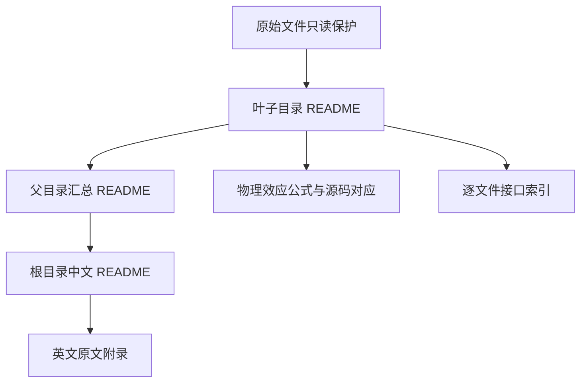

## 用户需求

为 FAC 源码目录树自底向上新建并更新一套完整的中文 README.md 文档体系，使人类和 Agent 都能快速理解每个目录的职责、文件组织、接口、物理效应及源码对应关系。

## 核心功能

- 覆盖工作区根目录下全部 38 个目录，包括隐藏配置目录、CI 目录、第三方数值库、物理模块、接口层、示例目录、数据目录和文档目录。
- 从无子目录的叶子目录开始，逐个阅读源码、脚本、数据和配置文件，编写本目录 README.md。
- 每个 README.md 均说明目录职责、文件组织形式、主要接口、调用关系、输入输出和使用方式。
- 对涉及物理效应的目录，给出效应简介、LaTeX 公式、公式出处和源码对应位置。
- 第三方数值库按用户要求逐个源文件说明每个 `.f` 文件的功能与接口。
- 父目录 README 向上汇总子目录内容并提供导航，根目录 README 作为整套体系的入口。
- 根 README 前置全新中文主题内容，原始英文 README 全文逐字保留到末尾「原始文档」附录。
- `demo/README` 旧文件保留不动，其内容翻译后并入 `demo/README.md`。
- 在文档编写前，将原始代码、脚本、数据、配置等非 README 交付文件设为只读，避免误修改，同时保留原有可执行性。
- 所有 README 正文使用简体中文；公式不确定时允许查证仓库论文、手册或外部权威文献，不得臆造。

## 技术栈选择

- 文档格式：Markdown，数学公式使用标准 LaTeX 行内公式 `$... 与独立公式 `$...。
- 现有代码栈：Fortran 77/90、C、Python、Autotools、Makefile、Shell 脚本；本次不改动这些源码和构建逻辑。
- Windows 文件保护：使用 PowerShell `IsReadOnly=$true` 或 `attrib +R` 设置只读属性，不修改 ACL、不移除可执行扩展或文件关联。
- 探索工具：使用已提供的 `code-explorer` SubAgent 批量阅读源码、提取函数签名、子程序清单、调用关系和公式线索。

## 实施策略

采用「先保护原始文件，再叶子详述，再父级汇总，最后根入口与验证」的顺序。每个叶子目录只读取一次源码并沉淀成 README，避免反复扫描大目录。父级 README 只基于已完成的子目录 README 和必要源码做层级总结，避免结论漂移。

文档统一模板建议包含：

1. 目录职责与适用场景。
2. 目录组织形式与文件分类。
3. 逐文件说明：文件名、类型、功能、关键入口、依赖关系。
4. 接口说明：函数、子程序、Python API、命令行或数据格式。
5. 物理效应：简介、LaTeX 公式、出处、源码对应表。
6. 与上下游目录的关系。
7. 导航链接和注意事项。

## 实施注意事项

- 文件保护必须先执行并验证：遍历工作区内所有现存文件，除所有 `README.md` 交付文件外，其余文件设置为只读；`demo/README` 作为需保留的原始英文文档也设为只读。
- 只读操作只设置 ReadOnly 属性，不执行 `icacls` 拒绝写权限，不改扩展名，不改 PATH 或执行策略，从而保留脚本和可执行文件的原有运行方式。
- 保护后抽查 `.f`、`.c`、`.py`、`configure`、`Makefile.in`、`demo/README`、数据文件，确认只读属性生效且内容未被修改。
- 生成 README 时不得取消源码只读属性；如工具因只读拒绝写入，只写入对应 README.md 文件。
- `lapack/` 有 112 个 `.f` 文件，`faclib/` 有 30 个 `.c` 和 38 个 `.h` 文件，`cmultip.f`、`fac.c`、`rfac.py` 等超大文件需按函数族分组整理，但仍为每个文件保留独立条目。
- 公式来源优先级：仓库 `doc/manual.tex`、`doc/papers/*.tex`、源码注释、README 原始说明、必要时查证权威文献。每个物理公式需标注出处，禁止编造接口名或公式。
- 物理 README 的源码对应表应精确到目录、文件、函数或子程序名；若行号可能随环境变化，则以函数名为准。
- 根目录原英文 README 共 164 行，必须逐字复制，不做翻译、删减或重排，放在末尾附录。
- 所有新增 README 使用相对链接导航，避免绑定绝对路径。
- 最终验证：确认 38 个目录均有 README.md，中文正文完整，物理目录均含公式与源码对应，第三方库逐文件条目无遗漏，旧 `demo/README` 未被改写。

## 架构设计



## 目录结构

本次文档涉及以下 38 份 README。除 README.md 交付文件外，所有现存源码、脚本、数据、配置和文档文件均执行只读属性保护。

```text
fac/
├── README.md                         # [MODIFY] 前置中文总览、架构、目录导航、物理效应索引；末尾逐字保留原英文全文
├── .circleci/README.md               # [NEW] 说明 CircleCI 配置文件用途、触发方式和与构建流程的关系
├── blas/README.md                    # [NEW] 20 个 BLAS 源文件逐文件说明，包含接口和调用关系
├── ci/README.md                      # [NEW] 4 个依赖环境 yml 文件逐项说明，标明 Python 版本和 OpenMP 变体
├── coul/README.md                    # [NEW] 18 个库仑函数源文件逐文件说明，包含连续态和特殊函数公式
├── faclib/README.md                  # [NEW] 核心 C 库 30 个 .c 与 38 个 .h 逐文件说明，汇总结构、碰撞、复合、跃迁、CRM、MBPT 等效应
├── ionis/README.md                   # [NEW] 12 个电离平衡和速率拟合源文件逐文件说明，给出拟合公式和源码对应
├── lapack/README.md                  # [NEW] 112 个 LAPACK 源文件逐文件说明，按线性代数函数族归类
├── minpack/README.md                 # [NEW] 8 个优化和最小二乘源文件逐文件说明，列出关键子程序接口
├── modqed/README.md                  # [NEW] 17 个 QED 源文件逐文件说明，给出 Dirac 方程、自能、Uehling 势等公式
├── mpfun/README.md                   # [NEW] 22 个高精度和缔合 Legendre 函数源文件逐文件说明，说明数值用途
├── ode/README.md                     # [NEW] 13 个 ODE 求解器源文件逐文件说明，说明积分器接口和调用关系
├── python/README.md                  # [NEW] 8 个 Python 模块和 5 个 C 扩展逐文件说明，说明 PFAC 接口和数据表
├── quadpack/README.md                # [NEW] 9 个数值积分源文件逐文件说明，列出积分子程序和适用范围
├── sfac/README.md                    # [NEW] sfac、scrm、spol 及解析器源码逐文件说明，解释命令行接口
├── toms/README.md                    # [NEW] 29 个 TOMS 数值源文件逐文件说明，函数族归类并列出接口
├── demo/
│   ├── README.md                     # [NEW] 翻译合并旧 demo/README 内容，汇总全部示例并链接子目录
│   ├── aidr/
│   │   ├── README.md                 # [NEW] 说明自电离示例脚本、Makefile、物理过程和输入输出
│   │   └── ref/README.md             # [NEW] 说明参考结果文件格式、来源和用途
│   ├── excitation/
│   │   ├── README.md                 # [NEW] 说明电子碰撞激发示例及 Python 与 SFAC 双版本脚本
│   │   └── ref/README.md             # [NEW] 说明 ne.ce、ne.ceM、ne.lev 等参考数据
│   ├── FeL/README.md                 # [NEW] 说明 Fe-L 壳等离子体光谱示例、绘图脚本和数据处理流程
│   ├── ionization/
│   │   ├── README.md                 # [NEW] 说明电子碰撞电离示例、脚本接口和物理量
│   │   └── ref/README.md             # [NEW] 说明 ne.ci、ne_f.lev 等参考数据
│   ├── NeL/
│   │   ├── README.md                 # [NEW] 说明 Ne VIII 碰撞辐射模型示例和谱合成流程
│   │   └── ref/README.md             # [NEW] 说明 Ne03a、Ne03b 参考数据格式
│   ├── pirr/
│   │   ├── README.md                 # [NEW] 说明光电离和辐射复合示例，给出相关公式
│   │   └── ref/README.md             # [NEW] 说明 li.lev、li.rr 参考结果
│   ├── polariz/
│   │   ├── README.md                 # [NEW] 说明类 He 铁谱线偏振示例和 pfac.pol 用法
│   │   └── ref/README.md             # [NEW] 说明 pol.txt、pop.txt、ta.ce 等参考文件
│   ├── rmatrix/README.md             # [NEW] 说明 Dirac R 矩阵碰撞激发示例和脚本接口
│   ├── structure/
│   │   ├── README.md                 # [NEW] 说明 Ne-like Fe 原子结构示例和完整 API 调用链
│   │   └── ref/README.md             # [NEW] 说明 ne.lev、ne.tr 参考结果
│   └── tests/
│       ├── README.md                 # [NEW] 说明哈密顿量、麦克斯韦速率和简单 CRM 诊断脚本
│       └── ref/README.md             # [NEW] 说明 diagh_O_a.en、O.sp 参考数据
└── doc/
    ├── README.md                     # [NEW] 汇总手册、misc 和 papers 子目录，作为理论文档入口
    ├── misc/README.md                # [NEW] 说明 jj2ls.md、gitcommit.md 两个工具文档
    └── papers/README.md              # [NEW] 索引论文源文件、图表和理论主题，标注对应物理效应
```

## SubAgent

- **code-explorer**
- Purpose: 批量读取各目录源码、注释、脚本和文档，提取文件清单、函数签名、子程序接口、调用关系与物理公式出处。
- Expected outcome: 为叶子目录 README 提供可验证的逐文件说明素材，为父目录汇总提供准确依据，避免编造接口和公式。