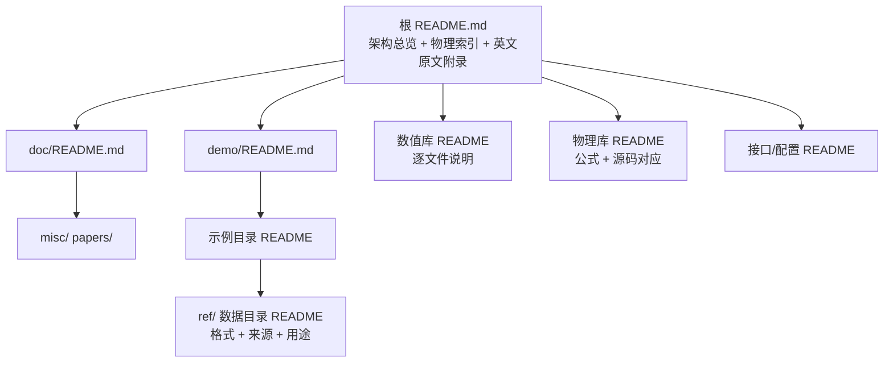

## 用户要求

为 FAC（Flexible Atomic Code）源码树自底向上新建并更新一套完整的 README.md 中文文档体系。

## 产品概述

在 `e:/PhySimX/PhySimX/diagnosis/SpecX_test/SpecX-diag/specx/_solvers/fac/src/fac` 下共 38 个目录中，每个目录产出一份中文 README.md。叶子目录直接阅读源码逐文件说明，父目录逐步向上汇总，最终形成可导航、可被人类与 Agent 共同理解的文档体系。

## 核心功能

- 覆盖全部 38 个目录（含 `.circleci/`、`ci/`、8 个 `ref/` 数据目录、`doc/misc/`、`doc/papers/`）。
- 叶子目录 README 说明本目录功能、组织形式、逐文件/逐配置项功能与接口，便于人类阅读和 Agent 识别利用。
- 涉及物理效应的目录必须给出：效应简介、LaTeX 物理公式、源码对应（目录/文件/函数或子程序）。
- 第三方数值库（blas/lapack/minpack/quadpack/ode/toms/mpfun/coul/ionis）逐个 `.f` 文件给出功能与接口说明。
- 父目录 README 汇总子目录内容并提供导航链接；根目录 README 作为整个体系入口。
- 根目录原英文 README.md 全文逐字保留在新文档末尾的「原始文档」章节；`demo/README` 内容译为中文并入新建的 `demo/README.md`，旧文件保留不动。
- 所有 README 正文使用简体中文（仅根目录附录的英文原文为例外）。

## 技术方案

### 文档体系架构

采用「叶子详述 → 中层汇总 → 根入口」三层结构，与源码目录树一一对应：



### 实施策略

1. **严格自底向上**：先完成全部叶子目录，再完成含子目录的父目录，最后处理根目录，确保汇总内容有据可依。
2. **统一模板**：每份 README 包含「目录职责 / 文件清单与接口 / 物理效应（如适用）/ 调用关系 / 导航」五部分。
3. **物理效应章节规范**：每个效应按「简介 → LaTeX 公式（`$... 行内、`$...$` 独立）→ 源码对应表（文件、函数/子程序、行号范围）」三段式撰写。例如 Dirac 方程、自能/真空极化、电子碰撞激发截面、电离平衡拟合公式等。
4. **逐文件说明粒度**：每个 `.f`/`.c`/`.py`/`.h` 文件独立条目，含文件名、功能、关键入口子程序、依赖或被调关系；超大文件（如 `cmultip.f`、`rfac.py`、`fac.c`）按函数族分组后仍逐文件列出。
5. **只读探索**：使用 `code-explorer` 子代理批量读取源码、提取子程序签名与调用关系，避免逐文件手工读取造成上下文膨胀。
6. **零源码改动**：仅新增或更新 Markdown 文件，不触碰任何源码、构建脚本或配置。

### 目录结构（全部 38 份 README）

```
fac/
├── README.md                    # [MODIFY] 新中文内容前置 + 原英文全文逐字保留至末尾附录
├── .circleci/README.md          # [NEW] CI 配置说明
├── blas/README.md               # [NEW] 20 个 BLAS 子程序逐文件说明
├── ci/README.md                 # [NEW] 4 个 yml 环境配置逐项说明
├── coul/README.md               # [NEW] 18 个库仑函数源文件 + 物理公式
├── faclib/README.md             # [NEW] 30 .c + 38 .h 核心库逐文件说明 + 多效应公式
├── ionis/README.md              # [NEW] 12 个电离平衡/拟合源文件 + 公式
├── lapack/README.md             # [NEW] 112 个 LAPACK 源文件逐文件说明
├── minpack/README.md            # [NEW] 8 个优化源文件逐文件说明
├── modqed/README.md             # [NEW] 17 个 QED 源文件 + 自能/真空极化公式
├── mpfun/README.md              # [NEW] 22 个高精度/缔合 Legendre 源文件说明
├── ode/README.md                # [NEW] 13 个 ODE 求解器源文件逐文件说明
├── python/README.md             # [NEW] 8 .py + 5 .c 接口层逐文件说明
├── quadpack/README.md           # [NEW] 9 个积分源文件逐文件说明
├── sfac/README.md               # [NEW] 4 .c + 1 .h 命令行接口说明
├── toms/README.md               # [NEW] 29 个 TOMS 源文件逐文件说明
├── demo/
│   ├── README.md                # [NEW] 译并合并旧 demo/README 内容 + 汇总示例
│   ├── aidr/{README.md,ref/README.md}
│   ├── excitation/{README.md,ref/README.md}
│   ├── FeL/README.md
│   ├── ionization/{README.md,ref/README.md}
│   ├── NeL/{README.md,ref/README.md}
│   ├── pirr/{README.md,ref/README.md}
│   ├── polariz/{README.md,ref/README.md}
│   ├── rmatrix/README.md
│   ├── structure/{README.md,ref/README.md}
│   └── tests/{README.md,ref/README.md}
└── doc/
    ├── README.md                # [NEW] 汇总 misc/ 与 papers/
    ├── misc/README.md           # [NEW] 2 个 md 工具文档说明
    └── papers/README.md         # [NEW] 论文与理论背景索引
```

### 关键约束

- 根目录 164 行英文原文必须逐字保留，不做翻译或删减，置于末尾「原始文档」章节。
- `demo/README` 旧文件保留不动，其内容以中文形式整合进 `demo/README.md`。
- 所有物理公式使用标准 LaTeX 语法，源码对应关系必须基于实际读取结果，不臆造接口名。

## Agent Extensions

### SubAgent

- **code-explorer**
- Purpose: 批量读取各目录源码文件，提取子程序签名、功能描述、调用关系与物理效应实现位置，为逐文件说明提供事实依据。
- Expected outcome: 每个目录产出结构化的文件清单与接口摘要，确保所有 `.f`/`.c`/`.py`/`.h` 文件都有可验证的说明素材，避免臆造。