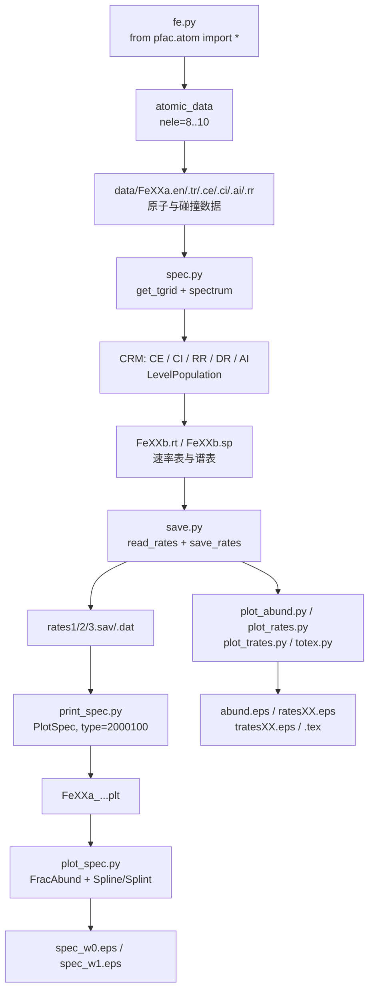
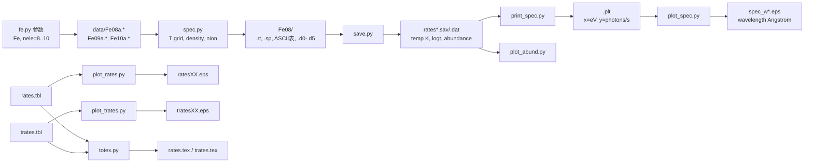

# Fe-L 壳碰撞电离等离子体光谱综合示例

## 1. 定位与物理场景

本目录演示 FAC 对**碰撞电离等离子体中 Fe-L 壳 X 射线/EUV 谱**的综合计算：L 壳（`n=2`）内壳层空位由 M 壳及更外层电子填充，产生丰度诊断和温度诊断常用的铁谱线。流程覆盖：

1. 逐电荷态生成原子结构、跃迁、CE、CI、AI、RR 数据；
2. 用碰撞辐射模型（CRM）求稳态能级布居；
3. 合成谱表、速率表和丰度；
4. 展开谱线、绘图并与文献速率系数比较。

脚本中的电荷态范围并不完全一致：`fe.py` 使用 `nele = range(8, 11)`，即 Fe O-like/F-like/Ne-like（8–10 个电子）；`spec.py` 当前只使用 `nele = range(8, 9)`，即 8 电子离子；而 `save.py`、`print_spec.py`、`plot_spec.py` 等后处理脚本遍历 `3..10`。独立运行完整后处理链时，必须确认 Fe03–Fe07 等数据是否由其他流程提供，或相应缩小后处理范围。

顶层 [`../Makefile`](../Makefile) 的 `DIRS` 不包含 `FeL`，原因是该例计算量很大，不适合每日回归测试。

## 2. 运行环境与构建兼容处理

- 实测环境：WSL Ubuntu 22.04；`gcc 9.5`；`gfortran 11.4`；`Python 3.10`；PFAC 四个扩展模块编译成功。
- 实测构建采用两项兼容处理：构建脚本由 CRLF 转为 LF；`sysdef.h` 中启用 `#define f2cFortran 1`。它们只影响脚本执行与 C/Fortran ABI，**不涉及物理模型、公式或数值算法**；原始源码树未修改。
- 实测运行使用适配后的 `fe.py`、`spec.py`：在脚本入口新增 `fac.InitializeMPI(8)`，并设置 Python 3 语法/导入兼容。线程数只影响速度，不改变组态、能级、跃迁算符、CE/CI/RR/DR 速率或 CRM 方程。夜间并行调度中 FeL 用 8 线程、rmatrix 用 16 线程，合计使用 24 核。
- 目录中原脚本使用 Python 2 风格语法（`print` 语句、`cPickle`、`Numeric`、`biggles`）；在 Python 3.10 环境运行前需做兼容适配。这属于运行适配，不是物理改动。

## 3. 物理效应、公式、出处与源码映射

| 物理效应 | 公式 | 出处 | 源码 / 脚本映射 |
|---|---|---|---|
| 稳态 CRM 布居 | $\sum_{j\ne i} n_j R_{j\to i}-n_i\sum_{j\ne i}R_{i\to j}=0$ | FAC 手册 CRM 章节（`doc/manual.tex` 约 3902–3908） | [`../../python/spm.py`](../../python/spm.py):649–791；[`../../faclib/crm.c`](../../faclib/crm.c) 中 `SetCERates` 5698、`SetTRRates` 5949、`SetCIRates` 6260、`SetRRRates` 6349、`SetAIRates` 6542、`LevelPopulation` 4223 |
| 电荷态平衡近似 | $\dfrac{n_{k+1}}{n_k}\simeq\dfrac{q^{\rm CI}_k(T_e)}{q^{\rm RR}_{k+1}(T_e)+q^{\rm DR}_{k+1}(T_e)}$ | 碰撞电离等离子体准稳态近似 | [`plot_abund.py`](plot_abund.py) 上图与 [`plot_trates.py`](plot_trates.py) 的总速率对比；`spec.py` 中 `nion=3/2/1` |
| 电子碰撞激发 CE | $\sigma_{ij}=\dfrac{\pi}{k_i^2 g_i}\Omega_{ij}$，$q_{ij}=\langle\sigma_{ij}v\rangle_T$ | `doc/manual.tex` CE 章节（约 762–793） | `spectrum()` 调用 `SetCERates(1)`；[`../../faclib/crm.c`](../../faclib/crm.c):5698 |
| 电子碰撞电离 CI | $\sigma^{\rm CI}_{ij}=\dfrac{1}{k_i^2 g_i}\Omega^{\rm CI}_{ij}$；注意 EII 与 CE 的 $\pi$ 因子差异 | `doc/manual.tex` 约 1053–1059 | `SetCIRates(1)`；[`../../faclib/crm.c`](../../faclib/crm.c):6260 |
| 辐射复合 RR | $\sigma_{\rm RR}=\dfrac{\alpha^2}{2}\dfrac{g_i}{g_f}\dfrac{\omega^2}{\varepsilon(1+\alpha^2\varepsilon/2)}\sigma_{\rm PI}$ | `doc/manual.tex` 约 898–906 | `SetRRRates(0)`；[`../../faclib/crm.c`](../../faclib/crm.c):6349 |
| 双电子复合 DR / 自电离 AI | $A^a_{i\to f}=2\sum_\kappa\left|\left\langle\psi_f,\kappa;J_TM_T\left|\sum_{p<q}r_{pq}^{-1}\right|\psi_i\right\rangle\right|^2$，$S_{\rm DC}\propto A^a$，${\rm DR}=S_{\rm DC}B(i)$ | `doc/manual.tex` 约 1672–1674（AI/DC 强度单位）；DR 分支比理论 | `SetAIRates(1)`；[`../../faclib/crm.c`](../../faclib/crm.c):6542 |
| 谱线光子发射率 | $I(\omega)=\sum_{i>j}n_i A_{ij}\phi(\omega-\omega_{ij})$，单位为 photons/s，**不含 $\hbar\omega$** | [`../../doc/manual.tex`](../../doc/manual.tex):1138–1146 明确 `strength` 为 “line luminosity in photons/s”；[`../../faclib/crm.c`](../../faclib/crm.c):4488–4498 中 `r.strength=c*(a+b)` | `SpecTable()`；[`../../faclib/crm.c`](../../faclib/crm.c):4363；[`../../python/spm.py`](../../python/spm.py):783–784 |
| 能量发射率（若需要） | $I_E(\omega)=\hbar\omega\,I(\omega)$ | 由 photons/s 转能量单位的标准换算 | 本例不执行该乘法；[`plot_spec.py`](plot_spec.py) 使用光子发射率口径 |

### 3.1 `PlotSpec` 的 `type=2000100` 不是 `n0=2`

[`print_spec.py`](print_spec.py) 中：

```python
type = 2000100
PlotSpec(spf, pltf, k, type, emin, emax, de[i])
```

这是 `PlotSpec`/`SelectLines` 的**谱线选择编码**，不是 `SP_HEADER` 的物理 line-type 编码。

- `PlotSpec` 选择器按 4 个两位十进制字段解释；见 [`../../faclib/crm.c`](../../faclib/crm.c):4876–4881 和 [`../../doc/manual.tex`](../../doc/manual.tex):4268–4283。
- 对 `2000100`，源码解析为：`t2 = 2`（最高字段，选择模式），`t1 = 0`，`t0 = 1`。`t2=2` 分支再按 `r1=h.type/10000`、`r0=(h.type%10000)/100` 过滤，即按块头中的 $n_0,n_1$ 字段做阈值选择。
- 因此**不能**把 `2000100` 理解为“$n_0=2$ 的 DR 卫星线”。这是本例最重要的修正点之一。
- `SP_HEADER` 的编码另作：`type = 10000*n0 + 100*n1 + n2`；见 [`../../doc/manual.tex`](../../doc/manual.tex):1107–1115。其中 $n_0\ne0$ 表示带旁观电子的 DR 卫星线，$n_0=n_1=0$ 表示 RR 连续谱。

### 3.2 `LevelInfor` 的模块归属

[`plot_rates.py`](plot_rates.py) 调用 `LevelInfor(efile, i)` 读取能级所属子壳。该 API 属于 `pfac.fac`，不是 `pfac.crm`：

- 包装函数 `PLevelInfor`：`../../python/fac.c:5452`；
- 方法表暴露 `LevelInfor` / `LevelInfo`：`../../python/fac.c:6961–6962`。

若运行报 `NameError: LevelInfor`，应在脚本中补充：

```python
from pfac.fac import LevelInfor
# 或
from pfac.fac import *
```

这只是 API 归属修正，不改变物理计算。

## 4. 逐文件说明与真实 PFAC API 调用链

### 4.1 [`fe.py`](fe.py)

- 作用：生成 Fe 原子数据，第一步。
- 主要调用链：

```python
from pfac.atom import *
from pfac import fac

atomic_data(nele=range(8, 11), asym='Fe', iprint=1, dir='data/')
# 可选 SFAC 开关：fac.ConvertToSFAC('fe.sf') / fac.CloseSFAC()
```

- 输入：脚本内硬编码参数 `asym='Fe'`、`nele=8..10`。
- 输出：`data/Fe08a.*`、`data/Fe09a.*`、`data/Fe10a.*`，Makefile 的 `RESULTS` 覆盖 `.ai/.ce/.ci/.en/.rr/.tr` 六类表。

### 4.2 [`spec.py`](spec.py)

- 作用：用 `spectrum()` 求解 CRM 并输出速率/谱表，第二步。
- 外部调用链：

```python
from pfac.spm import *
from pfac import const

(temp, logt, population) = get_tgrid(26, nele)
spectrum([nele], temp, [1.0], population,
         'Fe', dir0='data/', dir1='Fe%02d/'%nele,
         nion=3)
spectrum(..., nion=2)
spectrum(..., nion=1)
```

- `spectrum()` 内部真实 API 链（[`../../python/spm.py`](../../python/spm.py):649–791）：
  `get_complexes` → `AddIon` → `SetBlocks` → `SetTRRates` → `SetEleDist` → `SetCERates` → `SetRRRates` → `SetCIRates` → `SetAIRates` → `SetAbund` → `SetEleDensity` → `SetIteration` → `SetCascade` → `InitBlocks` → `LevelPopulation` → `Cascade` → `DumpRates` → `RateTable` → `SpecTable` → `PrintTable` → `ReinitCRM`。
- 输出：`Fe08/` 下 `Fe08b_t%02dd%di%d.rt/.sp`、ASCII `Fe08a_...rt/.sp`、以及 `Fe08a_....d0` 到 `.d5` 六类速率转储。

### 4.3 [`save.py`](save.py)

- 作用：把 `.rt` 速率表读回并序列化。
- 调用链：`get_tgrid` → `read_rates(nt, nd, nele, dir=..., nion=3/2/1)` → `save_rates(...)`。
- 输出：`Fe%02d/rates3.sav/.dat`、`rates2.sav/.dat`、`rates1.sav/.dat`。
- 注意：`neles = range(3,11)`，与 `spec.py` 当前只生成 Fe08 不一致。

### 4.4 [`print_spec.py`](print_spec.py)

- 作用：把 `.sp` 谱表按线型选择器、能量窗口和高斯展宽展开成两列 `.plt`。
- 调用链：

```python
from pfac.crm import *
from pfac.spm import *

PlotSpec(spf, pltf, k, type, emin, emax, de[i])
```

- 输入：`Fe%02d/Fe%02db_t%02dd0i%d.sp`、`Fe%02d/rates1.sav`。
- 输出：`Fe%02d/Fe%02da_t%02di%dw%d.plt`；`k==10 && j==3` 时额外写出 `.plt+1`。
- 关键修正：`type=2000100` 是 `PlotSpec` 选择器，见第 3.1 节。

### 4.5 [`plot_spec.py`](plot_spec.py)

- 作用：按温度插值并按离子丰度加权叠加谱，输出 `Te × Nion` 谱图阵列。
- 调用链：`TABLE.read_column` → `FracAbund` → `Spline/Splint` → `const.hc/a` → `biggles.FramedArray/Curve/PlotLabel/write_eps`。
- 输入：`.plt` 与 `.sav`。
- 输出：`spec_w0.eps`、`spec_w1.eps`，对应 `de=1.0`、`10.0 eV`。

### 4.6 [`plot_abund.py`](plot_abund.py)

- 作用：画相邻电荷态丰度比和电离率/复合率之比。
- 调用链：`get_tgrid` → `MaxAbund` → `TABLE.read_columns` → `biggles.Curve/Label`。
- 输入：`trates.tbl` 与内建电离平衡网格。
- 输出：`abund.eps`、`abund0.eps`。

### 4.7 [`plot_rates.py`](plot_rates.py)

- 作用：把逐能级速率按末态 `3s/3p/3d` 子壳归类，比较 RE、DR+RR、CI 相对 CE 的贡献。
- 调用链：`TABLE.read_columns` → `get_complexes` → `LevelInfor`（`pfac.fac`）→ `biggles.Curve/Points/PlotKey`。
- 输入：`rates.tbl`、`data/Fe%02db.en`。
- 输出：`rates03.eps` 到 `rates10.eps`。
- 注意：需确认 `LevelInfor` 从 `pfac.fac` 导入。

### 4.8 [`plot_trates.py`](plot_trates.py)

- 作用：总复合/电离速率系数与 AR92、Chen98、Roszman87a/b 文献值对比。
- 调用链：`TABLE.read_columns` → `const.kb` → `biggles.Curve/Points/Label/PlotKey`。
- 输出：`trates03.eps` 到 `trates10.eps`；纵轴单位为 $10^{-10}\,\mathrm{cm^3\,s^{-1}}$。

### 4.9 [`totex.py`](totex.py)

- 作用：把 `rates.tbl`、`trates.tbl` 转成 LaTeX 表格。
- 调用链：`TABLE.convert2tex(...)`。
- 输出：`rates.tex`、`trates.tex`。

### 4.10 [`Makefile`](Makefile)

- `all:` 只运行 `python fe.py` 和 `python spec.py`。
- `RESULTS` 列出 `data/Fe08a.*`、`Fe09a.*`、`Fe10a.*` 共 18 个原子数据表。
- `check/ref/clean/openmp` 由 [`../Make.common`](../Make.common) 提供。

## 5. Mermaid FAC 使用流程图



## 6. Mermaid 数据流图



## 7. 执行记录与命令

2026-11-25 夜间实测结果：**成功**。以 8 线程顺序执行 `fe.py`、`spec.py`，并与 16 线程的 `rmatrix/cs.py` 并行。夜间任务从 `2026-11-25T02:00:58+08:00` 运行至 `2026-11-25T04:40:40+08:00`（总墙钟耗时 `2 h 39 min 42 s`）；`fe.py` 约 `02:01` 至 `04:27`（约 `2 h 26 min`，运行记录内三段 `Total Time` 分别为 `1817 s`、`1466 s`、`671.7 s`），`spec.py` 约 `04:27` 至 `04:40:23`（约 `13 min`）。退出码：`FE_EXIT=0`、`SPEC_EXIT=0`，实测汇总中 `fe_exit`/`spec_exit` 也均为 `0`；运行记录无 `Traceback`。

产物核对：

- `data/`：36 个文件，合计约 `3.66 GB`；`Fe08a/b`、`Fe09a/b`、`Fe10a/b` 每种电荷态均有 `.en`、`.tr`、`.ce`、`.ci`、`.ai`、`.rr` 六类表，Fe08/Fe09/Fe10 数据已完整生成。
- `Fe08/`：210 个文件，合计约 `19.2 GB`；按 `nion=3/2/1` 各 7 个温度点，输出 `.rt` 42 个、`.sp` 42 个，以及 `.d0`–`.d5` 各 21 个。当前 `spec.py` 的 `neles = range(8, 9)` 只处理 8 电子离子，因此本轮只生成 `Fe08/`；后处理脚本若遍历 Fe03–Fe10，仍需先核对数据覆盖范围。
- 运行记录中有 16 条 `File data/Fe07b.en does not exist` 警告（`nion=3` 分支需要相邻电离态能级数据），但这不是致命错误：`spec.py` 仍以退出码 `0` 完成并写出全部谱表。

此前中间产物已清理，最终产物以本轮执行结果为准。

建议执行顺序（在 `demo/FeL/` 中，使用已适配脚本与已构建的 PFAC 环境）：

```bash
# 核心两步：Makefile 的 all 目标
python fe.py
python spec.py

# 后处理：需按实际已生成的数据范围调整脚本循环
python save.py
python print_spec.py
python plot_spec.py
python plot_abund.py
python plot_rates.py
python plot_trates.py
python totex.py
```

说明：

- `make` 只覆盖 `fe.py`、`spec.py`。
- 本目录**没有官方 `ref/`**，`make check` 不适用；顶层 `demo/Makefile` 也不把 `FeL` 纳入每日测试。
- `make openmp` 传入的 `openmp` 参数会被原脚本忽略；实测并行来自脚本内 `fac.InitializeMPI(8)`。

## 8. 输出清单与单位

| 输出 | 内容 | 单位 |
|---|---|---|
| `data/FeXXa.en` | 能级、组态、角动量 | 能量 eV，相对 `E0` |
| `data/FeXXa.tr` | 辐射跃迁 | $\Delta E$ eV；$gf$ 无量纲；$A$ s$^{-1}$ |
| `data/FeXXa.ce` | CE 碰撞强度和截面 | 入射能量 eV；$\Omega$ 无量纲；截面按 FAC 表约定为 $10^{-20}\,\mathrm{cm^2}$ |
| `data/FeXXa.ci` | CI 碰撞强度和截面 | 能量 eV；$\Omega$ 无量纲；截面 $10^{-20}\,\mathrm{cm^2}$ |
| `data/FeXXa.ai` | AI 率与 DC 强度 | $A^a$ s$^{-1}$；DC 强度 $10^{-20}\,\mathrm{eV\,cm^2}$ |
| `data/FeXXa.rr` | RR/PI 截面与束缚-自由 $gf$ | 截面 $10^{-20}\,\mathrm{cm^2}$；$gf$ 无量纲 |
| `FeXXb.rt` | CRM 速率矩阵表 | 辐射/AI 率 s$^{-1}$；电子碰撞速率系数约 cm$^3$ s$^{-1}$ |
| `FeXXb.sp` | 能级布居与谱线强度 | $E$ eV；strength photons/s；$A$ s$^{-1}$；布居无量纲 |
| `FeXXa_...d0`–`.d5` | 分过程速率转储 | 按对应速率类型，同上 |
| `rates*.sav` | pickle 字典 | `temp` K；`logt` 为 $\log_{10}T$；`abund` 无量纲 |
| `.plt` | 两列谱 | 第一列 eV；第二列 photons/s（乘丰度权重） |
| `spec_w*.eps` | 最终谱图 | 波长 Å；纵轴 s$^{-1}$ |
| `abund.eps`/`abund0.eps` | 电离平衡诊断 | 横轴 $\log_{10}T(\mathrm{K})$；纵轴无量纲比 |
| `rates*.eps`/`trates*.eps` | 速率对比图 | 温度 K；速率系数 $10^{-10}\,\mathrm{cm^3\,s^{-1}}$ 或比值 |
| `rates.tex`/`trates.tex` | LaTeX 表格 | 数值单位同源表 |

## 9. 比对与物理合理性检查

1. **无官方回归基准**  
   本目录没有 `ref/`，不执行 `check.py` 自动数值回归；本节以下各项为实测产物完整性与物理合理性检查。若用户另行准备基准，可用 `python ../check.py <结果> <基准>` 比对 `data/FeXXa.*`，脚本会忽略版本和时间戳，见 [`../check.py`](../check.py)。

2. **电荷态平衡检查**  
   [`plot_abund.py`](plot_abund.py) 上图应显示相邻电荷态峰值随温度依次移动；下图的 $q^{\rm CI}/(q^{\rm RR}+q^{\rm DR})$ 趋势应与丰度比定性一致。

3. **速率正值检查**  
   CE/CI/RR/DR 速率系数应为有限非负值；异常负值或数量级跳变通常来自数据文件缺失、温度网格不一致或错误速率表。

4. **谱强度口径检查**  
   `SP_RECORD.strength` 是 photons/s。若与能量发射率数据比较，需要乘 $h\nu$；不能直接混用。

5. **谱线选择器检查**  
   `type=2000100` 必须按 `PlotSpec` 选择器解释；若误写成 `SP_HEADER` 的 `n0=2`，会选错线型。

6. **文献对比**  
   [`plot_trates.py`](plot_trates.py) 内嵌 AR92、Chen98、Roszman87 等文献点，用于检查总 DR/RR/CI/EA 速率的温度依赖和数量级。

## 10. 限制与注意事项

- `FeL` 计算耗时大，顶层 `demo/Makefile` 明确排除。
- `fe.py`、`spec.py`、后处理脚本之间的电荷态范围不一致，独立运行完整链时需先核对数据覆盖。
- `rates.tbl`、`trates.tbl` 未随目录提供，需要由 `.rt` 表汇总或由用户生成。
- `print_spec.py` 的 `elimits`、`de` 与 `plot_spec.py` 的 `emin/emax/de` 必须一致，否则插值对齐会失败。
- `os.system('mkdir ...')` 在目录已存在时会报错，但通常不影响后续写入。
- `LevelInfor` 必须从 `pfac.fac` 导入；原脚本若只 `from pfac.crm import *` 可能失败。
- Python 2 风格脚本在 Python 3.10 上需适配；适配只涉及语法和包导入，不改变物理。
- 构建兼容处理（CRLF→LF 与 `#define f2cFortran 1`）仅修复 C/Fortran ABI，不改变任何物理结果。

[返回上级](../README.md)