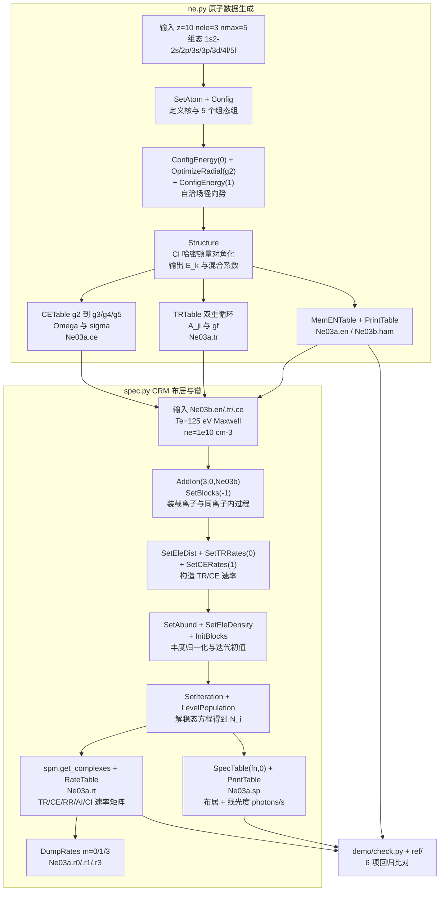
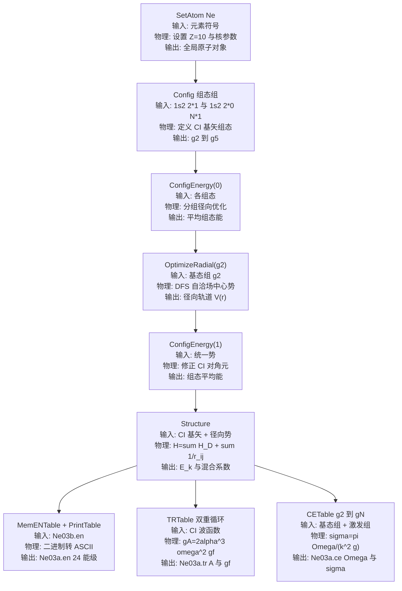
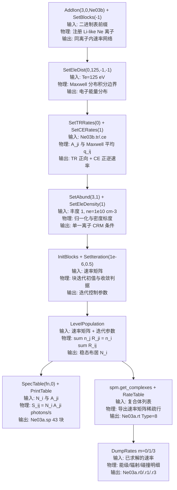
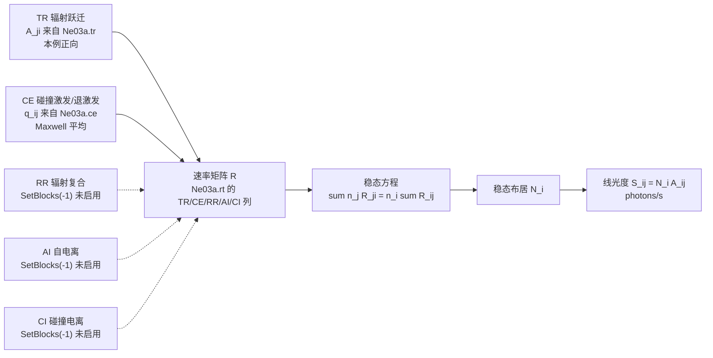
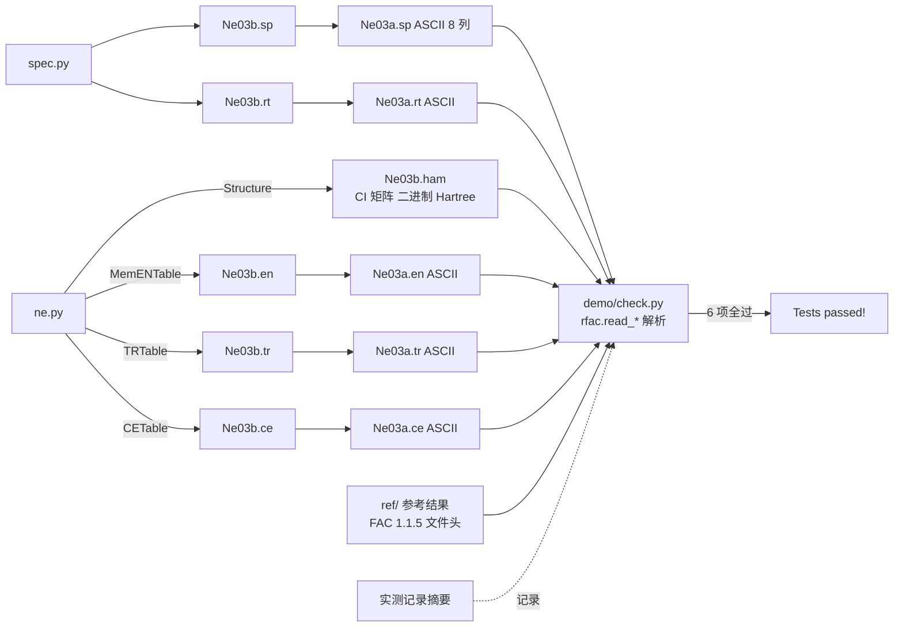
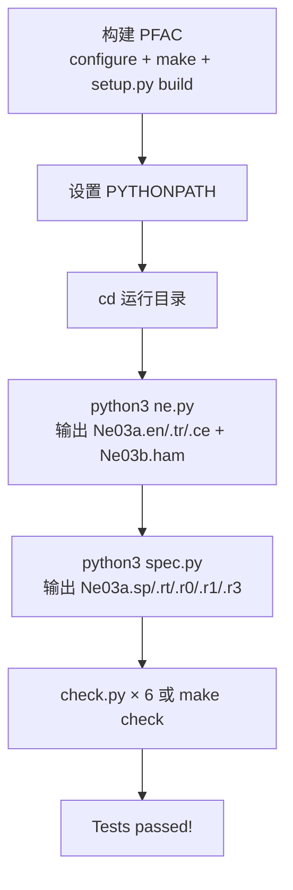
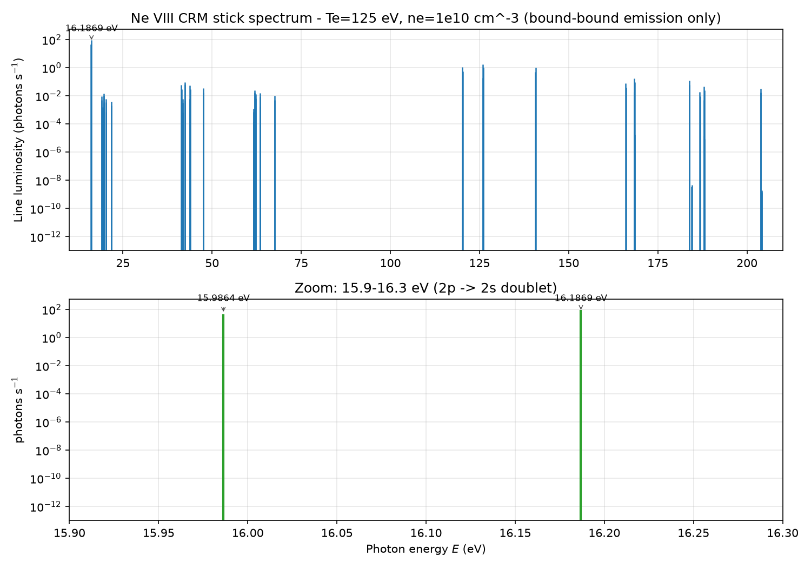
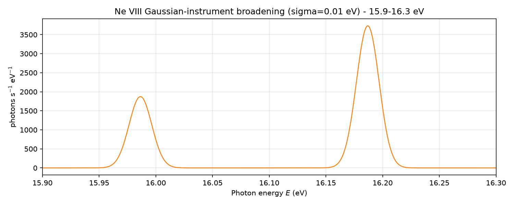

# demo/NeL —— Ne VIII 碰撞辐射模型与谱合成

> **入门导读**：建议按「§1 物理场景 → §5.1 总览图 → §3.1.1/§3.2.1 逐行解读 → §5.2/5.3 逐 API 图 → §4 API 详解 → §2 公式 → §6 手动复现 → §7 输出表 → §10 深入解析（组态展开、产物格式、温度与密度、绘图）」的顺序阅读。所有物理量口径均以 FAC 源码与手册为准，不确定之处明确标注。

## 1. 物理场景

本示例演示 Ne VIII（类 Li 氖，`Z=10`、3 个电子）的**光薄等离子体碰撞—辐射模型（CRM）**与合成谱全流程。脚本 `ne.py` 先建立原子结构、辐射跃迁率与电子碰撞激发表，`spec.py` 再求解稳态能级布居、合成线谱并导出速率矩阵。

| 参数 | 取值 | 说明 |
|---|---|---|
| `z` | 10 | 原子序数 Ne |
| `nele` | 3 | 束缚电子数（Li-like） |
| 电荷态 $q$ | $1+z-\text{nele}=8$ | Ne VIII |
| `nmax` | 5 | 最大主量子数；组态 `1s²2s`、`1s²2p`、`1s²3s/3p/3d`、`1s²4ℓ`、`1s²5ℓ`（$\ell=0\ldots4$） |
| `temp` | $500(q/16)^2 = 125\ \mathrm{eV}$ | 脚本级经验电荷标度；FAC 内部只收到 `125 eV` 的 Maxwell 分布，无特殊“scaled Maxwell”语义 |
| `dens` | `1.0` | 单位 $10^{10}\,\mathrm{cm^{-3}}$，即 $1.0\times10^{10}\,\mathrm{cm^{-3}}$（出处：[`manual.tex`](../../doc/manual.tex) 第 4352–4354 行 `SetEleDensity`；注意第 4516–4519 行是另一个函数 `SetDensity`） |
| 前缀 `p` | `'Ne03'` | `%s%02d%(ATOMICSYMBOL[z], nele)`；`*a.*` 为 ASCII 表，`*b.*` 为二进制表 |

依据 [demo/README](../README.md)：“`NeL/. a simple collisional-radiative model example for NeVIII.`”，参考结果基准为 FAC 1.1.4（生成文件头为 `FAC 1.1.5`）。

## 2. 物理效应、LaTeX 公式、出处与源码映射

### 2.1 原子结构与 CI 哈密顿量

- **效应**：相对论 Dirac 轨道 + 组态相互作用（CI），对角化哈密顿量得到精细结构能级与混合系数。
- **公式**：$H=\sum_i H_D(i)+\sum_{i<j}1/r_{ij}$，$H\Psi_k=E_k\Psi_k$。
- **输出物理量**：24 个精细结构能级（3 块，`NLEV=8/7/9`），$E_k$ 相对电离阈 $E_0=-2795.57571$ eV；混合系数存于 `Ne03b.ham`。
- **出处与映射**：[`doc/manual.tex`](../../doc/manual.tex) 第 3667–3679 行；`faclib/structure.c:3739 SolveStructure`、`:2290 DiagnolizeHamilton`；[ne.py](ne.py) 第 28–45 行；二进制 `Ne03b.ham` 解析见 [`python/rfac.py`](../../python/rfac.py) 第 1519 行 `read_ham()`。

### 2.2 辐射跃迁率与振子强度（FAC 口径）

- **公式**（FAC 手册与源码口径，$\omega$ 以 Hartree 计，$gf$ 无量纲，$L=|m|$ 为多极阶数）：

  $$gA_{ji}=2\alpha^3\omega^2\,gf_{ij},\qquad gf_{ij}=\frac{\omega\,(\alpha\omega)^{2L-2}}{2L+1}\,|M|^2$$

  $$A_{ji}\,[\mathrm{s^{-1}}]=\frac{2\alpha^3\omega^2}{2J_j+1}\,gf_{ij}\times R_{\rm AU},\qquad R_{\rm AU}=4.13413733\times10^{16}\ \mathrm{s^{-1}}$$

- **输出物理量**：跃迁能 $\Delta E$（eV）、加权振子强度 $gf$、辐射跃迁率 $A_{ji}$（s⁻¹）、多极矩参数 `MULTIP`。
- **出处与映射**：[`doc/manual.tex`](../../doc/manual.tex) 第 601–620 行；`faclib/dbase.c:5452-5473 OscillatorStrength`；[ne.py](ne.py) 第 48–52 行 `TRTable` → `Ne03a.tr`；解析见 [`python/rfac.py`](../../python/rfac.py) 第 690 行 `read_tr()`。
- **说明**：`ref/README.md` 旧版照抄的 $\frac{2\pi}{\hbar}\frac{1}{2J_j+1}|\langle j\|D^{(k)}\|i\rangle|^2\omega^{2k+1}/[(2k+1)!!]^2$ 是通用多极形式，在 $\omega$ 取 Hartree 时缺 $2\alpha^3$ 因子；本例统一采用 FAC 实际口径（等价的 SI 形式见根 [`README.md`](../../README.md) 第 116 行）。

### 2.3 电子碰撞激发

- **公式**：$\sigma_{ij}(E)=\dfrac{\pi}{k_i^2g_i}\Omega_{ij}$（$k_i^2=2E_i$，$E_i$ 以 Hartree 计；$g_i=2J_i+1$）；Maxwell 平均速率系数 $q_{ij}=\langle\sigma v\rangle_T$。
- **输出物理量**：碰撞强度 $\Omega$（无量纲）、截面（ASCII 输出 $10^{-20}\,\mathrm{cm^2}$）、Bethe/Born 拟合参数与能量网格。
- **出处与映射**：[`doc/manual.tex`](../../doc/manual.tex) 第 785–791、2853–2859 行；`faclib/excitation.c:3718 SaveExcitation`、`faclib/rates.c:501-543 CERate`；[ne.py](ne.py) 第 55–61 行 `CETable`（仅基态组态 g2 → g2/g3/g4/g5）→ `Ne03a.ce`；解析见 [`python/rfac.py`](../../python/rfac.py) 第 810 行 `read_ce()`。

### 2.4 碰撞辐射模型（CRM）稳态布居

- **公式**：

  $$\frac{dN_i}{dt}=\sum_{j\neq i}N_j R_{j\to i}-N_i\sum_{j\neq i}R_{i\to j}=0$$

- **速率矩阵来源**：TR（辐射跃迁，本例正向）、CE（碰撞激发 + 退激发）、RR（辐射复合）、AI（自电离）、CI（碰撞电离）。本例 `SetBlocks(-1)` 只保留同一离子内过程，实际生效的是 TR 与 CE；`RR/AI/CI` 列在 `Ne03a.rt` 中预留为 0。
- **输出物理量**：各精细结构能级稳态布居 $N_i$（无量纲，归一化至总丰度 1）。
- **出处与映射**：根 [`README.md`](../../README.md) 第 118 行、[`doc/manual.tex`](../../doc/manual.tex) 第 3905–3908、4119–4121 行；`faclib/crm.c:4223 LevelPopulation`、`:4306-4324` 块迭代；[spec.py](spec.py) 第 33–50 行；`spm.get_complexes()`/`RateTable()` → `Ne03a.rt`；解析见 [`python/rfac.py`](../../python/rfac.py) 第 1458 行 `read_rt()`。

### 2.5 谱合成（务必区分 photons/s 与能量发射率）

- **关键事实 1**：`SP_RECORD.strength`（[`faclib/dbase.h`](../../faclib/dbase.h) 第 414–424 行）在 `TYPE≠0` 的线发射块中是**光子发射率** photons/s；`crm.c:4495 r.strength=c*(a+b)` 中 $c=N_i$ 为上能级布居、$a=A_{ij}$、$b$ 为光激发项。在 `TYPE=0` 的**布居块**中同一字段存的是**能级布居** $N_i$。
- **关键事实 2**：二进制表中 `r.energy` 一律为 **Hartree**（`crm.c:4488` 的 `e` 未乘 `HARTREE_EV`）；ASCII 表里的 eV 是 `PrintTable` verbose 打印时 `dbase.c:6955-6956` 乘 `HARTREE_EV=27.2114` 得到的。**不可把输出直接写成含 $\hbar\omega$ 的 $I(\omega)$ 能量谱。**
- **口径公式**：

  $$S_{ij}=N_i A_{ij}\quad[\mathrm{photons/s}],\qquad \varepsilon_{ij}(\nu)=N_i A_{ij}\,h\nu\,\phi(\nu-\nu_{ij})\quad[\mathrm{能量发射率}]$$

  后者才需乘 $h\nu$；`SpecTable` 本身只给线光度与中心能量，线型 $\phi$ 由后处理施加。
- **出处与映射**：[`doc/manual.tex`](../../doc/manual.tex) 第 1131–1147、2066–2080 行；`faclib/crm.c:4416-4425,4479-4495`；`faclib/dbase.c:6955-6964 PrintSPTable`；[spec.py](spec.py) 第 53–55 行；解析见 [`python/rfac.py`](../../python/rfac.py) 第 1085 行 `read_sp()`。

## 3. 逐文件说明

### 3.1 [ne.py](ne.py) —— 原子数据生成

- **功能**：Ne VIII 能级、辐射跃迁率、碰撞激发数据，并写出 CI 哈密顿量。运行：`python ne.py`（可选参数 `openmp` → `InitializeMPI(2)`/`FinalizeMPI()`，实为 **2 个 MPI 进程**，脚本注释“openmp”为旧称）。
- **关键 API 链**：`SetAtom('Ne')` → `Config('g2','1s2 2*1')` + 循环 `Config('g%d'%n,'1s2 2*0 %d*1'%(n))`（n=3..5；`2*0` 即 n=2 壳层无电子）→ `ConfigEnergy(0)`/`OptimizeRadial('g2')`/`ConfigEnergy(1)` → `Structure('Ne03b.en','Ne03b.ham',['g2','g3'])` → `Structure` 追加 n=4..5 → `MemENTable`/`PrintTable` → `Ne03a.en` → 双重循环 `TRTable` → `Ne03a.tr` → `CETable` → `Ne03a.ce`。
- **输出**：`Ne03a.en/.tr/.ce`，二进制 `Ne03b.en/.ham/.tr/.ce`。

#### 3.1.1 `ne.py` 逐行解读（共 65 行）

| 行 | 代码 | 在做什么 / 物理含义 | 产物或状态变化 |
|---|---|---|---|
| 1–5 | `"""..."""` | 模块说明：Z=10 氖、3 电子、`nmax=5`，附 FAC 官网 | 无 |
| 6 | `import sys` | 导入 `sys` 以读取命令行参数 | 无 |
| 7 | `from pfac.fac import *` | 导入 PFAC 原子结构接口；本例 `*a.*` 写 ASCII 表、`*b.*` 写二进制表 | 全局函数可用 |
| 9–11 | `use_openmp = False` + `if len(sys.argv)==2 and sys.argv[1]=='openmp'` | 默认串行；仅当唯一参数为 `openmp` 时置位 | `use_openmp` 布尔值 |
| 14–16 | `if use_openmp: InitializeMPI(2)` | 初始化 **2 个 MPI 进程**（注释“openmp”为历史误称，非 OpenMP） | MPI 运行时启动 |
| 18 | 注释 | 说明下面三个量是物理输入 | 无 |
| 19–21 | `z=10; nele=3; nmax=5` | 核电荷、束缚电子数、最大主量子数 | 决定后续循环上界与文件名 |
| 23 | `a = ATOMICSYMBOL[z]` | 查周期表得 `'Ne'` | `a='Ne'` |
| 24 | `p = '%s%02d'%(a, nele)` | 拼前缀 | `p='Ne03'` |
| 26 | `SetAtom(a)` | 设置元素：Z=10、质量、核半径（fm） | 全局原子对象 |
| 28 | `Config('g2','1s2 2*%d'%(nele-2))` | `nele-2=1` → 组态 `1s²2s¹`，命名组 g2（`*` 的 ℓ 展开规则见 §10.1） | 组 g2 定义 |
| 29–30 | `for n in range(3,nmax+1): Config('g%d'%n,'1s2 2*%d %d*1'%(nele-3,n))` | `nele-3=0`；n=3,4,5 各建一组 `1s² nℓ¹`（ℓ 自动展开，见 §10.1） | 组 g3/g4/g5 定义 |
| 33 | `ConfigEnergy(0)` | 各组分别优化径向轨道、保存平均组态能（**第一步**） | 分组轨道与平均能 |
| 34 | `OptimizeRadial('g2')` | 以基态组 g2 为参考，DFS 自洽迭代求中心势 | 统一径向势 V(r) |
| 35 | `ConfigEnergy(1)` | 用统一势重算所有组平均能，修正 CI 对角元（**第二步**） | 修正后的对角元 |
| 39 | `Structure(p+'b.en', p+'b.ham', ['g2','g3'])` | 首次调用：构造 g2+g3 的 CI 哈密顿量并对角化；第二参数额外导出稀疏矩阵 | `Ne03b.en`（首块 8 能级）、`Ne03b.ham`（Hartree） |
| 41–42 | `for n in range(4,nmax+1): Structure(p+'b.en',['g%d'%n])` | 逐组追加 g4（7 能级）、g5（9 能级）的对角化结果；不传 ham 参数，故哈密顿量不重写 | `Ne03b.en` 累计 24 能级 / 3 块 |
| 44 | `MemENTable(p+'b.en')` | 将能级表载入内存，供 verbose 打印展开组态名 | 内存索引 |
| 45 | `PrintTable(p+'b.en', p+'a.en')` | 二进制 → ASCII（verbose） | `Ne03a.en`：Type=1，3 块 |
| 48–51 | `for n in 2..5: for m in n..5: Print(...); TRTable(p+'b.tr',['g%d'%n],['g%d'%m])` | 共 **10 组**组态对（n≤m）的辐射跃迁：多极矩阵元 → $A_{ji}$、$gf$；`Print` 输出进度 | `Ne03b.tr`，最终 10 个块 |
| 52 | `PrintTable(p+'b.tr', p+'a.tr')` | 转 ASCII | `Ne03a.tr`：Type=2，10 块 |
| 55–57 | `for n in 2..5: if n>2: continue` | 外层循环只保留 n=2（基态组 g2），其余跳过 | 只算从基态出发的激发 |
| 58–60 | `for m in 2..5: Print(...); CETable(p+'b.ce',['g2'],['g%d'%m])` | g2→g2/g3/g4/g5 共 4 次调用：解连续电子波函数，得碰撞强度 Ω、截面 σ 与 Bethe/Born 拟合 | `Ne03b.ce`，最终 5 块 |
| 61 | `PrintTable(p+'b.ce', p+'a.ce')` | 转 ASCII | `Ne03a.ce`：Type=3，5 块 |
| 63–64 | `if use_openmp: FinalizeMPI()` | 收尾 MPI（若启用） | 进程退出 |

### 3.2 [spec.py](spec.py) —— CRM 布居与谱

- **功能**：读取 `Ne03b.*` 二进制表，建 CRM、解布居、合成谱、导出速率矩阵。运行：`python spec.py`（可选 `openmp`）。
- **关键 API 链**：`AddIon(3,0.0,'Ne03b')` → `SetBlocks(-1)` → `SetEleDist(0,125,-1,-1)` → `SetTRRates(0)` → `SetCERates(1)` → `SetAbund(3,1.0)` → `SetEleDensity(1.0)` → `InitBlocks()` → `SetIteration(1e-6,0.5)` → `LevelPopulation()` → `SpecTable('Ne03b.sp',0)`/`PrintTable` → `Ne03a.sp` → `spm.get_complexes(3)`/`RateTable`/`PrintTable(...,1)` → `Ne03a.rt` → `DumpRates('Ne03a.r%d'%m,-1,m,-1,1)`（m=0,1,3）。
- **输出**：`Ne03a.sp`、`Ne03a.rt` 及 `Ne03a.r0/.r1/.r3`（后三者**不在 `RESULTS`**）。
- **注意**：脚本首行注释 `s.py ...` 为旧名残留。

#### 3.2.1 `spec.py` 逐行解读（共 67 行）

| 行 | 代码 | 在做什么 / 物理含义 | 产物或状态变化 |
|---|---|---|---|
| 1–4 | `"""s.py runs... sel.py prints..."""` | 旧名残留注释（`s.py`/`sel.py`），实际脚本名为 `spec.py` | 无 |
| 5 | `import sys` | 读取命令行参数 | 无 |
| 6–8 | `from pfac.crm import *` / `from pfac import fac, spm` | 导入 CRM 接口、`fac` 元素符号表、`spm` 复合体工具 | 三类函数可用 |
| 10–12 | `use_openmp` 参数检测 | 同 `ne.py` | 布尔值 |
| 15–17 | `if use_openmp: InitializeMPI(2)` | 初始化 2 个 MPI 进程 | MPI 运行时启动 |
| 20 | `z = 10` | 原子序数 | 后续 `ATOMICSYMBOL` 查表 |
| 22 | `nele = 3` | 电子数（Li-like） | 选离子与前缀 |
| 24 | `temp = 500.0*((1+z-nele)/16.0)**2` | 电荷态 $q=1+z-\text{nele}=8$ 的经验标度：$500\times(8/16)^2=125$ eV。**只是脚本级选温公式**，FAC 内部收到的是普通 125 eV Maxwell；与密度无函数关系（见 §10.3） | `temp=125.0` |
| 25 | `dens = 1.0` | 电子密度，单位 $10^{10}$ cm⁻³；与温度独立，决定碰撞/辐射相对速率（见 §10.3） | `dens=1.0` → $10^{10}$ cm⁻³ |
| 28 | `a = fac.ATOMICSYMBOL[z]` | 得 `'Ne'`（此处需 `fac.` 前缀，因未 `import *`） | `a='Ne'` |
| 30 | `p = '%s%02d'%(a, nele)` | 拼前缀 | `p='Ne03'` |
| 33 | `AddIon(nele, 0.0, '%sb'%p)` | 注册 3 电子离子，密度参数 0 是占位（第 43 行覆盖），前缀自动补 `.en/.tr/.ce/...` | 内存离子对象 |
| 34 | `SetBlocks(-1)` | **负丰度开关**：只保留同一离子内过程，不读更低电荷态数据；不是“块数” | 限定 CRM 范围 |
| 36 | `SetEleDist(0, temp, -1, -1)` | 类型 0=Maxwell；125 eV；两个 `-1` 触发默认 $E_{\min}=1.25\times10^{-18}$ eV、$E_{\max}=1.25\times10^{4}$ eV | 电子能量分布（与 `.rt` 中 `NPEDIS=3` 一致） |
| 38 | `SetTRRates(0)` | 只取辐射跃迁**正向率**；`1` 才加光激发逆过程 | TR 速率 |
| 40 | `SetCERates(1)` | 由 CE 表对 Maxwell 积分得 $q_{ij}=\langle\sigma v\rangle$，并加入碰撞退激发逆过程 | CE 正/逆速率 |
| 43 | `SetAbund(nele, 1.0)` | 覆盖第 33 行的占位值，设该离子丰度为 1（单一离子模型） | 丰度归一化 |
| 44 | `SetEleDensity(dens)` | 存 $n_e=1.0$（×$10^{10}$ cm⁻³） | 密度就绪 |
| 46 | `InitBlocks()` | 初始化超能级块、布居数组、总衰变率数组 | 迭代初值 |
| 48 | `SetIteration(1e-6, 0.5)` | 收敛精度 $10^{-6}$、松弛因子 0.5（最大迭代默认 256） | 迭代控制参数 |
| 50 | `LevelPopulation()` | 超能级块法解稳态方程 $\sum_j N_jR_{j\to i}=N_i\sum_jR_{i\to j}$；控制台打印迭代历史（0→10 收敛） | 各能级布居 $N_i$ |
| 53 | `SpecTable(p+'b.sp', 0)` | `rrc=0`：输出布居 + 线发射率（**不含**复合连续谱） | `Ne03b.sp` 二进制 |
| 55 | `PrintTable(p+'b.sp', p+'a.sp')` | verbose ASCII，8 列，能量 Hartree→eV | `Ne03a.sp`：Type=7，43 块 |
| 58 | `rate = spm.get_complexes(nele)` | 纯 Python：返回复合体名列表 `['1*2 2*1','1*2 3*1']` | `RateTable` 选择参数 |
| 59 | `RateTable(p+'b.rt', rate)` | 导出速率矩阵稀疏行（TR/CE/RR/AI/CI 各列贡献） | `Ne03b.rt` 二进制 |
| 60 | `PrintTable(p+'b.rt', p+'a.rt', 1)` | `v=1` verbose 转 ASCII | `Ne03a.rt`：Type=8，1 块 |
| 62–63 | `for m in [0,1,3]: DumpRates(p+'a.r%d'%m,-1,m,-1,1)` | `k=-1` 所有离子；m=0 能级信息 / 1 辐射率 / 3 碰撞激发率；`imax=-1` 全部能级；`a=1` ASCII | `Ne03a.r0/.r1/.r3`（不在 `RESULTS`） |
| 65–66 | `if use_openmp: FinalizeMPI()` | 收尾 MPI（若启用） | 进程退出 |

### 3.3 [Makefile](Makefile) 与 [ref/](ref/README.md)

- `Makefile`：`RESULTS = Ne03a.ce Ne03a.en Ne03a.rt Ne03a.sp Ne03a.tr Ne03b.ham`，`SCRIPTS = ne.py spec.py`。
- [ref/README.md](ref/README.md)：六个参考文件的格式、字段与比对容差。

## 4. “关键 API 链”逐项详解

> 下表逐 API 说明「demo 实参 → 输入 → C 层实际动作与物理效应 → 输出物理量」。Python 包装位于 `python/fac.c` / `python/pcrm.c`，核心算法位于 `faclib/*.c`。

### 4.1 `ne.py`（`from pfac.fac import *`）

| # | API 与 demo 实参 | 输入 | C 层动作与物理效应 | 输出物理量 / 文件 |
|---|---|---|---|---|
| 1 | `SetAtom('Ne')`（`fac.c:1468` → `nucleus.c:416`） | 元素符号 `Ne` | 查表设置 $Z=10$、质量数、核半径（fm）；后续所有轨道计算以此核为中心 | 全局原子对象（无文件） |
| 2 | `Config('g2','1s2 2*1')`；`Config('gN','1s2 2*0 N*1')`，N=3..5（`fac.c:612` → `faclib/config.c`） | 组态字符串；`N*1` 表示 n=N 壳层 1 个电子，展开全部 $\ell$ | 向命名组添加组态：g2=`1s²2s`，g3=`1s²3ℓ`，g4=`1s²4ℓ`，g5=`1s²5ℓ` | 5 个组态组的基矢定义 |
| 3 | `ConfigEnergy(0)`（`fac.c:4875` → `radial.c:6311`） | 上述组态组 | 对各组分别优化径向轨道，保存平均组态能 | 各组优化后的径向轨道与平均能 |
| 4 | `OptimizeRadial('g2')`（`fac.c:1583` → `radial.c:4050/4166`） | 参考组 g2（基态 `1s²2s`） | DFS 自洽场迭代求中心势 $V(r)$ | 自洽径向势与轨道 |
| 5 | `ConfigEnergy(1)` | 统一势 | 用统一势重算所有组平均能，修正 CI 哈密顿量对角元，保证组态间能级相对位置正确 | 修正后的对角元 |
| 6 | `Structure(fn.en,fn.ham,['g2','g3'])`；再追加 g4/g5（`fac.c:1783` → `structure.c:3739/2290`） | CI 基矢、径向势 | 构造 $H=\sum H_D+\sum 1/r_{ij}$ 并 LAPACK 对角化，得精细结构本征值与混合系数 | `Ne03b.en`（24 能级）、`Ne03b.ham`（稀疏 CI 矩阵，Hartree） |
| 7 | `MemENTable(fn.en)`（`fac.c:4575` → `dbase.c:5186`） | `Ne03b.en` | 把能级表加载进内存，供 verbose `PrintTable` 展开组态名 | 内存中的能级索引 |
| 8 | `PrintTable(fn.en,'Ne03a.en')`（`fac.c:4557` → `dbase.c:4731`） | `Ne03b.en` | 二进制转 ASCII（verbose，`v=1`） | `Ne03a.en`：Type=1，3 块，`NLEV=8/7/9`，$E_k$（eV，相对 $E_0$）、$2J$、宇称、组态名 |
| 9 | `TRTable(fn.tr,[gn],[gm])`，n,m=2..5（`fac.c:2699` → `transition.c:1606`） | CI 波函数 | 计算组态间多极跃迁矩阵元 → $A_{ji}$、$gf$（默认 `m=0` 全多极求和） | `Ne03b.tr` → `Ne03a.tr`：Type=2，10 块，`ΔE`/`gf`/`rate`/`MULTIP` |
| 10 | `CETable(fn.ce,['g2'],[gm])`，m=2..5（`fac.c:2801` → `excitation.c:3718`） | 基态组 g2 + 激发组 g3/g4/g5 | 解连续电子 Dirac–Fock 波函数，得碰撞强度 $\Omega(E)$、截面 $\sigma(E)$、Bethe/Born 拟合 | `Ne03b.ce` → `Ne03a.ce`：Type=3，5 块 |
| 11 | `InitializeMPI(2)` / `FinalizeMPI()`（可选，`fac.c:6239/6329` → `mpiutil.c:237/339`） | 进程数 2 | MPI 初始化/收尾（**非 OpenMP**），并行可能改变输出行序 | 无文件 |

### 4.2 `spec.py`（`from pfac.crm import *`）

| # | API 与 demo 实参 | 输入 | C 层动作与物理效应 | 输出物理量 / 文件 |
|---|---|---|---|---|
| 1 | `AddIon(3,0.0,'Ne03b')`（`pcrm.c:736` → `crm.c:449`） | 电子数 3、占位密度 0、文件前缀 | 注册离子，自动拼接 `.en/.tr/.ce/...` 二进制表；密度参数随后被 `SetAbund` 覆盖 | 内存中的离子对象 |
| 2 | `SetBlocks(-1)`（`pcrm.c:575` → `crm.c:963`） | 负丰度 | **负丰度开关**：只保留同一离子内过程，不读取更低电荷态数据；**不是“块数”** | 限定 CRM 进程范围 |
| 3 | `SetEleDist(0,125,-1,-1)`（`pcrm.c:283` → `rates.c:1634`） | 类型 0=Maxwell；$T_e=125$ eV；`-1,-1` 触发默认 $E_{\min}=10^{-20}T_e=1.25\times10^{-18}$ eV、$E_{\max}=100T_e=1.25\times10^{4}$ eV | 设置电子能量分布函数，供速率系数积分 | Maxwell 分布（与 `Ne03a.rt` 的 `NPEDIS=3` 三参数一致） |
| 4 | `SetTRRates(0)`（`pcrm.c:789` → `crm.c:5949`） | `inv=0` | 只取辐射跃迁**正向**率 $A_{ji}$；`inv=1` 才加入光激发逆过程 | TR 正向速率 |
| 5 | `SetCERates(1)`（`pcrm.c:756` → `crm.c:5698`、`rates.c:501`） | `inv=1` | 由 CE 表对 Maxwell 分布积分得 $q_{ij}=\langle\sigma v\rangle$，并加入碰撞退激发逆过程 | CE 正/逆速率系数 |
| 6 | `SetAbund(3,1.0)`（`pcrm.c:943` → `crm.c:1711`） | 离子电子数 3、丰度 1.0 | 覆盖 `AddIon` 的占位值，设单一离子丰度为 1 | 离子丰度归一化 |
| 7 | `SetEleDensity(1.0)`（`pcrm.c:477` → `crm.c:156-159,1745,4251`） | `1.0`（单位 $10^{10}$ cm⁻³） | 存入 `electron_density=1.0`，使用时乘 $10^{10}$ 转成实际密度 | $n_e=1\times10^{10}$ cm⁻³ |
| 8 | `InitBlocks()`（`pcrm.c:594` → `crm.c:1732`） | 已装载的速率 | 初始化超能级块、布居数组与总衰变率数组，为迭代准备 | 迭代初值 |
| 9 | `SetIteration(1e-6,0.5)`（`pcrm.c:557` → `crm.c:171-176`） | 精度 $10^{-6}$、松弛因子 0.5（最大迭代默认 256） | 设置稳态迭代收敛判据 | 迭代控制参数 |
| 10 | `LevelPopulation()`（`pcrm.c:607` → `crm.c:4223,4306-4324`） | 速率矩阵 + 迭代参数 | 超能级块法：`BlockMatrix → BlockPopulation → BlockRelaxation`，直到残差 $<10^{-6}$ | 各能级稳态布居 $N_i$ |
| 11 | `SpecTable('Ne03b.sp',0)`（`pcrm.c:633` → `crm.c:4363`） | `rrc=0` | 输出布居 + 线发射率（**不含**复合连续谱；`rrc=1` 才加 RRC，`-1` 只输出布居） | `Ne03b.sp` 二进制 |
| 12 | `PrintTable('Ne03b.sp','Ne03a.sp')`（`pcrm.c:869` → `dbase.c:6909`） | `Ne03b.sp` | verbose ASCII：每行 8 列（见 §7），能量乘 `HARTREE_EV` 转 eV | `Ne03a.sp`：Type=7，43 块 |
| 13 | `spm.get_complexes(3)`（`python/spm.py:623-647`） | 电子数 3 | 纯 Python：返回复合体名列表 `['1*2 2*1','1*2 3*1']` | `RateTable` 的选择参数 |
| 14 | `RateTable('Ne03b.rt',rate)` + `PrintTable(...,1)`（`pcrm.c:904` → `crm.c:2080`） | 复合体列表 | 导出 CRM 速率矩阵的稀疏行（TR/CE/RR/AI/CI 各列贡献） | `Ne03a.rt`：Type=8，1 块，`NTRANS=10` |
| 15 | `DumpRates('Ne03a.r%d'%m,-1,m,-1,1)`，m=0,1,3（`pcrm.c:1342` → `crm.c:7019`） | `k=-1` 所有离子；`m=0` 能级信息 / `1` 辐射率 / `3` 碰撞激发率；`imax=-1` 全部能级；`a=1` ASCII | 按指定类型导出速率明细文本 | `Ne03a.r0/.r1/.r3`（不受 `make check` 覆盖） |

## 5. Mermaid 图

### 5.1 FAC 使用总览流程图



### 5.2 `ne.py` API 链与物理含义



### 5.3 `spec.py` API 链与物理含义



### 5.4 CRM 物理过程网络图



### 5.5 数据产品血缘与比对流图



## 6. 实测复现流程与结果

> 前提：Linux/WSL + gcc/gfortran/make + Python 3.10，实测 Ubuntu 22.04。原始源码树保持只读；以下兼容处理只在独立构建目录中完成。

### 6.1 实测结论摘要

- `ne.py`、`spec.py` 均 `EXIT=0`；**耗时未记录**，不推断墙钟时间。
- `ne.py` 输出 14 行固定进度（`TR: g2→g2` … `CE: g2→g5`）；`spec.py` 的布居迭代到第 10 步残差约 `6.9e-7`，小于 `1e-6` 收敛判据。
- `Ne03a.ce/en/rt/sp/tr` 与 `Ne03b.ham` 共 **6 项 `check.py` 比对全部通过**。
- 产物包括 `Ne03a.en/.tr/.ce/.sp/.rt` 与 `Ne03b.en/.tr/.ce/.ham/.sp/.rt`，以及 `DumpRates` 辅助文件 `Ne03a.r0/.r1/.r3`。

> **先看清三个最常见的报错：**
>
> | 报错 | 原因 | 正确处理 |
> |---|---|---|
> | `ls: cannot access './build/lib.linux-x86_64-*/pfac'` | PFAC 产物在 `$BUILD_SRC/build/...`，不在当前目录 | 按 §6.2 定义 `BUILD_SRC` 并设置 `PYTHONPATH` |
> | `./configure: /bin/sh^M: bad interpreter` | 仓库脚本为 CRLF 行尾（实测 `configure` 有 6636 个 `\r\n`） | 先 `sed -i 's/\r$//'` 归一化 |
> | `-bash: BUILD_SRC: No such file or directory` | 路径变量未替换 | 把 `$BUILD_SRC`、`$RUN_DIR` 改成实际存在的独立目录 |

### 6.2 构建与导入（Linux/WSL）

```bash
BUILD_SRC=/path/to/buildable/fac   # 指向已准备好的独立构建目录
cd "$BUILD_SRC"

# 构建前兼容处理：仅作用于独立构建目录，不改原始源码树
for f in configure config.guess config.sub install.sh mkinsdir.sh; do
    sed -i 's/\r$//' "$f"
done
./configure
sed -i 's/^#undef f2cFortran$/#define f2cFortran 1/' sysdef.h
make
python3 setup.py build

export PYTHONPATH=$BUILD_SRC/build/lib.linux-x86_64-3.10:$BUILD_SRC/python
python3 -c "from pfac import fac, crm, spm; print('PFAC OK')"
```

输出 `PFAC OK` 即环境就绪。`sed` 修 CRLF，`f2cFortran` 修 C/Fortran ABI，均不改变物理公式（见 §9）。

### 6.3 准备独立运行目录

```bash
RUN_DIR=/path/to/run_NeL
mkdir -p "$RUN_DIR"
cp "$BUILD_SRC/demo/NeL/ne.py" "$BUILD_SRC/demo/NeL/spec.py" "$RUN_DIR"/
cd "$RUN_DIR"
```

不要在 `$BUILD_SRC/demo/NeL` 原地运行，以免覆盖基准输出；用独立 `$RUN_DIR` 便于清理和复现。

### 6.4 第 3 步：运行 `ne.py`（生成原子数据；**必须先做**）

```bash
python3 ne.py | tee ne.log
```

**必须出现的控制台输出**（14 行，顺序固定；已与实测记录逐行核对）：

```
TR: g2 -> g2
TR: g2 -> g3
TR: g2 -> g4
TR: g2 -> g5
TR: g3 -> g3
TR: g3 -> g4
TR: g3 -> g5
TR: g4 -> g4
TR: g4 -> g5
TR: g5 -> g5
CE: g2 -> g2
CE: g2 -> g3
CE: g2 -> g4
CE: g2 -> g5
```

**运行后应存在的文件**：

```bash
ls -lh Ne03*     # 应看到 Ne03a.en/.tr/.ce 与 Ne03b.en/.tr/.ce/.ham
head -8 Ne03a.en # Type = 1, NBlocks = 3, E0 = 0, -2.79557571E+03
```

> 这一步耗时最长（CI 对角化 + 辐射跃迁 + 碰撞激发）。若中途失败，`spec.py` 无法运行。

### 6.5 第 4 步：运行 `spec.py`（CRM 布居与谱；依赖第 3 步）

```bash
python3 spec.py | tee spec.log
```

**必须出现的控制台输出**（迭代历史，已与实测记录逐行核对）：

```
Population Iteration:
    0  1.0000E+00  8.3000E-05  8.3000E-05  2.2489E+07
    1  2.5872E-03  4.0000E-05  1.2300E-04  2.2489E+07
    ...（到第 10 步，残差约 6.9e-7 < 1e-6 收敛）
```

**运行后新增文件**：

```bash
ls -lh Ne03a.sp Ne03a.rt Ne03a.r0 Ne03a.r1 Ne03a.r3 Ne03b.sp Ne03b.rt
head -8 Ne03a.sp    # Type = 7, NBlocks = 43
head -12 Ne03a.rt   # Type = 8, NBlocks = 1, NTRANS = 10, EDEN = 1.0
```

### 6.6 第 5 步：与参考结果比对

```bash
cd "$RUN_DIR"
for f in Ne03a.ce Ne03a.en Ne03a.rt Ne03a.sp Ne03a.tr Ne03b.ham; do
    python3 "$BUILD_SRC/demo/check.py" "$f" "$BUILD_SRC/demo/NeL/ref/$f" || exit 1
done
echo "Tests passed!"
```

也可在 `$BUILD_SRC/demo/NeL` 中执行 `make && make check`（[`Make.common`](../Make.common) 第 9–11 行自动逐项比对并打印 `Tests passed!`）。单项手工比对示例：

```bash
python3 "$BUILD_SRC/demo/check.py" Ne03a.sp "$BUILD_SRC/demo/NeL/ref/Ne03a.sp"
```

### 6.7 第 6 步：查看关键物理量（可选）

```bash

# 能级表首块（2s 基态 + 2p/3s/3p/3d 精细结构），列含义见下方说明
sed -n '10,20p' Ne03a.en

# 辐射跃迁表首块：2p -> 2s 的两条强线，rate 应在 ~5.6e8 s^-1 量级
# 注意：.tr 表里是数字与表头，没有 "g2 -> g3" 文字；那只是 ne.py 运行时打印到屏幕的进度
sed -n '9,16p' Ne03a.tr

# 谱表首块（TYPE=0000000 布居块，第 4 列 strength 是布居而非 photons/s）
sed -n '9,17p' Ne03a.sp

# 若想看 ne.py 打印的 "TR: g2 -> g3" 等进度行，看运行日志而非结果表：
grep 'TR:\|CE:' ne.log          # 你运行时的 tee ne.log

# 前 3 个能级：2s 基态与 2p 精细结构
sed -n '10,20p' Ne03a.en

# 谱表首块（TYPE=0000000 布居块，strength 为布居而非 photons/s）
sed -n '9,17p' Ne03a.sp
```

### 6.8 顺序总结（Mermaid）



### 6.9 Windows 环境说明

Windows 宿主若无 gcc/gfortran/make，无法本地构建 PFAC；Windows Python 也不能直接加载 Linux/WSL 编译出的 `.so`。因此强烈建议在 WSL 中按 §6.2–6.6 执行。实测结论：`ne.py`、`spec.py` 均 `EXIT=0`，6 项 CHECK 全部通过。

## 7. 输出清单与单位

| 文件 | 含义 | 关键字段与单位 |
|---|---|---|
| `Ne03a.en` | 能级表 Type=1，3 块，`NLEV=8/7/9`（共 24 能级） | `E0=-2795.57571`、`ENERGY` 均 eV；`ENERGY` 相对 `E0`；`2J`、`P` 无量纲；`VNL` 为组态数值标签 |
| `Ne03a.tr` | 跃迁率表 Type=2，10 块 | `Delta E` eV；`gf` 无量纲；`rate` s⁻¹；`multipole` 无量纲 |
| `Ne03a.ce` | 碰撞激发表 Type=3，5 块 | `Delta E`/`TE0`/`EGRID` eV；`collision strength` 无量纲；`crosssection` 为 $10^{-20}\,\mathrm{cm^2}$（**不是** $\pi a_0^2$；`dbase.c:5809-5814`、`consts.h:170`） |
| `Ne03a.sp` | CRM 谱表 Type=7，43 块；每数据行 **8 列**：`upper lower energy strength rrate trate wimp wstk`（`dbase.c:6963-6964`；UTA 时 9 列） | `energy` eV（二进制为 Hartree，ASCII 打印时 ×27.2114）。`TYPE=0` 布居块：`strength`=$N_i$（无量纲）、`rrate`=$2J+1$、`trate`=总衰变率 s⁻¹；`TYPE≠0` 线发射块：`strength`=$N_iA_{ij}$（**photons/s**）、`rrate`=$A_{ij}$ s⁻¹、`trate`=上能级总衰变率 s⁻¹；`wimp`/`wstk` 为 Stark 展宽参数，本例为 0 |
| `Ne03a.rt` | 速率矩阵 Type=8，1 块，`NTRANS=10` | 行含 TR/CE/RR/AI/CI 贡献；`EDEN=1.0` 以 $10^{10}\,\mathrm{cm^{-3}}$ 计；`NPEDIS=3` 为 125 / 1.25e-18 / 1.25e4 eV |
| `Ne03b.ham` | CI 哈密顿量（二进制） | 稀疏矩阵元 Hartree；需 [`rfac.read_ham()`](../../python/rfac.py) 解析 |
| `Ne03a.r0/.r1/.r3` | `DumpRates` 辅助输出 | 不在 `RESULTS`，文本矩阵（m=0 能级 / 1 辐射率 / 3 碰撞激发率） |

> **重要口径提醒**：[`python/rfac.py`](../../python/rfac.py) 第 1110–1118 行的 `read_sp()` 只解析前 6 列，并把它们**错名**为 `block/level/abs. energy/population/Delta E/emissivity`；实际这 6 列分别是 `upper/lower/energy/strength/rrate/trate`。`demo/check.py` 沿用了这些键名，因此比对容差表（§8）中的物理标签需按本表对照理解。

## 8. check.py 比对结果

`make check` 对六个 `RESULTS` 逐一比对，**全部通过**（6 项 `EXIT=0`；耗时未记录）：

| 文件 | check 函数 | 关键容差（atol / rtol） |
|---|---|---|
| `Ne03a.en` | `check_en` (:96) | `ENERGY` 10 / 0.01；`E0` 1% |
| `Ne03a.tr` | `check_tr` (:122) | `rate` 1e4 / 0.05；`gf` 1e-4 / 0.02 |
| `Ne03a.ce` | `check_ce` (:138) | `collision strength` 1e-3 / 0.05；`crosssection` 0.01 / 0.1 |
| `Ne03a.sp` | `check_sp` (:197) | `abs. energy`(=energy) 1 / 0.01；`population`(=strength) 1e-30 / 0.05；`Delta E`(=rrate) 1 / 0.01；`emissivity`(=trate) 1e-10 / 0.05（键名为 `read_sp` 历史误命名，见 §7） |
| `Ne03a.rt` | `check_rt` (:213) | 默认 atol 1e-8 / rtol 1e-5 |
| `Ne03b.ham` | `check_ham` (:221) | `value` 1e-5 / 1e-3 |

## 9. 限制与构建兼容处理说明

- 基准为 FAC 1.1.4，而参考文件头为 `FAC 1.1.5`；`Ne03a.sp` 有 43 个块，弱线用极小绝对容差（1e-10/1e-30），需关注相对误差。
- `RT` 表字段 `NB`、`Ne03b.ham` 存储顺序等按源码表格定义为准（`python/rfac.py:1458/1519`）；`DumpRates` 文件不受 `make check` 覆盖。
- **构建兼容处理（仅构建/ABI 层面，非物理）**：因 Windows 宿主 CRLF 破坏 `#!/bin/sh`，将 `configure`、`install.sh`、`mkinsdir.sh`、`config.guess`、`config.sub` 归一化为 LF；因 configure 的 `AC_DEFINE_UNQUOTED` 未填入模板，在独立构建目录的 `sysdef.h` 中将 `#undef f2cFortran` 改为 `#define f2cFortran 1`，以固定 C/Fortran 名字修饰与 LOGICAL 约定的 ABI。**原始源码树未修改**；上述处理已由本目录六项 ref 比对全部通过验证，不改变任何物理公式或数值口径。

## 10. 深入解析：五个常见问题

### 10.1 `Config('g2','1s2 2*1')` 中的 `2s` 是怎么来的？

FAC 的组态字符串语法（[`doc/manual.tex`](../../doc/manual.tex) 第 2643–2657 行）：

- `nl^N` 表示 n、ℓ 壳层有 N 个电子，光谱记号 `s,p,d,f,g,...` 对应 $\ell=0,1,2,3,4,\ldots$。例如 `2p+3` 表示 $2p_{3/2}$ 壳层 3 个电子。
- **若用 `*` 代替 ℓ 符号，FAC 会自动枚举该 n 下所有合法的 $\ell$ 值，生成多个组态**。也可用 `[s,p,d]` 显式限定允许的 $\ell$ 集合。
- 因此 `1s2 2*1` 展开为两个组态：`1s²2s¹`（$\ell=0$）和 `1s²2p¹`（$\ell=1$）。

| 组名 | 输入字符串 | 展开的组态 | 精细结构能级数 |
|---|---|---|---|
| g2 | `1s2 2*1` | `1s²2s`、`1s²2p` | $1+2=3$ |
| g3 | `1s2 2*0 3*1` | `1s²3s`、`3p`、`3d` | $1+2+2=5$ |
| g4 | `1s2 2*0 4*1` | `1s²4s`、`4p`、`4d`、`4f` | $1+2+2+2=7$ |
| g5 | `1s2 2*0 5*1` | `1s²5s`、`5p`、`5d`、`5f`、`5g` | $1+2+2+2+2=9$ |

合计 $3+5+7+9=24$ 个精细结构能级。g2 与 g3 在第一次 `Structure(...,['g2','g3'])` 中合并为参考文件的第 1 块（`NLEV=8`），g4、g5 各成一块（7、9）。`2*0` 表示 n=2 壳层 0 电子（占位声明，该组不含 n=2 电子）。

### 10.2 `ne.py` 的产物、变量与单位

**脚本变量**

| 变量 | 值 | 类型 / 单位 | 物理意义 |
|---|---|---|---|
| `z` | 10 | 无量纲整数 | 原子序数（Ne） |
| `nele` | 3 | 无量纲整数 | 束缚电子数（Li-like） |
| `nmax` | 5 | 无量纲整数 | 组态展开的最大主量子数 |
| `a` | `'Ne'` | 字符串 | 元素符号，由 `ATOMICSYMBOL[10]` 查得 |
| `p` | `'Ne03'` | 字符串 | 输出前缀：`a` + 两位 `nele` |
| `use_openmp` | `False` / `True` | 布尔 | 是否启用 2 进程 MPI（历史参数名 `openmp`） |

**ASCII 产物（前缀 `Ne03a.`）**

| 文件 | Type | 头部关键字段 | 数据行格式与单位 |
|---|---|---|---|
| `Ne03a.en` | 1 | `NBlocks=3`，`E0=0, -2.79557571E+03`；每块 `NELE=3`、`NLEV=8/7/9` | `ILEV IBASE ENERGY P VNL 2J` + 3 列组态名；`ENERGY`/`E0` 为 **eV**（`ENERGY` 相对 `E0`），`2J` 无量纲，`P` 宇称（0 偶/1 奇） |
| `Ne03a.tr` | 2 | `NBlocks=10`；每块 `NTRANS`、`MULTIP`、`GAUGE=2`、`MODE=1` | 8 列 `upper_idx upper_2J lower_idx lower_2J ΔE gf rate multipole`；`ΔE` eV、`gf` 无量纲、`rate` s⁻¹、`multipole` 无量纲 |
| `Ne03a.ce` | 3 | `NBlocks=5`；每块 `NTRANS`、`TE0`、`NEGRID`、`UTYPE`、`NUSR` 等 | 跃迁头 `upper lower upper_2J lower_2J ΔE nsub`；随后每能量点 `E Ω σ`：`E` Hartree、`Ω`（碰撞强度）无量纲、`σ` 为 $10^{-20}$ cm² |

**二进制产物（前缀 `Ne03b.`）**：`Ne03b.en/.tr/.ce` 是 FAC 内部格式，`Ne03b.ham` 是 CI 哈密顿量稀疏矩阵（矩阵元 Hartree，需 `rfac.read_ham()` 解析）。二进制表供 `spec.py` 直接读取，ASCII 表供人阅读与 `check.py` 比对。

### 10.3 温度公式与密度：谁是自变量？

**`temp` 不是由密度和电离度“算出来”的**。`500[(1+z-\text{nele})/16]^2` 只是脚本作者用来**挑一个代表温度**的经验公式（$q=1+z-\text{nele}=8$，得 125 eV）。它借鉴了电晕平衡下离子丰度峰值温度 $\propto q^2$ 的标度直觉，但：

- FAC 内部**没有**用它做任何电离平衡计算；`SetEleDist(0,125,-1,-1)` 收到的就是普通 125 eV Maxwell 分布。
- 本例 `SetBlocks(-1)` 只保留单一离子（Ne VIII）内部过程，**不求解电离平衡**。
- 把 `dens` 改成别的值，`temp` 不会跟着变——两者在脚本里是**独立变量**。

**为什么还需要 `dens`？** 因为 CRM 稳态方程中碰撞项与辐射项对密度的依赖不同：

$$\sum_j N_j\big(A_{ji}+n_e q_{ji}\big)=N_i\sum_j\big(A_{ij}+n_e q_{ij}\big)$$

- $T_e$ 决定 Maxwell 分布，从而决定速率系数 $q_{ij}=\langle\sigma v\rangle_T$；
- $n_e$ 决定**碰撞项的绝对值** $n_e q_{ij}$，而辐射率 $A_{ij}$ 与密度无关；
- 因此布居 $N_i$ 取决于 $n_e q / A$ 的**比值**：$n_e\to0$ 时所有离子回到基态，$n_e$ 很大时趋向 LTE 玻尔兹曼分布。$n_e$ 是独立且必需的物理旋钮。

本例 `SetEleDensity(1.0)` 表示 $n_e=1\times10^{10}$ cm⁻³，记录在 `Ne03a.rt` 头部的 `EDEN=1.0`。若要让温度随电离平衡自洽，需另用 `pfac.spm` 的多离子丰度计算，而非本脚本的单离子 CRM。

### 10.4 `spec.py` 的产物、变量与单位

**脚本变量**

| 变量 | 值 | 类型 / 单位 | 物理意义 |
|---|---|---|---|
| `z`, `nele` | 10, 3 | 整数 | 同上 |
| `temp` | 125.0 | eV | 电子温度（经验选温，见 §10.3） |
| `dens` | 1.0 | $10^{10}$ cm⁻³ | 电子密度 |
| `a`, `p` | `'Ne'`, `'Ne03'` | 字符串 | 元素符号与文件前缀 |
| `use_openmp` | 布尔 | — | 是否启用 MPI |
| `rate` | `['1*2 2*1','1*2 3*1']` | 字符串列表 | `spm.get_complexes(3)` 返回的复合体名，作 `RateTable` 选择参数 |

**产物**

| 文件 | Type | 头部关键字段 | 数据行格式与单位 |
|---|---|---|---|
| `Ne03a.sp` | 7 | `NBlocks=43`（9 个布居块 + 34 个线发射块） | 8 列 `upper lower energy strength rrate trate wimp wstk`；`energy` eV（二进制 Hartree，ASCII 打印时转 eV）；`TYPE=0` 布居块 `strength`=$N_i$ 无量纲、`rrate`=$2J+1$、`trate`=总衰变率 s⁻¹；`TYPE≠0` 线发射块 `strength`=$N_iA_{ij}$ **photons/s**、`rrate`=$A_{ij}$ s⁻¹、`trate`=上能级总衰变率 s⁻¹ |
| `Ne03a.rt` | 8 | `NBlocks=1`，`NTRANS=10`，`EDEN=1.0`，`EDIST=0`，`NPEDIS=3`（125 / 1.25e-18 / 1.25e4 eV），`PDEN=0` | 9 列 `block level NB TR CE RR AI CI ncomplex`：`block`/`level` 为整数索引，`NB/TR/CE/RR/AI/CI` 为各过程（块数/跃迁数、辐射、碰撞、复合、自电离、电离）的计数或索引，`ncomplex` 为复合体名字符串 |
| `Ne03a.r0/.r1/.r3` | 文本 | `DumpRates` 辅助输出 | `m=0` 能级信息、`m=1` 辐射跃迁率、`m=3` 碰撞激发率；不在 `RESULTS`，不参与 `make check` |

二进制中间表 `Ne03b.sp`、`Ne03b.rt` 供 `PrintTable` 转 ASCII。注意 `rfac.read_sp()` 只解析 `.sp` 前 6 列且键名历史误命名（见 §7 提醒）。

### 10.5 怎么看光谱图？如何绘制常见光谱图？

`Ne03a.sp` 中**只有 `TYPE≠0` 的线发射块才是谱线**，每块 `strength=$N_iA_{ij}$` 是 photons/s（线光度），`energy` 是光子能量（eV）。布居块（`TYPE=0000000`）不是谱线，必须跳过。FAC 输出的是**离散谱线表**，不含连续谱；要画“常见光谱图”需自行做展宽卷积。**本例所有谱图统一以光子能量 eV 为横轴**（SP 表的原生单位，无需波长换算）。

#### 10.5.1 本例实际生成的两张图（推荐，当前环境可直接运行）

仓库提供独立脚本 [`plot_spec.py`](plot_spec.py)：直接解析 SP 文本表，**不依赖 `pfac`/`rfac`**（当前未构建 PFAC 的 Windows 宿主也能运行），仅依赖 `numpy` + `matplotlib`。数据来源为参考表 [`ref/Ne03a.sp`](ref/Ne03a.sp)。

```bash
cd demo/NeL
python plot_spec.py                             # 默认读 ref/Ne03a.sp，输出两张 PNG
python plot_spec.py --sigma 0.02                # 调大高斯展宽 σ（eV）
python plot_spec.py --euv-gauss                 # 高斯面板改看 60–210 eV 高能区
python plot_spec.py Ne03a.sp --outdir figs      # 改用自己运行 spec.py 生成的表
python plot_spec.py --gauss-range 60 210        # 手动指定展宽能量区间（eV）
```

脚本输出：`43 blocks, 33 line blocks, 103 lines`；光子能量范围 0.00721–204.13 eV，`strength` 3.22e-12–93.6 photons/s。主棒谱聚焦 10–210 eV，并放大 15.9–16.3 eV 的 2p→2s 双线区。

**棒谱（stick spectrum，横轴为光子能量 eV）**



**高斯仪器展宽谱（15.9–16.3 eV，σ=0.01 eV，横轴 eV）**



#### 10.5.2 这张光谱的物理边界（非常重要）

- **只有 bound-bound（bb）发射线**：`SpecTable(fn, 0)` 的 `rrc=0` 不含辐射复合连续谱（free-bound），FAC 的 `SpecTable` 也不产生 free-free（韧致辐射）；本例 `SetBlocks(-1)` 更未启用 RR/AI/CI，连 bf 复合速率源都没有。手册依据见 [`manual.tex`](../../doc/manual.tex) 第 4447–4451 行。
- **无几何尺寸、无体积归一化**：这是 0 维、光薄、局域 CRM，输入只有 $T_e$、$n_e$ 与丰度；输出 `strength` 是**每个离子的线光度** photons/s（布居归一化到丰度 1）。要得到体积发射率需再乘离子数密度/体积。
- **无透过率谱、无辐射转移**：没有自吸收、光电离逆过程或背景场；源码 `crm.c:59 photon_density=0.0` 且本脚本未调用 `SetPhoDensity`。要算透过率需另加截面、辐射场与转移后处理。
- **纵轴是光子数**，不是能量：若要**能量发射率**（erg/s 或 W）需再乘单光子能量 $h\nu=E$（即横轴 eV 值换算成 erg/J）；`strength` 不含线型 $\phi$，图中展宽只是**仪器展宽示意**，不等同于真实 Voigt 线型（本例 `wimp`/`wstk` 为 0）。

#### 10.5.3 在已构建 PFAC 的环境中使用 `rfac` 的等价脚本

若已构建 PFAC 扩展，也可用 `rfac.read_sp` 直接读取（当前 Windows 宿主未构建 PFAC，故此脚本仅作参考）：

```python
#!/usr/bin/env python3
"""从 Ne03a.sp 绘制 Ne VIII 线谱：棒图 + 高斯展宽连续谱。"""
import sys
sys.path.insert(0, '../../python')          # 指向 rfac.py 所在目录
import numpy as np
import matplotlib.pyplot as plt
from rfac import read_sp

h, blocks = read_sp('Ne03a.sp')

# read_sp 键名是历史误命名：'abs. energy'=能量(eV)，'population'=strength
E, S = [], []
for b in blocks:
    if b['TYPE'] != '0000000':              # 跳过布居块，只取线发射块
        E.extend(b['abs. energy'])
        S.extend(b['population'])           # 实为 strength = N_i A_ij (photons/s)

E = np.asarray(E)                           # 光子能量 eV，直接作横轴
S = np.asarray(S)                           # photons/s

# (1) 棒谱：每条线一根竖线，横轴光子能量 eV
plt.figure(figsize=(10, 4))
plt.vlines(E, 0, S, colors='C0', linewidth=1.5)
plt.xlabel(r'Photon energy $E$ (eV)')
plt.ylabel('Line luminosity (photons/s)')
plt.title('Ne VIII CRM stick spectrum (Te=125 eV, ne=1e10 cm^-3)')
plt.tight_layout()
plt.savefig('NeL_stick.png', dpi=150)

# (2) 高斯展宽成连续谱（模拟仪器展宽；真实线型需 Voigt + Stark 参数）
sigma, step = 0.01, 0.001                   # eV，可按需调整
erange = (15.9, 16.3)                       # 2p->2s 双线区（eV）
grid = np.arange(erange[0], erange[1]+step, step)
conv = np.zeros_like(grid)
for e, s in zip(E, S):
    if erange[0] <= e <= erange[1]:
        conv += s * np.exp(-0.5*((grid-e)/sigma)**2) / (sigma*np.sqrt(2*np.pi))
plt.figure(figsize=(10, 4))
plt.plot(grid, conv, 'C1-', lw=1)
plt.xlabel(r'Photon energy $E$ (eV)')
plt.ylabel(r'photons s$^{-1}$ eV$^{-1}$')
plt.title('Ne VIII spectrum - Gaussian convolution')
plt.tight_layout()
plt.savefig('NeL_gauss.png', dpi=150)
```

**补充提示**

- 参考示例：[`demo/FeL/plot_spec.py`](../FeL/plot_spec.py) 展示了多离子、多温度合成谱（Python 2 + `biggles`，仅作思路参考，不直接适用本例）。
- 线识别：用 `Ne03a.en` 的能级索引与 `Ne03a.sp` 的 `upper`/`lower` 对应，即可给谱线标注跃迁（如 $2p_{1/2}\to2s_{1/2}$ 为 15.986 eV，对应约 775.5 Å 的强线；$2p_{3/2}\to2s_{1/2}$ 为 16.187 eV，约 765.9 Å）。
