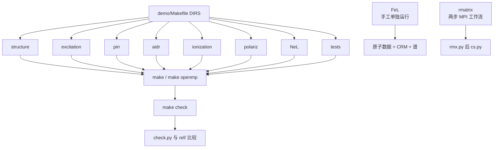
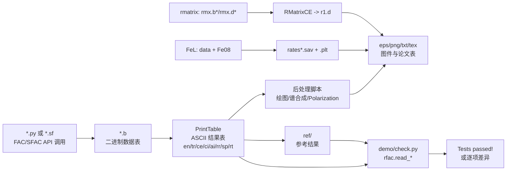

# FAC 示例程序与回归测试总览（`demo/`）

本目录收录 FAC 论文相关的示例脚本及其参考结果，也是一套回归测试集合。多数示例同时提供 Python（`*.py`）和 SFAC（`*.sf`）版本；两者调用 FAC 函数的顺序基本一致，差别是 Python 接口需要 `from pfac import fac` 并加 `fac.` 前缀。

参考结果位于各示例的 `ref/` 子目录；文档基准称源自 FAC 1.1.4，实际参考文件头多为 FAC 1.1.5。`demo/check.py` 用 `rfac.read_*` 解析输出表，并在容差范围内比较当前结果与参考值。

## 1. 环境与构建口径

- 实测环境：WSL Ubuntu 22.04；`gcc 9.5`；`gfortran 11.4`；`Python 3.10`。
- PFAC 编译产物为四个扩展模块：`pfac.fac`、`pfac.crm`、`pfac.pol`、`pfac.util`。
- 实测构建采用两类 ABI/脚本兼容处理：
  1. 构建脚本 CRLF→LF，保证 `#!/bin/sh` 正常执行；
  2. `sysdef.h` 中启用 `#define f2cFortran 1`，固定 C/Fortran 名字修饰与 LOGICAL 传递约定。
- 这些处理只适配编译与链接，**不影响物理公式和数值结果**；原始源码树未修改。
- 运行工作流上的输入依赖不是源码物理改动。例如 [`rmatrix/`](rmatrix/README.md) 必须先运行 `rmx.py` 生成基/表面文件，再运行 `cs.py`；这些文件承载内区本征态与边界振幅，是外区匹配的物理输入。

## 2. 10 个示例一览

| 示例 | 物理场景 | 相对链接 |
|---|---|---|
| `structure` | Ne-like Fe（Fe XVII）能级结构与 `n=2→3` 多极辐射跃迁 | [structure/README.md](structure/README.md) |
| `excitation` | Ne-like Fe 电子碰撞激发，碰撞强度、截面与磁子能级表 | [excitation/README.md](excitation/README.md) |
| `pirr` | Li-like Fe（Fe XXIV）光电离 PI 与辐射复合 RR | [pirr/README.md](pirr/README.md) |
| `aidr` | Ne-like Se 双激发自电离 AI 与双电子俘获 DC 强度 | [aidr/README.md](aidr/README.md) |
| `ionization` | Ne-like Fe 电子碰撞电离 EII 分波截面 | [ionization/README.md](ionization/README.md) |
| `NeL` | Ne VIII 简单碰撞辐射模型与谱合成闭环 | [NeL/README.md](NeL/README.md) |
| `FeL` | 碰撞电离等离子体中 Fe-L 壳 X 射线/EUV 谱，CE/CI/RR/DR/AI 统一建模 | [FeL/README.md](FeL/README.md) |
| `polariz` | He-like Fe 谱线偏振，磁子能级布居与取向 | [polariz/README.md](polariz/README.md) |
| `rmatrix` | He-like O 的 Dirac R 矩阵电子碰撞激发 | [rmatrix/README.md](rmatrix/README.md) |
| `tests` | 哈密顿量对角化、Maxwell 速率与简单 CRM 底层测试 | [tests/README.md](tests/README.md) |

顶层 [`Makefile`](Makefile) 当前为：

```make
DIRS = structure excitation pirr aidr ionization polariz NeL tests
```

因此 [`FeL/`](FeL/README.md) 因计算量大被排除在每日测试之外；[`rmatrix/`](rmatrix/README.md) 也不在 `DIRS` 中，需按专门的两步 MPI 工作流运行。

### 2.1 全量执行结果总览

10 个示例均已完成实测。8 个日常示例共 **22 项 `check.py` 比对全部通过**；`FeL` 与 `rmatrix` 没有官方 `ref/`，只做产物完整性与物理合理性检查。

| 示例 | 实测命令（脚本位于对应示例目录） | 退出码 | 验证结论 | 主要产物 / 证据要点 |
|---|---|---|---|---|
| [`structure`](structure/README.md) | `python fe17_structure.py`；可加 `openmp` | `EXIT=0` | `ne.lev`、`ne.tr` 2 项通过 | 脚本 stdout 为空；两条 check 仅打印文件名且无异常；耗时未记录 |
| [`excitation`](excitation/README.md) | `python fe17_excitation.py`；`python fe17_excitationM.py` | `EXIT=0` | `ne.ce`、`ne.ceM`、`ne.lev` 3 项通过 | 两个脚本 stdout 为空；三条 check 无异常；耗时未记录 |
| [`pirr`](pirr/README.md) | `python fe24_pirr.py` | `EXIT=0` | `li.lev`、`li.rr` 2 项通过 | 运行与比对均返回 0；耗时未记录 |
| [`aidr`](aidr/README.md) | `python se_ai.py` | `EXIT=0` | `se.lev`、`se.ai` 2 项通过 | 运行与比对均返回 0；耗时未记录 |
| [`ionization`](ionization/README.md) | `python fe17_ionization.py`；可加 `openmp` | `EXIT=0` | `ne_f.lev`、`ne.ci` 2 项通过 | RUN/CHECK 均明确记录 `EXIT=0`；耗时未记录 |
| [`NeL`](NeL/README.md) | `python ne.py`；`python spec.py` | `EXIT=0` | `Ne03a.ce/en/rt/sp/tr`、`Ne03b.ham` 6 项通过 | `ne.py` 14 行控制台输出与 `spec.py` 迭代历史均与实测一致；耗时未记录 |
| [`polariz`](polariz/README.md) | `python data.py`；`python pol.py` | `EXIT=0` | `ta.en`、`ta.tr`、`ta.ce` 3 项通过 | `data.py` stdout 为空、`pol.py` 布居迭代收敛；`pop.txt`/`pol.txt` 非回归；耗时未记录 |
| [`tests`](tests/README.md) | `python simple_crm.py`；`python diag_hamiltonian.py`；`python maxwell_rate.py` | `EXIT=0` | `diagh_O_a.en`、`O.sp` 2 项通过 | 三条 RUN 与两条 CHECK 均返回 0；Maxwell 中间表无基准；耗时未记录 |
| [`FeL`](FeL/README.md) | `python fe.py` → `python spec.py`（8 线程） | `FE_EXIT=0`、`SPEC_EXIT=0` | 无官方 `ref/`；产物与物理合理性检查通过 | `data/` 36 文件约 3.66 GB；`Fe08/` 210 文件约 19.2 GB；16 条 `Fe07b.en` 缺失警告非致命 |
| [`rmatrix`](rmatrix/README.md) | `python rmx.py` → `python cs.py`（16 线程，复用 `rmx.b*`/`rmx.d*`） | `CS_EXIT=0` | 无官方 `ref/`；产物与物理合理性检查通过 | `r1.d` 928,130,571 字节（约 886 MiB）、12,890,917 行；17 个跃迁 × 121214 能量点，560–720 eV |

长耗时示例于 `2026-11-25T02:00:58+08:00` 至 `2026-11-25T04:40:40+08:00` 并行调度，总墙钟 `2 h 39 min 42 s`。`rmatrix/cs.py` 约 `02:01` 开始、`04:01:28` 结束，日志末行 `Time = 7.22908E+03`（约 `2 h 0 min 29 s`）；`FeL/fe.py` 约 `02:01` 至 `04:27`（三段 `Total Time` 为 `1817 s`、`1466 s`、`671.7 s`），`spec.py` 约 `04:27` 至 `04:40:23`（约 `13 min`）。三项退出码 `CS_EXIT`、`FE_EXIT`、`SPEC_EXIT` 均为 `0`。

早期汇总记录中的 `rmatrix` SIGSEGV 与 `FeL` 未运行状态已被本轮实测取代；当前结论以本表和各示例 README 的执行记录为准。

## 3. 通用工作流

在 `demo/` 顶层：

```bash
make            # 依次进入 DIRS 各目录执行 make
make openmp     # 向支持 openmp 分支的脚本传递 openmp 参数
make check      # 依次与 ref/ 中参考结果比对
make clean      # 清理示例输出与 *.b
make ref        # 用当前结果覆盖 ref/；需谨慎使用
```

在单个示例目录：

```bash
python xxx.py               # 运行 Python 版
python xxx.py openmp        # 支持的脚本进入 MPI/OpenMP 分支
sfac xxx.sf                 # 运行 SFAC 版，若该目录提供
python ../check.py <结果> ref/<结果>
```

通用目录模式：

- `*.py` / `*.sf`：主脚本；
- `Makefile`：定义 `RESULTS` 和 `SCRIPTS`；
- `ref/`：参考结果及格式说明；
- `*.b`：FAC 二进制表；
- `*.en/.tr/.ce/.ci/.ai/.rr/.sp/.rt`：可读结果表。

## 4. Mermaid 总览流程图



## 5. Mermaid 总数据流图



## 6. 物理效应索引

| 物理效应 | 基本公式 | 示例 |
|---|---|---|
| 相对论原子结构 | $\hat H\Psi=E\Psi$，$H=\sum_i H_D(i)+\sum_{i<j}r_{ij}^{-1}$ | [`structure`](structure/README.md)、[`NeL`](NeL/README.md) |
| 辐射跃迁 | $gA_{fi}=2\alpha^3\omega^2gf_{fi}$ | [`structure`](structure/README.md)、[`FeL`](FeL/README.md) |
| 电子碰撞激发 CE | $\sigma_{ij}=\pi\Omega_{ij}/(k_i^2g_i)$ | [`excitation`](excitation/README.md)、[`rmatrix`](rmatrix/README.md) |
| 电子碰撞电离 CI/EII | $\sigma^{\rm CI}_{ij}=\Omega_{ij}/(k_i^2g_i)$ | [`ionization`](ionization/README.md)、[`FeL`](FeL/README.md) |
| 光电离 PI / 辐射复合 RR | $\sigma_{\rm RR}\propto(\omega^2/\varepsilon)\sigma_{\rm PI}$ | [`pirr`](pirr/README.md)、[`FeL`](FeL/README.md) |
| 自电离 AI / 双电子复合 DR | $A^a\propto|\langle\psi_f,\kappa|V|\psi_i\rangle|^2$，DR $\propto S_{\rm DC}B(i)$ | [`aidr`](aidr/README.md)、[`FeL`](FeL/README.md) |
| CRM 稳态布居 | $\sum_j n_jR_{j\to i}=n_i\sum_jR_{i\to j}$ | [`NeL`](NeL/README.md)、[`FeL`](FeL/README.md)、[`tests`](tests/README.md) |
| 谱合成 | $S(\omega)=\sum_{i>j}n_iA_{ij}\phi(\omega-\omega_{ij})$，线积分光度 photons/s（含线型 $\phi$ 时为光子数/频率） | [`NeL`](NeL/README.md)、[`FeL`](FeL/README.md) |
| 谱线偏振 | $P=(I_\parallel-I_\perp)/(I_\parallel+I_\perp)$；FAC 还输出球张量比 | [`polariz`](polariz/README.md) |
| R 矩阵 | $R_{ij}(E)=\frac{1}{2a}\sum_k w_{ik}w_{jk}/(E_k-E)$ | [`rmatrix`](rmatrix/README.md) |

`SpecTable` 在 `TYPE≠0` 线发射块中的 `strength` 是 photons/s，不含 $\hbar\omega$（`TYPE=0` 布居块的同一字段是能级布居 $N_i$）。若比较能量发射率，必须再乘 $h\nu$。注意 `rfac.read_sp()` 只解析 ASCII 前 6 列且键名为历史误命名，完整列语义见 [`NeL/README.md`](NeL/README.md) §7。

## 7. `check.py` 比对逻辑

[`check.py`](check.py) 将 `../python`、`../../python` 加入 `sys.path`，然后 `from rfac import *`。它根据文件名后缀/扩展名分派到不同校验函数：

- `.en` / `lev`：能级；
- `.tr`：辐射跃迁；
- `.ce` / `.ceM`：碰撞激发；
- `.ci`：碰撞电离；
- `.rr`：辐射复合/光电离；
- `.ai`：自电离；
- `.sp`：谱；
- `.rt`：速率矩阵；
- `.ham`：哈密顿量矩阵。

比对时忽略版本和时间戳；`E0` 通常允许 1% 相对误差，能量、速率、碰撞强度、截面等按类型设置不同 `atol/rtol`。为兼容 MPI/OpenMP 导致的行序变化，`check_ai/check_tr/check_ce/check_ci/check_rr` 会先按能级或分波索引排序。

## 8. PFAC 线程安全与并行注意

- PFAC 不是线程安全模块；不要用 Python 多线程并发调用同一 PFAC 实例。
- 支持 `openmp` 参数的示例会调用 `fac.InitializeMPI(2)` / `fac.FinalizeMPI()`；不支持的脚本即使传参也不进入并行分支。
- [`rmatrix`](rmatrix/README.md) 例外：脚本硬编码 `InitializeMPI(16)`，且必须按 `rmx.py` → `cs.py` 顺序运行。
- [`FeL`](FeL/README.md) 例外：原脚本忽略 `make openmp` 的参数，实测并行来自适配脚本内的 `fac.InitializeMPI(8)`；无官方 `ref/`，不参与 `make check`。
- 并行可能改变输出行顺序，`check.py` 已针对常见表做排序。
- 建议先用 `make check` 检查环境，再运行单个示例；`make ref` 会覆盖基准，需谨慎。

## 9. README 维护记录（自底向上）

- **定位与职责**：`demo/` 是示例与回归入口，将底层 API 组合为可复现的物理工作流。
- **底层依据**：`check.py`、`Makefile`、`Make.common` 与各示例脚本；公式证据回溯到 `faclib/`、`modqed/`、`coul/`、`ionis/`、`mpfun/`。
- **输入/输出**：输入脚本参数、组态与网格；输出 `.en/.tr/.ce/.ci/.rr/.ai/.sp/.rt/.ham` 及辅助图件。
- **验证与回归**：8 个日常示例共 22 项 `check.py` 比对通过；两个长耗时任务无官方基准，只做产物与物理合理性检查。
- **已知限制**：PFAC 非线程安全；`make ref` 会覆盖基准；死键与弱线容差会让“通过”意义有限；耗时未记录时不得编造。
- **公式核查**：本目录公式为物理原型索引；逐条源码命中与下划线注记以对应底层目录 README 为准，不在这里重复判定。
- **导航**：父级 [`../README.md`](../README.md)；核心库 [`../faclib/README.md`](../faclib/README.md)；工具 [`../scripts/README.md`](../scripts/README.md)；场景 [`../scenarios/README.md`](../scenarios/README.md)。

[返回上级](../README.md)