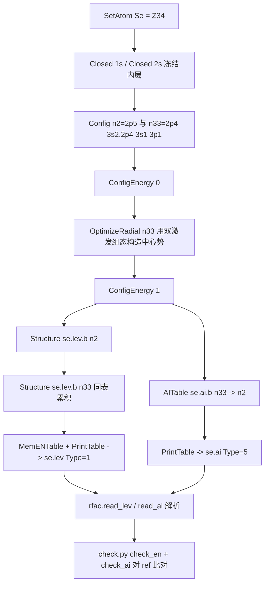
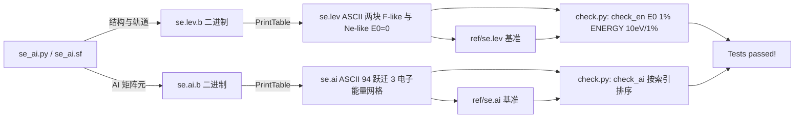

# demo/aidr —— Ne-like Se 双激发态自电离与双电子俘获（AI/DC）

本文件为完整重写的中文说明，面向 Agent 精确执行与复核。所有相对链接以本目录 `demo/aidr/` 为基准。

## 1. 物理场景

计算 **Ne-like Se（Se XXV）** 双激发态的自电离（autoionization, AI）率及逆过程双电子俘获（dielectronic capture, DC）强度。体系为 F-like Se 残余离子（`2p5`）加自由电子构成的连续态，与 Ne-like Se 双激发束缚态（`2p4 3s2`、`2p4 3s1 3p1`）之间的电子–电子关联跃迁。内层 `1s`、`2s` 由 `Closed` 冻结。

> **重要更正**：物理离子是 **Ne-like Se = Se XXV**（Se 的 Z=34，Ne-like 保留 10 个电子，电荷态 +24，光谱记号 XXV）。旧版 README 写作 “Se XXXIII” 是**错误**的（XXXIII 对应电荷 +32、仅 2 电子的 He-like Se），在此明确修正。全文一律以 Se XXV 为准。

这是 CPC 论文 `../../doc/papers/aidr.tex`（*The Flexible Atomic Code: IV. Autoionization and Dielectronic Recombination*）的基准算例；论文摘要与 Results 节明确以 Ne-like selenium 的自电离率与既有工作对比（`aidr.tex:19-33, 209-218`）。与 `../pirr/` 互补：`pirr/` 是非共振 RR/PI，`aidr/` 是共振（双激发）过程的基石。

## 2. 物理效应：简介 + LaTeX 公式 + 出处 + 源码映射

### 2.1 相对论原子结构与双激发态能级（CI）

- 简介：束缚态由 Dirac–Fock–Slater 自洽势 + 组态混合对角化得到；本例关键是**用双激发组态 `n33` 构造最优中心势**以便与 Oreg 等人结果对比（`aidr.tex:212-218`）。F-like 与 Ne-like 双激发两组写入同一 `se.lev.b`，保证后续 AI 矩阵元使用一致轨道基。
- 公式（出处 `../../doc/papers/structure.tex:118-130`）：

$$
H=\sum_i H_D(i)+\sum_{i<j}\frac{1}{r_{ij}},\qquad
\hat H_{\rm DC}\psi_i=E_i\psi_i,\qquad
E_i=\langle\psi_i|\hat H_{\rm DC}+\hat H_{\rm Breit}+\hat H_{\rm QED}|\psi_i\rangle .
$$

- 源码映射：[se_ai.py](se_ai.py):10-24（`Closed`/`Config`/`ConfigEnergy`/`OptimizeRadial`/`Structure`/`MemENTable`）；`../../doc/manual.tex:229-245, 2664-2681, 2876-2880`；`../../python/rfac.py:511 read_lev()`；`../check.py:96 check_en()`。脚本未显式开关 Breit/QED，具体修正按源码核对。

### 2.2 自电离（Auger 衰变）率 A^a

- 简介：双激发态经电子–电子关联 $1/r_{ij}$ 跃迁到“少一个电子的残余离子 + 自由电子”连续态，是辐射无电子俘获的逆过程；率由费米黄金规则给出，连续电子波函数按相对论扭曲波归一化（`aidr.tex:65-70, 89-97`）。
- 公式（出处 `aidr.tex:89-97`）：

$$
A^{a}=2\sum_{\kappa}\Big|\Big\langle\psi_f,\kappa;J_TM_T\Big|\sum_{i<j}\frac{1}{r_{ij}}\Big|\psi_i\Big\rangle\Big|^2,\qquad J_T=J_i,\ M_T=M_i .
$$

经角向/径向分离化为 Slater 型径向积分之和（`aidr.tex:98-121`）。常见黄金规则写法 $A^a_{i\to f}=\tfrac{2\pi}{\hbar}|\langle\Phi_f^{E}|V|\Psi_i\rangle|^2$ 与其等价，单位/归一化以论文原子单位式为准。
- 源码映射：[se_ai.py](se_ai.py):26-27 的 `fac.AITable('se.ai.b',['n33'],['n2'])`；`../../doc/manual.tex:2465-2470`（`AITable(fn,b,f[,c])`）、`manual.tex:392-393`（`DB_AI = 5`）、`manual.tex:1908`（`DB_AI` ASCII 格式）；`../../python/rfac.py:761 read_ai()`；`../check.py:106 check_ai()`。

### 2.3 双电子俘获强度 S_DC 与 DR 分支比

- 简介：AI 的逆过程是辐射无电子俘获（DC）；共振极窄，实用上用能量积分的共振强度 $S_{\rm DC}$ 表征，由详细平衡与 AI 率联系。随后 AI 与辐射衰变竞争，DR 分支比 $B(i)$ 决定复合是否完成（`aidr.tex:123-171`）。
- 公式（出处 `aidr.tex:130-135, 143-157`）：

$$
S_{\rm DC}=\frac{g_i}{2g_f}\,\frac{\pi^{2}}{E_{if}}\,A^{a},
$$

$$
B(i)=\frac{\sum_k A^r(i\to k)+\sum_a A^r(i\to a)B(a)}
{\sum_{k'}A^a(i\to k')+\sum_k A^r(i\to k)+\sum_a A^r(i\to a)},\qquad
S_{\rm DR}=S_{\rm DC}\,B(i).
$$

- 源码映射：[se_ai.py](se_ai.py):26 `AITable` 输出第 7 列 `DC strength`（`manual.tex:2472-2475`）；`../../python/rfac.py:804-805`（`AI rate`、`DC strength` 字段）；完整 DR 速率系数另由 `fac.DRStrength`/`fac.MaxwellRate` 处理（`manual.tex:401, 2853-2860`），**本示例只算到 AI/DC 层级**。

## 3. 逐文件说明（含相对链接）

- [se_ai.py](se_ai.py)：Python（pfac）主脚本。`SetAtom('Se')`；`Closed('1s')`、`Closed('2s')`；`n2='2p5'`、`n33='2p4 3s2','2p4 3s1 3p1'`（一个 `Config` 给出多个组态串）；`OptimizeRadial('n33')`；两次 `Structure` 写同一 `se.lev.b`；`AITable('se.ai.b',['n33'],['n2'])`。无外部输入，无 `sys.argv`/MPI 分支。
- [se_ai.sf](se_ai.sf)：SFAC 版等价脚本，`sfac se_ai.sf` 运行；裸调用、无 import、无 `fac.` 前缀，其余与 Python 版逐行对应。
- [Makefile](Makefile)：`RESULTS = se.ai se.lev`，`SCRIPTS = se_ai.py`，`include ../Make.common`。
- [ref/README.md](ref/README.md)：参考结果格式与容差说明；基准文件 [ref/se.lev](ref/se.lev)、[ref/se.ai](ref/se.ai)（文件头 `FAC 1.1.5`）。
- 上游依赖（相对链接）：`../check.py`、`../Make.common`、`../README.md`、`../../python/rfac.py`、`../../doc/manual.tex`、`../../doc/papers/aidr.tex`、`../../faclib/recombination.c`（`AITable` 实现）。

## 4. 真实 pfac API 调用链

`se_ai.py`（逐行对应源码）：

```
from pfac import fac
fac.SetAtom('Se')
fac.Closed('1s')
fac.Closed('2s')
fac.Config('2p5', group='n2')
fac.Config('2p4 3s2', '2p4 3s1 3p1', group='n33')
fac.ConfigEnergy(0)
fac.OptimizeRadial('n33')
fac.ConfigEnergy(1)
fac.Structure('se.lev.b', ['n2'])
fac.Structure('se.lev.b', ['n33'])
fac.MemENTable('se.lev.b')
fac.PrintTable('se.lev.b', 'se.lev', 1)
fac.AITable('se.ai.b', ['n33'], ['n2'])
fac.PrintTable('se.ai.b', 'se.ai', 1)
```

要点：两次 `Structure` 必须写同一 `se.lev.b`；`AITable` 参数顺序为（双激发组态 `n33` → 残余离子组态 `n2`），颠倒会得到相反过程。

## 5. Mermaid FAC 使用流程图



## 6. Mermaid 数据流图



## 7. 执行记录与命令

**实测环境**：WSL Ubuntu-22.04；gcc 9.5.0；gfortran 11.4.0；Python 3.10.12；PFAC 四个扩展模块编译成功。构建兼容处理见第 10 节。

**实测命令**（在 `demo/aidr/` 中，`PYTHONPATH` 指向已构建的 PFAC 模块）：

```bash
python se_ai.py
python ../check.py se.lev ref/se.lev
python ../check.py se.ai  ref/se.ai
# 或 make / make check / make ref / make clean
sfac se_ai.sf   # SFAC 版
```

**实测结果**：`se_ai.py` 与两条 check 均 `EXIT=0`；实测汇总为 `RUN aidr/se_ai.py EXIT=0`、`CHECK aidr/se.ai EXIT=0`、`CHECK aidr/se.lev EXIT=0`。**耗时未记录**，不推断墙钟时间。

> `make openmp` 在本目录仍执行 `python se_ai.py`，脚本无 OpenMP 分支。

## 8. 输出清单与单位

| 文件 | 类型 | 头部关键字段 | 主要列 / 单位 |
|---|---|---|---|
| `se.lev.b` / `se.lev` | Type=1 能级表 | `NBlocks=2`，`E0=0, -5.33765354E+04`；块1 `NELE=9,NLEV=2`（F-like `2p5` 双重态），块2 `NELE=10,NLEV=47`（Ne-like 双激发态） | `ILEV IBASE ENERGY P VNL 2J` + 组态名串；`ENERGY`、`E0` 为 **eV**（ASCII verbose 乘 `HARTREE_EV`，`dbase.c:5371-5374`） |
| `se.ai.b` / `se.ai` | Type=5 AI 表 | `NELE=10`、`NTRANS=94`、`EMIN=0`、`NEGRID=3`（能量点 `3.43465875E+02`/`4.37811295E+02`/`5.56958685E+02`） | 每行 7 列 `bound_index bound_2J free_index free_2J Delta E AI rate DC strength`；`EGRID`/`Delta E` 为 **eV**（`dbase.c:6466` verbose 输出 `EGRID*HARTREE_EV`）；`AI rate` 为 **s⁻¹**（由原子单位换算）；`DC strength` 为 **10⁻²⁰ eV·cm²**（`manual.tex:1672-1674`，非无量纲） |

参考文件：[ref/se.lev](ref/se.lev)、[ref/se.ai](ref/se.ai)。版本/时间戳被 `check.py` 忽略。

## 9. check.py 比对结果

- 分派：`../check.py:235` 后缀 `.ai` → `check_ai()`（第 106 行）、`lev` → `check_en()`（第 96 行）。
- `check_ai()`：先按 `bound_index`/`free_index` 排序（兼容 OpenMP 乱序，`_sort_array` 第 71 行）；再逐块比较：`AI rate` 相对误差 **5%**、默认 `atol=1e-8`；`DC strength` 相对 5%；`Delta E` `atol=0.5`、`rtol=0.01`；`EGRID` 相对 1%。
- **死键说明**：`../check.py:116-119` 的 `atols={'rate':1.0e1,...}`、`rtols={'rate':0.05,...}` 中键 `rate` 是遗留死键——`../../python/rfac.py:761 read_ai()` 返回的键为 `AI rate`（第 804 行），并无 `rate`，因此 `rate` 的 atol/rtol **不会命中**；实际 `AI rate` 的容差来自 `rtols['AI rate']=0.05` 与 `_check_block` 默认 `atol=1e-8`。即有效 AI 率判据为 rtol=5%/atol=1e-8。
- `check_en()`：`NBlocks` 相等、`E0` 相对 1%；`ENERGY` `atol=10`、`rtol=0.01`；字符串列逐字一致。
- **实测**：`se.lev`、`se.ai` 两项均通过（`EXIT=0`），本目录合计 **2 项检查通过**。早期全量汇总中的 rmatrix SIGSEGV 与 FeL 未运行状态属于阶段性历史，已被后续夜间实测取代，不影响本例结论。

## 10. 限制与构建兼容处理说明

- 限制：本示例只产出 AI 率/DC 强度，完整 DR 速率系数需另组合辐射率 $A^r$ 与分支比（见 `aidr.tex` 与手册 `DRStrength`）；`VNL` 列含义以 `rfac.read_lev()` 表格定义为准。脚本无 OpenMP 分支。
- 基准版本：`../README` 称基准来自 FAC=1.1.4，实际文件头为 `FAC 1.1.5`；比对脚本忽略版本/时间戳。不要手工打乱 `ref/` 行序，`check_ai` 依赖按索引重排。
- **记号更正**：物理离子为 Se XXV（Ne-like），旧 README 的 “Se XXXIII” 为笔误，已在本文件修正。
- **构建兼容处理（不改变物理，仅构建/ABI）**：实测 Linux/WSL 构建采用两类处理：
  1. `configure`、`install.sh`、`mkinsdir.sh`、`config.guess`、`config.sub` 由 CRLF 归一为 LF，修复 `#!/bin/sh` 执行失败；
  2. `sysdef.h` 中 `#undef f2cFortran` 改为 `#define f2cFortran 1`，固定 C/Fortran 的 f2c 风格函数名修饰与 LOGICAL 约定；
  **原始源码树未修改**。这些处理只影响编译与链接 ABI，不触碰物理模型或数值；本目录 2 项 `ref/` 比对全部通过。