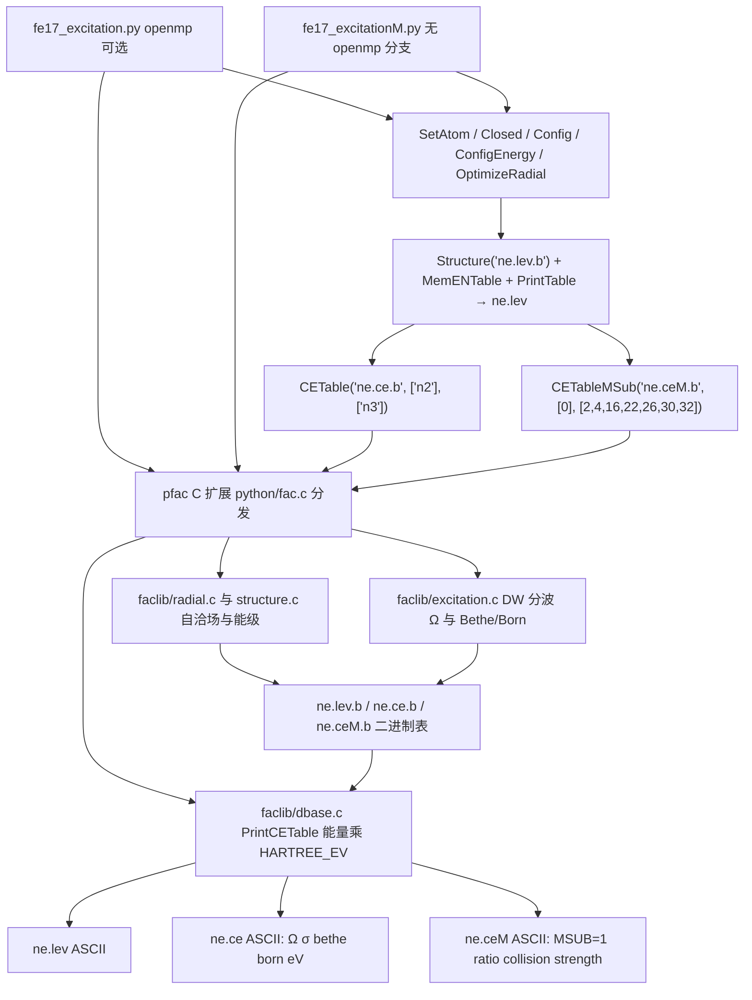
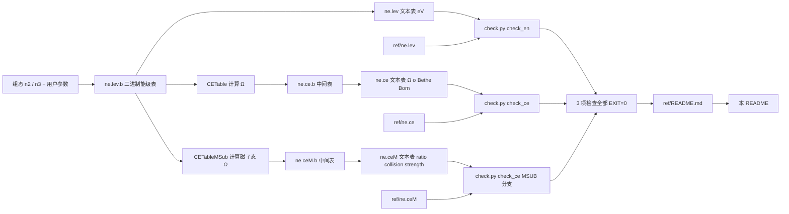

# demo/excitation —— Ne-like Fe 电子碰撞激发

本文件是 `demo/excitation/` 的自包含说明：物理问题、公式出处、源码映射、逐文件说明、完整 pfac API 调用链、两张 Mermaid 图、实际执行记录、`check.py` 比对结果与容差、已知限制，以及构建兼容处理说明。所有路径相对本文件所在的仓库根 `src/fac/`。

## 1. 物理场景与科学问题

- **离子与电荷态**：类氖铁 Fe XVII（Ne-like Fe），$Z=26$，10 电子，电荷态 $+16$；`1s` 冻结。末态组态同 `structure/`，共 37 个精细结构能级。
- **跃迁类型**：**电子碰撞激发**（EIE, electron impact excitation），从基组态 `n2 = 2*8`（$2s^22p^6$）到激发组态 `n3 = 2*7 3*1`（$2s^22p^53s/3p/3d$）的 **36 条**跃迁（`ne.ce` 中 `NTRANS=36`，`MSUB=0`）；另给出从能级索引 0 到 {2,4,16,22,26,30,32} 共 **7 条**跃迁的**磁子能级（$M_J$）分辨**碰撞强度（`ne.ceM`，`MSUB=1`、`PWTYPE=1`）。
- **能量范围**：`ne.ce` 头部 `NTEGRID=2`（温度网格 `7.24092437E+02`、`9.44031529E+02`）、`TE0=8.34061980E+02`、`ETYPE=1`、`NEGRID=6`，均为 **eV**（`faclib/dbase.c:5725-5747` 在 verbose 输出乘 `HARTREE_EV`）。碰撞能量覆盖从阈值附近到数倍阈值的入射电子能量；Magnesium-like 的高能区由 Bethe/Born 系数外推。
- **科学问题**：在相对论扭曲波（DW）近似下计算 $\Omega$ 与 $\sigma$，验证 FAC 的因子化–插值碰撞强度算法；`ne.ceM` 是 `demo/polariz/` 偏振计算的输入类型，起桥梁作用。对应论文 `doc/papers/excitation.tex`（Results 节即 Ne-like iron 的全部 $2\to3$ 激发截面）。

## 2. 涉及的物理效应、LaTeX 公式、出处与源码映射

### 2.1 相对论自洽场与能级（复用 structure）

- **公式**：$\hat H\Psi=E\Psi$，$H=\sum_i H_D(i)+\sum_{i<j}1/r_{ij}$（出处 `doc/papers/structure.tex:118-130`）；势优化与能量修正见 `doc/manual.tex:229-245`、`:2664-2681`。
- **源码映射**：`faclib/radial.c`、`faclib/structure.c`；解析 `python/rfac.py:511 read_lev()`；比对 `demo/check.py:96 check_en()`。

### 2.2 电子碰撞激发截面（含 π）

- **物理效应**：入射电子使离子 $i\to j$，DW 近似下分波展开求碰撞强度 $\Omega$，再换算截面；高能区用 Coulomb–Bethe 近似补齐大角动量分波（`doc/papers/excitation.tex:91-95`、`:367-369`）。
- **公式**（出处 `doc/papers/excitation.tex:109-142`，原子单位；**注意 CE 截面含 $\pi$**：式 114）：

$$
\sigma_{01}=\frac{\pi}{k_0^2 g_0}\,\Omega_{01},\qquad
k_0^2=2\varepsilon_0\left(1+\frac{\alpha^2}{2}\varepsilon_0\right),
$$

$$
\Omega_{01}=2\sum_{\kappa_0\kappa_1}\sum_{J_T}[J_T]\,
\Big|\langle\psi_0\kappa_0,J_TM_T|\sum_{i<j}\tfrac{1}{r_{ij}}|\psi_1\kappa_1,J_TM_T\rangle\Big|^2,
$$

其中 $g_0=2J_0+1$，$[J_T]=2J_T+1$。因子化进一步形式见 `doc/papers/excitation.tex:143-150`。Maxwell 速率系数形式 $q_{ij}=\sqrt{8/(\pi m_e)}(kT)^{-3/2}\int_0^\infty\sigma_{ij}(E)Ee^{-E/kT}dE$（API `fac.CERate`/`fac.MaxwellRate`，`doc/manual.tex:2564-2573`、`:2853-2860`，归一化按源码核对）。
- **对比**：**EII 截面没有 $\pi$ 因子**（`doc/papers/ionization.tex:99-101`，源于自由/束缚轨道归一化不同），CE 则有，见 [../ionization/README.md](../ionization/README.md)。
- **源码映射**：`faclib/excitation.c`（`CETable`/`CETableMSub`）、`faclib/dbase.c:5778-5814`（`PrintCETable` 输出 $\Omega$、$\sigma$、Bethe/Born，能量乘 `HARTREE_EV`）；`faclib/rates.c`；解析 `python/rfac.py:810 read_ce()`；比对 `demo/check.py:138 check_ce()`。

### 2.3 磁子能级分辨激发与偏振

- **物理效应**：按 $M_J$ 展开 $\Omega_{iM_i\to jM_j}$，用于线偏振与磁场/电子束各向异性模型；本例 `CETableMSub` 只选 7 个上能级以控制计算量。
- **公式**（示意，归一化约定论文/手册未逐字给出，需按源码核对）：$\Omega_{ij}=\dfrac{1}{g_i}\sum_{M_iM_j}\Omega_{iM_i\to jM_j}$，再用 $\Omega(J_iM_i\to J_jM_j)$ 与偶极矩阵元求偏振度。
- **源码映射**：`faclib/excitation.c`（`CETableMSub`）；`doc/manual.tex:2590-2594`、`:4460-4466`；`demo/polariz/pol.py` 用 `SetMCERates('tb.ce')` 消费此类表；`python/rfac.py:871-891`（`MSUB` 分支解析）。

### 2.4 高能 Bethe/Born 渐近系数

- **公式**（示意，`doc/papers/excitation.tex:91-95` 仅在文字层说明 Coulomb–Bethe 近似）：$\Omega(E)\sim c_{\rm Bethe}\ln E+c_{\rm Born}^{(0)}+c_{\rm Born}^{(1)}/E$；确切列定义见 `python/rfac.py:863-865`、`:908-909` 与 `doc/manual.tex:1762`（`DB_CE` 表格）。
- **源码映射**：`faclib/dbase.c:5781-5782` 打印 `bethe`、`born0`、`born1`。

### 2.5 单位约定

- ASCII 表中 `Delta E`、`TEGRID`、`TE0`、`EGRID`、`USR`、能量列均为 **eV，不是 Hartree**：`faclib/dbase.c:5371-5374`、`:5725-5747`、`:5778-5814` 在 verbose 分支统一乘 `HARTREE_EV`。二进制 `.b` 内为原子单位。

### 2.6 映射总表

| 物理环节 | 用户 API | pfac 层 | faclib 核心文件 | 输出 |
|---|---|---|---|---|
| 结构/势 | `Config`, `ConfigEnergy`, `OptimizeRadial`, `Structure` | `python/fac.c` | `faclib/radial.c`, `faclib/structure.c` | `ne.lev.b`, `ne.lev` |
| EIE 全组态 | `CETable` | `python/fac.c` | `faclib/excitation.c`, `faclib/dbase.c` | `ne.ce.b`, `ne.ce` |
| EIE 磁子态 | `CETableMSub` | `python/fac.c` | `faclib/excitation.c`, `faclib/dbase.c` | `ne.ceM.b`, `ne.ceM` |
| 解析/比对 | — | `python/rfac.py read_ce()` | — | `demo/check.py check_ce()` |

## 3. 逐文件说明

- **[fe17_excitation.py](fe17_excitation.py)**：Python 版主路径。能级部分复用 structure；`fac.CETable('ne.ce.b', ['n2'], ['n3'])` 生成 36 条跃迁的 $\Omega$、$\sigma$、Bethe/Born。支持 `openmp`（第 7–13、32–33 行，`InitializeMPI(2)`）。
- **[fe17_excitation.sf](fe17_excitation.sf)**：对应 SFAC 版，裸调用、无流程控制/MPI。
- **[fe17_excitationM.py](fe17_excitationM.py)**：`fac.CETableMSub('ne.ceM.b', [0], [2,4,16,22,26,30,32])` 生成 7 条磁子能级分辨跃迁。**本脚本没有 `sys.argv`/`InitializeMPI` 分支**，`make openmp` 传来的 `openmp` 参数被忽略，实际仍单进程。
- **[fe17_excitationM.sf](fe17_excitationM.sf)**：对应 SFAC 版。
- **[Makefile](Makefile)**：`RESULTS = ne.ce ne.ceM ne.lev`，`SCRIPTS = fe17_excitation.py fe17_excitationM.py`，`include ../Make.common`。
- **[ref/](ref/README.md)**：`ne.lev`（同 structure，37 能级）、`ne.ce`（Type=3，`MSUB=0`，`NTRANS=36`）、`ne.ceM`（Type=3，`MSUB=1`、`PWTYPE=1`、`NTRANS=7`），文件头 `FAC 1.1.5`。

## 4. 完整 pfac API 调用链（真实函数名与参数含义）

**主脚本 `fe17_excitation.py`**（支持 openmp）：

```python
from pfac import fac
# sys.argv[1]=='openmp' → fac.InitializeMPI(2)
fac.SetAtom('Fe')                        # Z=26
fac.Closed('1s')                         # 冻结 1s
fac.Config('2*8', group='n2')             # 基组态 2s^2 2p^6
fac.Config('2*7 3*1', group='n3')         # 激发组态 2s^2 2p^5 3l
fac.ConfigEnergy(0)
fac.OptimizeRadial('n2')                  # 传组名字符串，与 ['n2'] 列表写法等价
fac.ConfigEnergy(1)
fac.Structure('ne.lev.b')                 # 未显式给组列表，默认全部已定义组
fac.MemENTable('ne.lev.b')
fac.PrintTable('ne.lev.b', 'ne.lev', 1)   # verbose，eV
fac.CETable('ne.ce.b', ['n2'], ['n3'])    # 下/上组态组名列表 → Type=3 表
fac.PrintTable('ne.ce.b', 'ne.ce', 1)     # verbose ASCII：Omega/sigma/Bethe/Born
# 可选 fac.FinalizeMPI()
```

**磁子脚本 `fe17_excitationM.py`**（无 openmp）：前 9 步相同，随后

```python
fac.CETableMSub('ne.ceM.b', [0], [2,4,16,22,26,30,32])
# 参数为能级序号（相对 ne.lev 的 ILEV）列表：初态 [0]，末态 7 个索引
fac.PrintTable('ne.ceM.b', 'ne.ceM', 1)
```

`CETable` 参数是**组态组名**，`CETableMSub` 参数是**能级索引**——二者语义不同，不可混用；索引与具体磁子态的映射需按源码表格定义核对。

## 5. Mermaid FAC 使用流程图



## 6. Mermaid 数据流图



## 7. 执行记录与命令

**实测环境**：WSL Ubuntu-22.04；gcc 9.5；gfortran 11.4；Python 3.10；PFAC 四个扩展模块编译成功。构建兼容处理见第 10 节。

**实测命令**（在 `demo/excitation/` 中）：

```bash
python fe17_excitation.py               # 主路径，36 条 CE
python fe17_excitation.py openmp        # 可选，InitializeMPI(2)
python fe17_excitationM.py              # 7 条磁子态 CE，openmp 参数会被忽略
python ../check.py ne.ce  ref/ne.ce
python ../check.py ne.ceM ref/ne.ceM
python ../check.py ne.lev ref/ne.lev
# 或 make / make openmp / make check / make ref / make clean
```

**实测结果**：两个脚本 `EXIT=0`；`ne.ce`、`ne.ceM`、`ne.lev` 三条 check 均未抛异常，`EXIT=0`。**耗时未记录**，不推断墙钟时间。

**输出清单**：`ne.lev.b`/`ne.lev`（37 能级）、`ne.ce.b`/`ne.ce`（36 条 EIE，Type=3，`MSUB=0`）、`ne.ceM.b`/`ne.ceM`（7 条磁子态 EIE，Type=3，`MSUB=1`、`PWTYPE=1`）。

## 8. 与 ref 的 check.py 比对结果与容差

`demo/check.py:231` 按扩展名分派：`lev` → `check_en()`；`[-3:] in ['.ce','ceM']`（第 241 行）→ `check_ce()`（第 138 行）。`_check_header` 校验 `NBlocks` 相等、`E0` 相对 ≤1%，忽略版本/时间戳。

| 文件 | 检查函数 | 关键容差 | 结果 |
|---|---|---|---|
| `ne.lev` | `check_en()` | `ENERGY` `atol=10`/`rtol=0.01`；`E0` `rtol=0.01` | 通过（3 项检查之一） |
| `ne.ce` | `check_ce()` | 按 `lower_index`/`upper_index` 排序；`collision strength` `atol=1e-3`/`rtol=0.05`；`crosssection` `atol=0.01`/`rtol=0.1`；`bethe`/`born` `rtol=0.05`；`Delta E`/`TEGRID`/`EGRID`/`USR`/`TE0` `atol=1`/`rtol=0.01` | 通过（之二） |
| `ne.ceM` | `check_ce()`（MSUB=1 分支） | 同上，额外比较 `ratio collision strength` `atol=0.1` | 通过（之三） |

**`demo/check.py:155` 的死键（dead key）**：`rtols` 字典中写作 `'ratio collision strenth': 0.05`（漏掉字母 g），而实际数据列名是 `ratio collision strength`。因此该列的**相对容差 `rtol=0.05` 根本不会生效**，`_check_block` 对该键取默认值 `rtol=1e-5`；实际只有 `atols` 中的 `atol=0.1`（第 151 行，键名正确）在起作用。由于本次比对通过，说明真实数据与参考值在该键上足够接近；但应意识到这一拼写错误使回归对该列的相对误差几乎不做限制，后续维护需修正为 `ratio collision strength`。

本例共 **3 项检查，全部通过**，`make check` 打印 `Tests passed!`。

## 9. 已知限制与注意事项

1. `demo/README` 称基准来自 FAC=1.1.4，`ref/` 文件头为 `FAC 1.1.5`；比对忽略版本/`TSess`。
2. 扩展名切片 `actual_file[-3:]` 判定类型，文件名 `ne.ce`/`ne.ceM` 不可改，否则 `demo/check.py:260` 抛 `TypeError`。
3. `make openmp` 会给两个脚本都传 `openmp`，但 `fe17_excitationM.py` 无对应分支，实际仍单进程（主脚本支持 `InitializeMPI(2)`）。
4. OpenMP 行序可能变化，`check_ce` 会按上下能级索引重排；不要手工调整 `ref/` 行序。
5. `ne.ceM` 的索引列表 `[0]`、`[2,4,16,22,26,30,32]` 指向 `ne.lev` 的 `ILEV`；改动结构配置会改变其物理含义。
6. 两个脚本都写 `ne.lev.b`/`ne.lev`，后者覆盖前者但结果应一致；能量、温度、网格单位均为 eV，列含义不确定处按 `python/rfac.py:810 read_ce()` 表格定义核对。
7. CE 截面含 $\pi$（`doc/papers/excitation.tex:114`），与 EII 无 $\pi$ 不同，移植公式时勿混淆。
8. PFAC 非线程安全；并行只能走进程级 MPI/OpenMP。

## 10. 构建兼容处理说明（不涉及物理）

实测 Linux/WSL 构建采用两项兼容处理，**原始源码树未修改**：

1. **构建脚本 CRLF→LF**：仅把 Windows 换行改为 Unix 换行，使 `configure`、`Makefile` 等 shell 脚本能在 WSL 下正确执行；只影响脚本执行，不改变物理模型、数值算法或编译选项。
2. **`sysdef.h` 中 `#define f2cFortran 1`**：只选择 C 与 Fortran 之间的 f2c 风格符号改名与参数传递约定（`cfortran.h` 桥接层），解决 `gcc 9.5`/`gfortran 11.4` 混编的链接/调用匹配问题；不改变 DW 碰撞强度、$\pi\Omega/(k_0^2g_0)$ 或 Bethe/Born 公式。

两项处理的效果已用 `ref/ne.lev`、`ref/ne.ce`、`ref/ne.ceM` 的 `check.py` 比对验证通过（见第 8 节）。