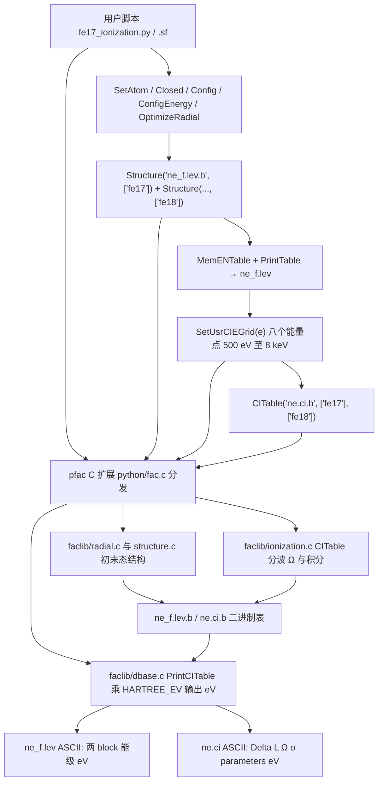
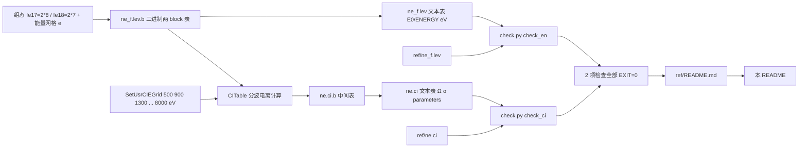

# demo/ionization —— Ne-like Fe 电子碰撞电离

本文件是 `demo/ionization/` 的自包含说明：物理问题、公式出处、源码映射、逐文件说明、完整 pfac API 调用链、两张 Mermaid 图、实际执行记录、`check.py` 比对结果与容差、已知限制，以及构建兼容处理说明。所有路径相对本文件所在的仓库根 `src/fac/`。

## 1. 物理场景与科学问题

- **离子与电荷态**：初态 Ne-like Fe（Fe XVII，$Z=26$、10 电子、电荷态 $+16$，组态 `2*8` 即 $2s^22p^6$）；末态 F-like Fe（Fe XVIII，9 电子、电荷态 $+17$，组态 `2*7` 即 $2s^22p^5$）。`1s` 冻结。
- **跃迁类型**：**电子碰撞电离**（EII, electron impact ionization），入射电子击出束缚电子，末态含两个连续电子；表中 `Delta L` 标记电离电子的轨道角动量分波。
- **能级**：`ne_f.lev` 含 `NBlocks=2`：块 1 为 Ne-like 基态（`NELE=10`、`NLEV=1`），块 2 为 F-like 末态（`NELE=9`、`NLEV=3`，$2p^5$ 双重态与 $2s^1$）。`E0 = 0, -3.12293444E+04`，单位 eV；末态与初态能量差给出电离阈值 $I$。
- **能量范围**：用户自定义入射电子能量网格 `e = [500.0, 900.0, 1.3e3, 1.7e3, 2.1e3, 4.2e3, 6.0e3, 8.0e3]`（脚本第 33 行），即 **500 eV 至 8.0 keV**，覆盖阈值到数倍阈值；`ne.ci` 头部 `NTEGRID=2`、`ETYPE=1`、`NEGRID=6`、`QKMODE=5`、`NPARAMS=4`。网格值经 `faclib/dbase.c` verbose 分支乘 `HARTREE_EV` 后以 eV 打印。
- **科学问题**：验证相对论扭曲波 + 因子化–插值方法对双连续电子末态截面的计算；结果用于碰撞–辐射模型中的电离速率系数。

## 2. 涉及的物理效应、LaTeX 公式、出处与源码映射

### 2.1 电离阈值与初末态结构

- **公式**：$I_i=E_{\rm ion}^{(N-1)}+E_e-E_i^{(N)}$（连续态能量守恒）；阈值由 `ne_f.lev` 两块的能级差给出。
- **源码映射**：`fe17_ionization.py:19-30`；`faclib/structure.c`、`faclib/dbase.c:5371-5374`（eV）；`python/rfac.py:511 read_lev()`；`demo/check.py:96 check_en()`。

### 2.2 电子碰撞电离截面（**无 π**）

- **物理效应**：相对论扭曲波（DW）近似，把束缚轨道换为出射电子的自由轨道并对角动量求和；径向积分 $Q^k$ 在 $I$、$\varepsilon_1$、$\varepsilon$ 三维网格上计算并插值（`doc/papers/ionization.tex:18-34`、`:84-116`、`:154-162`）。
- **公式**（出处 `doc/papers/ionization.tex:92-95` 式 `eq_cross`、`:99-101`、`:149-153` 式 `eq_total`）：

$$
\sigma(\varepsilon_0,\varepsilon)=\frac{1}{k_0^2 g_0}\,\Omega_{01},
$$

**EII 截面没有 $\pi$ 因子**——论文第 99–101 行明确指出，与 EIE 公式的差异源于自由轨道与束缚轨道归一化不同（对照 [../excitation/README.md](../excitation/README.md) 中 CE 的 $\sigma=\pi\Omega/(k_0^2g_0)$）。总截面：

$$
\sigma(\varepsilon_0)=\int_{0}^{(\varepsilon_0-I)/2}\sigma(\varepsilon_0,\varepsilon)\,d\varepsilon .
$$

碰撞强度 $\Omega_{01}=2\sum_{\kappa,J_T\atop k,\alpha_0\beta_0}Q^k(\alpha_0\kappa;\beta_0\kappa)\langle\psi_0\|Z^k(\alpha_0,\kappa)\|\psi_1,\kappa;J_T\rangle\langle\psi_0\|Z^k(\beta_0,\kappa)\|\psi_1,\kappa;J_T\rangle$（`doc/papers/ionization.tex:103-109`）。
- **源码映射**：`fe17_ionization.py:33-36` 的 `SetUsrCIEGrid` + `fac.CITable('ne.ci.b',['fe17'],['fe18'])` + `PrintTable`；`faclib/ionization.c`（`CITable`）；`faclib/dbase.c:6126-6128` 打印 `bound_index free_index Delta E vnl` 等；解析 `python/rfac.py:927 read_ci()`；比对 `demo/check.py:158 check_ci()`。

### 2.3 分波/子壳层贡献（Delta L）

- **物理效应**：`Delta L` 区分从不同亚壳层电离出的分波，$\sigma_{ij}=\sum_l\sigma_{ij}^{(l)}$，各 $l$ 通道分行给出；`j_{\alpha_0}=j_{\beta_0}$ 蕴含 $l_{\alpha_0}=l_{\beta_0}$（`doc/papers/ionization.tex:142-145`）。具体分波约定按源码表格定义核对。
- **源码映射**：`python/rfac.py:927 read_ci()`（第 974、994 行的 `delta_l`/`Delta L`）；`faclib/dbase.c:6126-6128`。

### 2.4 Maxwell 平均速率（辅助）

- **公式**：$\langle\sigma v\rangle=\sqrt{\dfrac{8}{\pi m_e}}(kT)^{-3/2}\displaystyle\int_0^\infty\sigma(E)Ee^{-E/kT}dE$；归一化与 `faclib/rates.c` 的 Maxwell 因子一致（`doc/manual.tex:2853-2860` 描述 `fac.MaxwellRate`，`demo/tests/maxwell_rate.py:40-41` 演示）。本脚本本身不调用速率 API。
- **源码映射**：`faclib/rates.c`；`demo/tests/maxwell_rate.py`。

### 2.5 单位约定

- ASCII 表中 `E0`、`Delta E`、`USR`、`EGRID`、`TEGRID`、`TE0` 均为 **eV，不是 Hartree**：`faclib/dbase.c:5371-5374`、`:4816-4818`、`:6172-6210` 在 verbose 分支乘 `HARTREE_EV`。二进制 `.b` 内为原子单位。

### 2.6 映射总表

| 物理环节 | 用户 API | pfac 层 | faclib 核心文件 | 输出 |
|---|---|---|---|---|
| 初末态结构 | `Config`, `OptimizeRadial`, `Structure`, `MemENTable` | `python/fac.c` | `faclib/radial.c`, `faclib/structure.c`, `faclib/dbase.c` | `ne_f.lev.b`, `ne_f.lev` |
| 能量网格 | `SetUsrCIEGrid(e)` | `python/fac.c` | `faclib/dbase.c`（网格头） | `ne.ci` 的 `USR`/`EGRID` |
| EII 截面 | `CITable` | `python/fac.c` | `faclib/ionization.c`, `faclib/dbase.c` | `ne.ci.b`, `ne.ci` |
| 解析/比对 | — | `python/rfac.py read_ci()` | — | `demo/check.py check_ci()` |

## 3. 逐文件说明

- **[fe17_ionization.py](fe17_ionization.py)**：Python（pfac）版主脚本。两次 `Structure` 分别生成 Ne-like 与 F-like 能级，`SetUsrCIEGrid(e)` 设定 8 个入射能量，`CITable` 生成分波电离截面。支持 `openmp`（第 6–13、38–39 行，`InitializeMPI(2)`）。
- **[fe17_ionization.sf](fe17_ionization.sf)**：SFAC 等价版；能量网格用 `SetUsrCIEGrid($e)` 传参，无 MPI/命令行解析。
- **[Makefile](Makefile)**：`RESULTS = ne_f.lev ne.ci`，`SCRIPTS = fe17_ionization.py`，`include ../Make.common`。
- **[ref/](ref/README.md)**：`ne_f.lev`（Type=1，`NBlocks=2`）与 `ne.ci`（Type=6，`NTRANS=3`，`QKMODE=5`、`NPARAMS=4`），文件头 `FAC 1.1.5`。

## 4. 完整 pfac API 调用链（真实函数名与参数含义）

```python
from pfac import fac
# sys.argv[1]=='openmp' → fac.InitializeMPI(2)   # 支持，2 核
fac.SetAtom('Fe')                          # Z=26
fac.Closed('1s')                           # 冻结 1s
fac.Config('2*8',  group='fe17')           # Ne-like 初态组态，组名 fe17
fac.Config('2*7',  group='fe18')           # F-like 末态组态，组名 fe18
fac.ConfigEnergy(0)                        # 各组单独优化平均能
fac.OptimizeRadial(['fe17'])               # 用初态基组态优化中心势
fac.ConfigEnergy(1)                        # 统一势能量修正
fac.Structure('ne_f.lev.b', ['fe17'])      # 第一次调用：Ne-like 能级，追加写入同一表
fac.Structure('ne_f.lev.b', ['fe18'])      # 第二次调用：F-like 能级，形成第 2 个 block
fac.MemENTable('ne_f.lev.b')               # 载入两张能级表
fac.PrintTable('ne_f.lev.b', 'ne_f.lev', 1)  # verbose ASCII，eV
e = [500.0, 900.0, 1.3e3, 1.7e3, 2.1e3, 4.2e3, 6.0e3, 8.0e3]  # 入射能量 eV
fac.SetUsrCIEGrid(e)                       # 设定用户自定义碰撞能量网格
fac.CITable('ne.ci.b', ['fe17'], ['fe18']) # 初态组→末态组，写 Type=6 电离表
fac.PrintTable('ne.ci.b', 'ne.ci', 1)      # verbose ASCII：Omega/sigma/parameters
# 可选 fac.FinalizeMPI()
```

参数要点：`CITable` 的两个组名列表分别是束缚初态与电离末态；`SetUsrCIEGrid` 的列表决定 `ne.ci` 中 `USR`/`EGRID` 行，必须与参考一致，否则 `check_ci` 失败。

## 5. Mermaid FAC 使用流程图



## 6. Mermaid 数据流图



## 7. 执行记录与命令

**实测环境**：WSL Ubuntu-22.04；gcc 9.5；gfortran 11.4；Python 3.10；PFAC 四个扩展模块编译成功。构建兼容处理见第 10 节。

**实测命令**（在 `demo/ionization/` 中）：

```bash
python fe17_ionization.py
python fe17_ionization.py openmp         # 可选，InitializeMPI(2) 双核路径
python ../check.py ne_f.lev ref/ne_f.lev
python ../check.py ne.ci    ref/ne.ci
# 或 make / make openmp / make check / make ref / make clean
```

**实测结果**：`fe17_ionization.py` 运行 `EXIT=0`；实测汇总明确记录 `RUN ... EXIT=0`、`CHECK ne_f.lev EXIT=0`、`CHECK ne.ci EXIT=0`。**耗时未记录**，不推断墙钟时间。

**输出清单**：`ne_f.lev.b`/`ne_f.lev`（两 block：Ne-like 1 能级 + F-like 3 能级）、`ne.ci.b`/`ne.ci`（3 条电离通道，Type=6，`QKMODE=5`、`NPARAMS=4`，8 个用户能量点）。

## 8. 与 ref 的 check.py 比对结果与容差

`demo/check.py:231` 按扩展名分派：`lev` → `check_en()`（第 96 行）；`ci` → `check_ci()`（第 158 行）。`_check_header` 校验 `NBlocks` 相等与 `E0` 相对 ≤1%。

| 文件 | 检查函数 | 关键容差 | 结果 |
|---|---|---|---|
| `ne_f.lev` | `check_en()` | `ENERGY` `atol=10`/`rtol=0.01`；`E0` `rtol=0.01`；`NBlocks` 相等；字符串列逐字一致 | 通过（2 项检查之一） |
| `ne.ci` | `check_ci()` | 按 `bound_index`/`free_index` 排序；`collision strength` `atol=1e-3`/`rtol=0.02`；`crosssection` `atol=0.01`/`rtol=0.1`；`Delta E` `atol=1`/`rtol=0.01`；`bethe`/`born`/`parameters`/`EGRID`/`TEGRID`/`USR`/`TE0` `rtol=0.01` | 通过（2 项检查之二） |

本例共 **2 项检查，全部通过**，`make check` 打印 `Tests passed!`。

## 9. 已知限制与注意事项

1. `demo/README` 记载基准为 FAC=1.1.4，参考文件头为 `FAC 1.1.5`；比对忽略版本/`TSess`。
2. `SetUsrCIEGrid` 的能量点（500 至 8.0e3 eV）必须与参考一致，否则 `USR`/`EGRID` 比对失败；网格单位以 `faclib/dbase.c` verbose 输出为准（eV）。
3. `check_ci` 按 `bound_index`/`free_index` 排序，`openmp` 的行序差异不影响结果；不要手工重排 `ref/`。
4. 本脚本支持 `openmp` → `InitializeMPI(2)`；PFAC 非线程安全，并行只走进程级 MPI/OpenMP。
5. `QKMODE=5`、`NPARAMS=4` 的拟合参数定义以 `doc/manual.tex` 与 `python/rfac.py:927 read_ci()` 表格为准，需按源码表格定义核对。
6. **EII 截面无 $\pi$**（`doc/papers/ionization.tex:99-101`），与 CE 不同；Maxwell 速率积分式见第 2.4 节，归一化按 `fac.MaxwellRate()` 源码核对。
7. 两次 `Structure` 调用写入同一 `ne_f.lev.b`，顺序决定 block 顺序（先初态后末态），改动会影响 `Delta E` 与阈值。
8. `make ref` 会覆盖 `ref/`；`make clean` 清除 `*.b` 与输出。

## 10. 构建兼容处理说明（不涉及物理）

实测 Linux/WSL 构建采用两项兼容处理，**原始源码树未修改**：

1. **构建脚本 CRLF→LF**：仅把 Windows 换行改为 Unix 换行，使 `configure`、`Makefile` 等 shell 脚本能在 WSL 下正确执行；只影响脚本执行，不改变物理模型、数值算法或编译选项。
2. **`sysdef.h` 中 `#define f2cFortran 1`**：只选择 C 与 Fortran 之间的 f2c 风格符号改名与参数传递约定（`cfortran.h` 桥接层），解决 `gcc 9.5`/`gfortran 11.4` 混编的链接/调用匹配问题；不改变分波截面 $\Omega/(k_0^2g_0)$、$\int_0^{(\varepsilon_0-I)/2}$ 积分或网格插值。

两项处理的效果已用 `ref/ne_f.lev`、`ref/ne.ci` 的 `check.py` 比对验证通过（见第 8 节）。