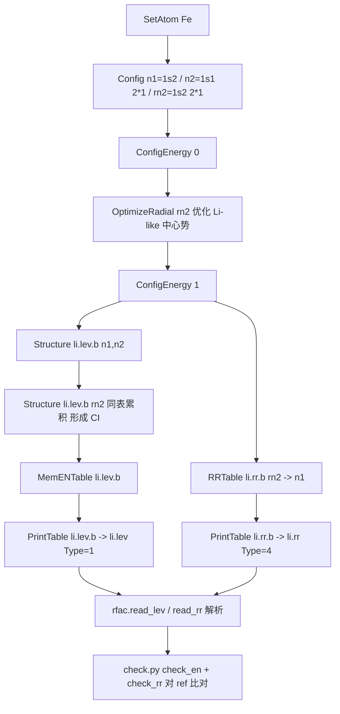
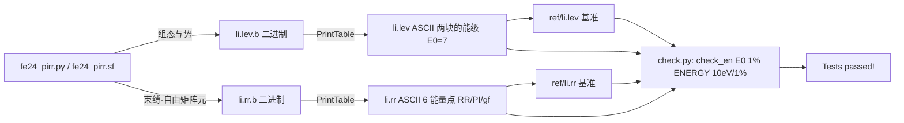

# demo/pirr —— Li-like Fe 光电离与辐射复合（PI/RR）

本文件为完整重写的中文说明，面向 Agent 精确执行与复核。所有相对链接以本目录 `demo/pirr/` 为基准。

## 1. 物理场景

计算 **Li-like Fe（Fe XXIV，Z=26，3 电子）** 的光电离（photoionization, PI）与辐射复合（radiative recombination, RR）截面。复合后离子为 He-like Fe（`1s2`、`1s 2s/1s 2p`，记作 `n1`/`n2`），复合前（初态）离子为 Li-like Fe（`1s2 2*1`，记作 `rn2`）。脚本对 Li-like 组态 `rn2` 做径向势优化，把 `n1`、`n2`、`rn2` 依次写入同一个能级表以纳入 n=1 与 n=2 复合体之间的组态相互作用（CI），再由 `RRTable` 计算束缚态 `n1` ↔ 连续态 `rn2` 的 RR/PI 截面。

这是 CPC 论文 `../../doc/papers/pirr.tex`（*The Flexible Atomic Code: III. Photoionization and Radiative Recombination*）的基准算例；论文结论节称 Li-like iron 结果与既有工作一致（`pirr.tex:323-331`）。与 `../structure/`、`../excitation/` 共用同一套自洽势/`Structure`/`PrintTable` 范式，但对象由束缚–束缚换成**束缚–自由**。

> 命名：任务描述曾写作 `li_pirr.py/.sf`，仓库中实际文件为 [fe24_pirr.py](fe24_pirr.py) 与 [fe24_pirr.sf](fe24_pirr.sf)（`fe24` = Fe XXIV），输出文件前缀才是 `li`。本文件按实际文件清单编写。

## 2. 物理效应：简介 + LaTeX 公式 + 出处 + 源码映射

### 2.1 光电离、辐射复合与 Milne 详细平衡

- 简介：光电离 $X^{q+}+\hbar\nu\to X^{(q+1)+}+e^-$ 与辐射复合 $X^{(q+1)+}+e^-\to X^{q+}+\hbar\nu$ 互为逆过程。FAC 在非相对论多极算符 + 相对论扭曲波连续态下计算束缚–自由微分振子强度，再由 Milne 关系得到 RR 截面。
- 公式（原子单位，出处 `../../doc/papers/pirr.tex:84-93`；$\alpha$ 为精细结构常数，$df/dE$ 为微分振子强度，$\omega$ 为光子能量，$\varepsilon$ 为自由电子能量，$g_i/g_f$ 为复合前后束缚态统计权重比）：

$$
\sigma_{\rm PI}=2\pi\alpha\,\frac{df}{dE},\qquad
\sigma_{\rm RR}=\frac{\alpha^{2}}{2}\,\frac{g_i}{g_f}\,
\frac{\omega^{2}}{\varepsilon\left(1+\tfrac12\alpha^{2}\varepsilon\right)}\,\sigma_{\rm PI}.
$$

- **记号约定**：论文只用 $\omega$（光子能量）与 $\varepsilon$（自由电子能量），**不使用 $\chi$ 记号**。旧版 [ref/README.md](ref/README.md) 中的 $\sigma_{\rm RR}=\frac{g_b}{2g_f}\frac{(\chi+\varepsilon)^2}{c^2\varepsilon}\sigma_{\rm PI}$ 是忽略相对论小量 $1+\tfrac12\alpha^2\varepsilon$ 的近似写法，引用公式时以论文上式为准。
- 源码映射：脚本 [fe24_pirr.py](fe24_pirr.py):27-28 的 `fac.RRTable`/`fac.PrintTable`；`../../doc/manual.tex:391-392`（`DB_RR = 4` 由 `RRTable` 产生）、`manual.tex:1842`（`DB_RR` ASCII 格式）；`../../python/rfac.py:1004 read_rr()`；`../check.py:178 check_rr()`。

### 2.2 束缚–自由跃迁矩阵元与分波结构

- 简介：RR 到 He-like Fe 的不同精细结构末态，以 `bound_index`（束缚末态）、`free_index`（自由电子分波道）、`Delta L`（自由电子角动量变化）标记；总截面为各分波贡献之和。连续电子必须解相对论 Dirac 方程；势可选复合前/后离子，论文指出高 Z 差异小、低 Z 差异显著（`pirr.tex:191-200`），本例 `OptimizeRadial(['rn2'])` 选 Li-like（复合）组态。
- 公式（微分振子强度的分波分解，出处 `pirr.tex:84-93`）：

$$
\sigma_{\rm RR}^{(l)}\propto\sum_k\Big|\big\langle\psi_b\big\|\mathbf D^{(k)}\big\|\psi_{\varepsilon l}\big\rangle\Big|^2 .
$$

- 源码映射：[fe24_pirr.py](fe24_pirr.py):12-18（组态定义与势优化）；`../../python/rfac.py:1047-1052`（`bound_index`/`free_index`/`Delta L` 字段）；`../check.py:178-194`。

### 2.3 组态相互作用（CI）与振子强度 gf

- 简介：脚本注释（第 20–21 行）明确“recombining ion 包含 n=1 与 n=2 复合体之间的 CI”。两次 `Structure` 写入同一 `li.lev.b`，形成两块 CI 结构。`gf` 列给出与 PI 截面等价的振子强度表示，便于等离子体模型直接使用。
- 公式：$H_{ij}=\langle\Phi_i|\hat H|\Phi_j\rangle$ 对角化给出混合态（通用 CI）；微分振子强度由 2.1 的 $\sigma_{\rm PI}=2\pi\alpha\,df/dE$ 给出（原子单位约定）。
- 源码映射：[fe24_pirr.py](fe24_pirr.py):20-25；`../../doc/papers/structure.tex:118-130`（CI 哈密顿量与 CSF 基础）；`../../python/rfac.py:1065,1080`（`gf_list`、`block['gf']`）；`../check.py:192-194`（`gf` 相对 1%）。

## 3. 逐文件说明（含相对链接）

- [fe24_pirr.py](fe24_pirr.py)：Python（pfac）主脚本。定义 `n1='1s2'`、`n2='1s1 2*1'`、`rn2='1s2 2*1'`；`ConfigEnergy(0)` → `OptimizeRadial(['rn2'])` → `ConfigEnergy(1)`；两次 `Structure` 累积写同一 `li.lev.b`；`RRTable('li.rr.b',['rn2'],['n1'])`。无外部输入，无 `sys.argv` 分支。
- [fe24_pirr.sf](fe24_pirr.sf)：SFAC 版等价脚本，`sfac fe24_pirr.sf` 运行；裸调用、无 import、无 `fac.` 前缀，其余与 Python 版逐行对应。
- [Makefile](Makefile)：`RESULTS = li.lev li.rr`，`SCRIPTS = fe24_pirr.py`，`include ../Make.common`。
- [ref/README.md](ref/README.md)：参考结果格式与容差说明；基准文件 [ref/li.lev](ref/li.lev)（文件头 `FAC 1.1.5`）、[ref/li.rr](ref/li.rr)。
- 上游依赖（相对链接）：`../check.py`（比对）、`../Make.common`（通用 make 目标）、`../README.md`（demo 总览）、`../../python/rfac.py`（ASCII 表解析）、`../../doc/manual.tex`（表格式）、`../../doc/papers/pirr.tex`（论文公式）、`../../faclib/recombination.c`（`RRTable` 实现）。

## 4. 真实 pfac API 调用链

`fe24_pirr.py`（逐行对应源码）：

```
from pfac import fac
fac.SetAtom('Fe')
fac.Config('1s2', group='n1')
fac.Config('1s1 2*1', group='n2')
fac.Config('1s2 2*1', group='rn2')
fac.ConfigEnergy(0)
fac.OptimizeRadial(['rn2'])
fac.ConfigEnergy(1)
fac.Structure('li.lev.b', ['n1', 'n2'])
fac.Structure('li.lev.b', ['rn2'])
fac.MemENTable('li.lev.b')
fac.PrintTable('li.lev.b', 'li.lev', 1)
fac.RRTable('li.rr.b', ['rn2'], ['n1'])
fac.PrintTable('li.rr.b', 'li.rr', 1)
```

要点：两次 `Structure` 必须写同一 `li.lev.b` 才能形成论文所需 CI；`RRTable` 参数顺序为（重组后组态 `rn2` → 目标 He-like 组态 `n1`），不可颠倒。

## 5. Mermaid FAC 使用流程图



## 6. Mermaid 数据流图



## 7. 执行记录与命令

**实测环境**：WSL Ubuntu-22.04；gcc 9.5.0；gfortran 11.4.0；Python 3.10.12。`libfac.a`、`sfac/sfac`、`sfac/scrm`、`sfac/spol` 与 `pfac.fac/crm/pol/util` 均构建成功。构建兼容处理见第 10 节。

**实测命令**（在 `demo/pirr/` 中，`PYTHONPATH` 指向已构建的 PFAC 模块）：

```bash
python fe24_pirr.py
python ../check.py li.lev ref/li.lev
python ../check.py li.rr  ref/li.rr
# 或 make / make check / make ref / make clean
sfac fe24_pirr.sf   # SFAC 版
```

**实测结果**：`fe24_pirr.py` 与两条 check 均 `EXIT=0`；实测汇总为 `RUN pirr/fe24_pirr.py EXIT=0`、`CHECK pirr/li.lev EXIT=0`、`CHECK pirr/li.rr EXIT=0`。**耗时未记录**，不推断墙钟时间。

> `make openmp` 在本目录仍执行 `python fe24_pirr.py`，脚本无 OpenMP 分支。

## 8. 输出清单与单位

| 文件 | 类型 | 头部关键字段 | 主要列 / 单位 |
|---|---|---|---|
| `li.lev.b` / `li.lev` | Type=1 能级表 | `NBlocks=2`，`E0=7, -2.01497967E+04`；块1 `NELE=2,NLEV=7`（He-like），块2 `NELE=3`（Li-like `rn2`） | `ILEV IBASE ENERGY P VNL 2J` + 组态名串；`ENERGY`、`E0` 为 **eV**（相对 E0 的激发能，ASCII verbose 输出乘 `HARTREE_EV`，`dbase.c:5371-5374`） |
| `li.rr.b` / `li.rr` | Type=4 RR/PI 表 | `NTRANS=3`、`QKMODE=2`、`MULTIP=100`、`NPARAMS=4`、`NEGRID=6`、`ETYPE=1` | 每条跃迁 `bound_index bound_2J free_index free_2J Delta E Delta L` + 4 个 `parameters` + 每能量点三列 `RR crosssection`、`PI crosssection`、`gf`；`Delta E`/能量网格 `EGRID` 为 **eV**（`dbase.c:6466` verbose 输出 `EGRID*HARTREE_EV`）；截面与 `gf` 按 `read_rr()`/`manual.tex` 表格定义 |

参考文件：[ref/li.lev](ref/li.lev)、[ref/li.rr](ref/li.rr)。版本/时间戳（`FAC 1.1.5`、`TSess`）被 `check.py` 忽略。

## 9. check.py 比对结果

- 分派：`../check.py:232` 按文件名后缀 `lev` → `check_en()`（第 96 行）、`rr` → `check_rr()`（第 178 行）。
- `check_en()`：表头 `NBlocks` 相等、`E0` 相对 1%；`ENERGY` `atol=10`、`rtol=0.01`；字符串列逐字一致。本例 `E0` 索引为 7（非零），必须一致，不能只看 `ENERGY`。
- `check_rr()`：先按 `bound_index`/`free_index` 排序（兼容 OpenMP 乱序）；`RR crosssection`、`PI crosssection`、`gf`、`parameters` 相对误差 1%；`Delta E`/`EGRID` 等 `atol=1`、`rtol=0.01`。
- **实测**：`li.lev`、`li.rr` 两项均通过（`../check.py` 仅打印文件名即成功，`EXIT=0`），本目录合计 **2 项检查通过**。早期全量汇总中的 FeL/rmatrix 状态已被后续实测取代，不作为本例结论。

## 10. 限制与构建兼容处理说明

- 限制：`RR`/`PI` 截面容差较严（相对 1%），能量网格点必须与脚本一致；`QKMODE=2`、`NPARAMS=4`、`MULTIP=100` 的参数化编码按 FAC 手册与 `rfac.read_rr()` 表格定义解释；`VNL` 列含义以 `read_lev()` 表格定义为准。脚本无 OpenMP 分支。
- 基准版本：`../README` 称基准来自 FAC=1.1.4，而实际文件头为 `FAC 1.1.5`；比对脚本忽略版本/时间戳，只校验数据字段。
- **构建兼容处理（不改变物理，仅构建/ABI）**：实测 Linux/WSL 构建采用两类处理：
  1. `configure`、`install.sh`、`mkinsdir.sh`、`config.guess`、`config.sub` 由 CRLF 归一为 LF，修复 `#!/bin/sh` 执行失败；
  2. `sysdef.h` 中 `#undef f2cFortran` 改为 `#define f2cFortran 1`，固定 C/Fortran 的 f2c 风格函数名修饰与 LOGICAL 约定；
  **原始源码树未修改**。这些处理只影响编译与链接 ABI，不触碰物理模型或数值；本目录 2 项 `ref/` 比对全部通过。