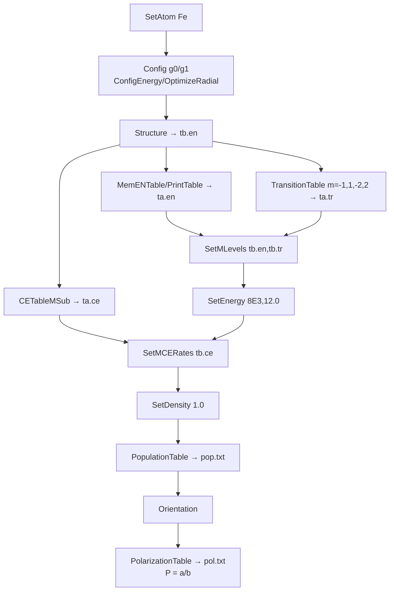
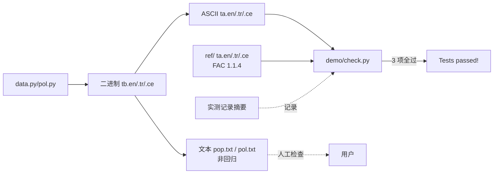

# demo/polariz —— 类 He 铁谱线偏振

## 1. 物理场景

本示例演示 `pfac.pol` 模块：以类氦铁（He-like Fe，Fe XXV，Z=26、2 电子）为对象，`data.py` 生成能级、多极辐射跃迁率与**磁子能级分辨**碰撞激发表，`pol.py` 计算磁子能级布居、取向参数并输出谱线偏振度。定向（单能）电子碰撞使磁子能级非统计布居，产生取向/排列，从而在与电子束垂直的观测方向上出现非零线偏振。束能量参数实际为 $E=8\,\mathrm{keV}$、高斯展宽 $\sigma=12\,\mathrm{eV}$（见第 5 节差异说明），密度 `SetDensity(1.0)`（单位 $10^{10}\,\mathrm{cm^{-3}}$）。依据 [demo/README](../README.md)：“`polariz/, use of pfac.pol module to calculate the polarizations of He-like Fe lines.`”

## 2. 物理效应、LaTeX 公式、出处与源码映射

### 2.1 多极辐射跃迁（E1/M1/E2/M2）

- 脚本以 `m in [-1,1,-2,2]` 生成四种多极：带符号 `m` 的约定为 $k=1$(E1)、$-1$(M1)、$2$(E2)、$-2$(M2)。
- 公式：$A_{ji}\propto \dfrac{\omega^{2k+1}}{(2J_j+1)}|\langle j\|\mathbf{D}^{(k)}\|i\rangle|^2$。
- 出处与映射：[data.py](data.py) 第 16–19 行 `TransitionTable`；[ref/README.md](ref/README.md) 第 16–21 行；解析 `python/rfac.py:690 read_tr()`。

### 2.2 磁子能级布居与排列参数 $B_k(J)$

- 公式：
  $$B_k(J)=\sum_{M}(-1)^{J-M}\sqrt{2k+1}\begin{pmatrix}J&k&J\\-M&0&M\end{pmatrix}\rho_{MM},\qquad \rho_{MM}=\frac{\mathrm{pop}_M}{\sum_M\mathrm{pop}_M}.$$
  源码真实实现见 [polarization.c](../../faclib/polarization.c) 第 1798–1816 行：对 $m_1=-J,\ldots,0$ 求和 `W3j(j1,j1,k2,-m1,m1,0)·(pop[t]/dtotal)·sqrt(k2+1)`，按 `IsOdd((j1+m1)/2)` 变号，最后乘 `sqrt(j1+1)` 得 `BL[k][i]`。
- 布居由速率方程 $0=\sum_{jM'}\rho_{jM'}R_{jM'\to iM}-\rho_{iM}\sum_{jM'}R_{iM\to jM'}$ 决定，磁子态碰撞强度 $\Omega_{iM_i\to jM_j}$ 由 `CETableMSub` 提供。
- 出处与映射：[ref/README.md](ref/README.md) 第 53–56、63–65 行；[pol.py](pol.py) 第 4–11 行 `SetMLevels`/`SetEnergy`/`SetMCERates`/`SetDensity`/`PopulationTable` → `pop.txt`。

### 2.3 谱线偏振度 $P=a/b$（⚠ 并非初等的 $(I_\parallel-I_\perp)/(I_\parallel+I_\perp)$）

- FAC 实际计算的是球张量比值：
  $$P=\frac{a}{b},\qquad a=\sum_t F_t\,PL2_t\,A_t\,B_t(J_i),\qquad b=\sum_t PL_t\,A_t\,B_t(J_i),$$
  其中 $PL_t=P_{2t}(\cos\theta)$，$PL2_t$ 为 $\mu=2$ 缔合 Legendre 项且 **$PL2_0=0$**；$k<0$ 时 $F_t$ 变号；
  $$A_t\propto(2k+1)\sqrt{(2J_i+1)(4t+1)}(-1)^{(J_i+J_f)/2}\begin{pmatrix}k&k&2t\\1&-1&0\end{pmatrix}\begin{Bmatrix}k&k&2t\\J_i&J_i&J_f\end{Bmatrix}.$$
- 源码映射：[polarization.c](../../faclib/polarization.c) 第 2073–2091 行算 `AL[t]`/`FL[t]`（含 `if (k<0) a=-a`），第 2098–2102 行 `a += FL[t]*PL2[t]*AL[t]*BL[t][i1]`、`b += PL[t]*AL[t]*BL[t][i1]` 并 `a = a/b`，第 2122–2123 行写 `pol.txt`。
- **重要澄清**：手册与源码均未定义 $I_\parallel/I_\perp$ 的符号约定，**不能**把这里的 $a/b$ 直接等同或反号于 $(I_\parallel-I_\perp)/(I_\parallel+I_\perp)$；它是上述球张量分量之比（[ref/README.md](ref/README.md) 第 58–61 行）。`B_t` 即 $B_k(J)$（第 2.2 节）。

## 3. 逐文件说明（含 ref 链接）

### 3.1 [data.py](data.py) —— 原子数据生成

- 功能：Fe XXV 能级、四多极跃迁率、磁子能级分辨激发数据。运行：`python data.py`。
- API 链：`SetAtom('Fe')` → `Config('g0','1s2')`/`Config('g1','1s1 2*1')` → `ConfigEnergy(0)`/`OptimizeRadial('g0')`/`ConfigEnergy(1)` → `Structure('tb.en',['g0','g1'])` → `MemENTable('tb.en')` → `PrintTable('tb.en','ta.en',1)` → 循环 `m=[-1,1,-2,2]`：`TransitionTable('tb.tr',['g0'],['g1'],m)` 与 `(['g1'],['g1'],m)` → `PrintTable('tb.tr','ta.tr',1)` → `CETableMSub('tb.ce',['g0'],['g1'])`、`(['g1'],['g1'])` → `PrintTable('tb.ce','ta.ce',1)`。
- 输出：`ta.en`、`ta.tr`、`ta.ce`（ASCII）与二进制 `tb.en/.tr/.ce`。

### 3.2 [pol.py](pol.py) —— 偏振计算

- 功能：磁子能级布居、取向参数与偏振。运行：`python pol.py`。
- API 链：`SetMLevels('tb.en','tb.tr')` → `SetEnergy(8E3,12.0)` → `SetMCERates('tb.ce')` → `SetDensity(1.0)` → `PopulationTable('pop.txt')` → `Orientation()` → `PolarizationTable('pol.txt')`。
- 顺序约束：`Orientation()` 必须在 `PopulationTable()` 之后、`PolarizationTable()` 之前（出处 [manual.tex](../../doc/manual.tex) 第 4480–4484 行）。
- `SetEnergy` 单位为 eV：出处同手册第 4521–4525 行 “Set the electron energy e in eV. If the optional s is positive, ... standard deviation σ=s in eV, and mean e.”

### 3.3 [Makefile](Makefile) 与 [ref/](ref/README.md)

- `Makefile`：实际 `RESULTS = ta.en ta.tr ta.ce`；注释行 `# RESULTS = ta.ce ta.en ta.tr pol.txt pop.txt` 表明 `pop.txt`/`pol.txt` 曾被考虑纳入但已排除。
- [ref/README.md](ref/README.md)：`ta.en/.tr/.ce` 格式与容差，以及 `pop.txt`/`pol.txt` 文本格式说明。

## 4. 真实 pfac API 调用链

```
data.py (pfac.fac) : SetAtom Fe → Config → ConfigEnergy/OptimizeRadial → Structure
                     → MemENTable → PrintTable(en) → TransitionTable(m=-1,1,-2,2)×2
                     → PrintTable(tr) → CETableMSub×2 → PrintTable(ce)
pol.py (pfac.pol)  : SetMLevels('tb.en','tb.tr') → SetEnergy(8E3,12.0)
                     → SetMCERates('tb.ce') → SetDensity(1.0)
                     → PopulationTable('pop.txt') → Orientation() → PolarizationTable('pol.txt')
```
两脚本分别 `from pfac.fac import *` / `from pfac.pol import *`；`pol` 函数可按 [manual.tex](../../doc/manual.tex) 第 155–169、2390–2395 行同语法改写为 `spol`（SFAC）。

## 5. Mermaid 图

### 5.1 FAC 使用流程图



### 5.2 数据流图



## 6. 执行记录与命令

**实测环境**：WSL Ubuntu-22.04；gcc 9.5.0；gfortran 11.4.0；Python 3.10.12；PFAC 模块编译成功。构建兼容处理见第 9 节。

**实测命令**（在 `demo/polariz/` 中，`PYTHONPATH` 指向已构建的 PFAC 模块）：

```bash
python data.py
python pol.py
python ../check.py ta.en ref/ta.en
python ../check.py ta.tr ref/ta.tr
python ../check.py ta.ce ref/ta.ce
# 或 make / make check
```

**实测结果**：`data.py` stdout 为空（正常），`pol.py` 布居迭代收敛；两个脚本与三条 check 均 `EXIT=0`。**耗时未记录**，不推断墙钟时间。

## 7. 输出清单与单位

| 文件 | 含义 | 关键字段与单位 |
|---|---|---|
| `ta.en` | 能级表 Type=1 | `E0`、`ENERGY` 均 eV；7 个精细结构能级 |
| `ta.tr` | 跃迁率 Type=2 | `Delta E` eV；`gf` 无量纲；`rate` s⁻¹；`multipole` 带符号整数 |
| `ta.ce` | 磁子能级分辨激发 Type=3（MSUB=1） | `collision strength` 无量纲；`crosssection` πa₀²；`ratio collision strength` 无量纲 |
| `pop.txt` | 磁子能级布居（文本） | 头部 `Energy=8.00000E+03` eV、`ESigma=1.20000E+01` eV、`Density=1.00000E+00`；$c=\mathrm{pop}[t]/\mathrm{dtotal}$ 无量纲；**不在回归** |
| `pol.txt` | 谱线偏振（文本） | 8 列：上能级电子数/序号、下能级序号、`k`、跃迁能 eV、`tem=N_upper·A`、`b`、`a`；末两列 $P=a/b$ 无量纲；**不在回归** |

## 8. check.py 比对结果

`make check` 仅对 `RESULTS = ta.en ta.tr ta.ce` 三项比对，**全部通过**（3 项 `EXIT=0`）：

| 文件 | check 函数 | 关键容差 |
|---|---|---|
| `ta.en` | `check_en` (:96) | `ENERGY` 10 / 0.01；`E0` 1% |
| `ta.tr` | `check_tr` (:122) | `rate` 1e4 / 0.05；`gf` 1e-4 / 0.02；`Delta E` 1% |
| `ta.ce` | `check_ce` (:138) | `collision strength` 1e-3 / 0.05；`ratio collision strength` atol=0.1 |

**⚠ check.py 已知拼写缺陷（务必知悉）**：[check.py](../../demo/check.py) 第 151 行 `atols` 中键名为正确的 `'ratio collision strength': 0.1`，但第 155 行 `rtols` 中误写为 `'ratio collision strenth': 0.05`（`strenth` 少了一个 `g`）。由于 `_check_block` 按键名取相对容差，该列的 **rtol=0.05 实际上未被应用**，只有 `atol=0.1` 生效。这是死键（dead key），不影响本例三项通过，但解读 `ta.ce`/MSUB 表 `ratio collision strength` 列的一致性时需注意：其通过仅由绝对容差保证。

## 9. 限制与构建兼容处理说明

- **命令与注释矛盾**：[pol.py](pol.py) 第 5 行注释称 “magnetic sublevel excitation rates at E=12.24 keV (900 Ryd)”，但实际调用为 `SetEnergy(8E3, 12.0)`，即 $E=8000\,\mathrm{eV}=8\,\mathrm{keV}$、$\sigma=12\,\mathrm{eV}$。$900\,\mathrm{Ryd}\approx12.24\,\mathrm{keV}$ 与代码值不符；**以代码实际值 `SetEnergy(8E3,12.0)` 为准**，注释为遗留错误。生成的 `pop.txt`/`pol.txt` 头部 `Energy=8.00000E+03`、`ESigma=1.20000E+01` 亦印证代码值。
- 基准 FAC 1.1.4、文件头 `FAC 1.1.5`。`pol.txt`/`pop.txt` 不在 `RESULTS`：`check.py` 的扩展名分派（第 231–260 行）无 `.txt` 分支，会抛 `TypeError`；`make ref` 也只拷贝三个 `RESULTS`。`ta.ce`/`ta.tr` 的磁子能级索引须与 `ta.en` 的 `ILEV` 对应，改动任一结构文件都会破坏偏振结果。
- **构建兼容处理（仅构建/ABI 层面，非物理，已确认但未修复代码注释）**：Windows 宿主 CRLF 破坏 `#!/bin/sh`，实测将 `configure`、`install.sh`、`mkinsdir.sh`、`config.guess`、`config.sub` 归一化为 LF；configure 的 `AC_DEFINE_UNQUOTED` 未填入模板，故将 `sysdef.h` 中 `#undef f2cFortran` 改为 `#define f2cFortran 1`，固定 C/Fortran 名字修饰与 LOGICAL 约定的 ABI。**原始源码树未修改**；上述处理已由本目录三项 ref 比对全部通过验证，不改变偏振公式、$a/b$ 口径或任何物理结论。