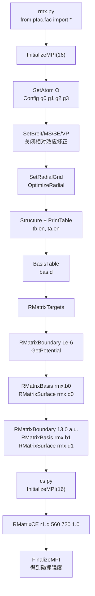
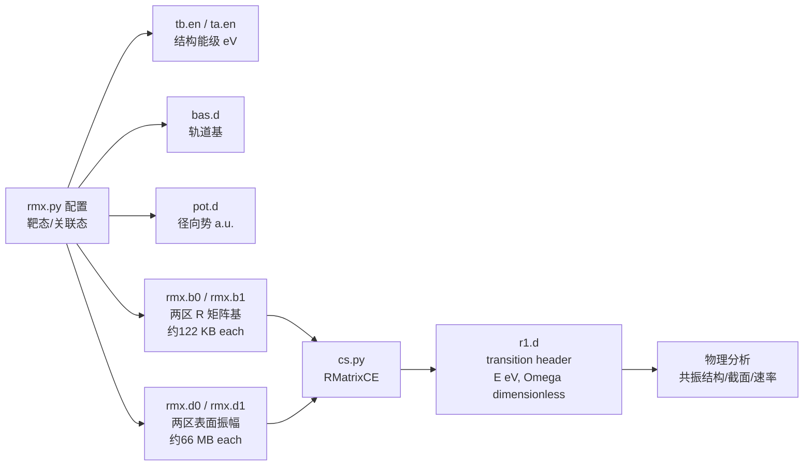

# He-like O 的 Dirac R 矩阵电子碰撞激发示例

## 1. 定位与物理场景

本目录演示 FAC 的 **Dirac R 矩阵**方法：以 He-like O 为例，先构造靶态与关联态，生成内区 R 矩阵基和表面振幅，再在外部区求解散射问题并输出碰撞强度 $\Omega_{ij}$。

目录只有两个核心脚本：

- [`rmx.py`](rmx.py)：生成 R 矩阵基、表面振幅、势与靶态结构；
- [`cs.py`](cs.py)：读取上述文件，计算碰撞强度 `r1.d`。

两者均调用 `InitializeMPI(16)`，需支持相应 MPI/OpenMP 初始化的运行环境。顶层 `../Makefile` 的 `DIRS` 不包含 `rmatrix`。

## 2. 运行环境与构建兼容处理

- 实测环境：WSL Ubuntu 22.04；`gcc 9.5`；`gfortran 11.4`；`Python 3.10`；PFAC 模块编译成功。
- 实测构建采用两项兼容处理：
  1. 构建脚本 CRLF→LF，保证 `#!/bin/sh` 正常执行；
  2. `sysdef.h` 中启用 `#define f2cFortran 1`，固定 C/Fortran 名字修饰与 LOGICAL 约定。
- 这些处理只适配 f2c 风格 C/Fortran ABI，**不涉及 R 矩阵物理、数值方法或输出公式**；原始源码树未修改。

## 3. 物理效应、公式、出处与源码映射

| 物理效应 | 公式 | 出处 | 源码 / 脚本映射 |
|---|---|---|---|
| 内区 R 矩阵展开 | $\Psi=\sum_k A_k\Phi_k$，$R_{ij}(E)=\dfrac{1}{2a}\sum_k\dfrac{w_{ik}w_{jk}}{E_k-E}$ | 标准 Wigner R 矩阵形式；`rmatrix.c` 未直接逐字写出该极点式 | 实现使用表面振幅 `wik0/wik1`、Buttle 基、传播和 K/S 矩阵；见 [`../../faclib/rmatrix.c`](../../faclib/rmatrix.c) |
| 内区边界与分区传播 | 第一区包围束缚轨道振幅显著区域；第二区传播到外边界 | [`../../doc/manual.tex`](../../doc/manual.tex):3058–3065、3067–3077 | `RMatrixBoundary`：`faclib/rmatrix.c:422`；传播/匹配：`RMatrixCE` 3536、`RMatrixCEW` 3954 |
| Buttle 基与表面振幅 | $w_{ik}$ 为边界处通道-基函数振幅 | [`../../doc/manual.tex`](../../doc/manual.tex):3051–3056、3143–3145 | `RMatrixBasis`：`faclib/rmatrix.c:531`；`RMatrixSurface`：`faclib/rmatrix.c:1379` |
| 靶态与关联态 | $t$ 为 target 组态组，$c$ 为 correlation 组态组 | [`../../doc/manual.tex`](../../doc/manual.tex):3147–3151 | `RMatrixTargets`：`faclib/rmatrix.c` 约 787；[`rmx.py`](rmx.py):43–44 |
| 碰撞强度与截面 | $\sigma_{ij}=\dfrac{\pi}{k_i^2 g_i}\Omega_{ij}$ | `doc/manual.tex` CE 章节；`doc/papers/excitation.tex` | [`cs.py`](cs.py):21；输出 `r1.d` |
| 闭通道共振 | $\Omega(E)\approx\Omega^{\rm bg}+C\dfrac{\Gamma_a\Gamma_b}{(E-E_r)^2+\Gamma^2/4}$ | 通用 Breit–Wigner 形式；R 矩阵通过闭通道耦合自然产生共振 | [`../../doc/manual.tex`](../../doc/manual.tex):3067–3107 的 S 矩阵匹配流程 |

### 3.1 公式与源码实现的关系

$R_{ij}(E)=\frac{1}{2a}\sum_k w_{ik}w_{jk}/(E_k-E)$ 是标准 Wigner R 矩阵表达，用来解释物理含义；FAC 源码并不是按该式逐字实现。实际代码路径为：

- `RMatrixTargets` 指定 target/correlation 态；
- `RMatrixBasis` 构造 Buttle 修正基函数；
- `RMatrixSurface` 计算表面振幅；
- `RMatrixCE` / `RMatrixCEW` 把第一区 R 矩阵向外传播，与外区解匹配得到 S 矩阵，再由 S/K/T 矩阵给出 $\Omega$；
- `SaveRMatrixCE`（`faclib/rmatrix.c:2952`）写出 `r1.d`。

Python 包装位于 [`../../python/fac.c`](../../python/fac.c)：`RMatrixCE` 6897、`RMatrixBoundary` 6900、`RMatrixBasis` 6902、`RMatrixSurface` 6903。

## 4. 逐文件说明与真实 PFAC API 调用链

### 4.1 [`rmx.py`](rmx.py) —— 第一步，必须先运行

作用：定义 He-like O 靶态与关联态，优化径向轨道，计算两个 R 矩阵区的基函数和表面振幅。

真实调用链：

```python
from pfac.fac import *

InitializeMPI(16)
SetAtom('O')

Config('g0', '1s2')
Config('g1', '1s1 2*1')
Config('g2', '1s1 3*1')

Config('g3', '1s2 2*1')
Config('g3', '1s2 3*1')
Config('g3', '1s1 2*2')
Config('g3', '1s1 2*1 3*1')
Config('g3', '1s1 3*2')

SetBreit(0)
SetMS(0, 0)
SetSE(0)
SetVP(0)

SetRadialGrid(3000, 1.4, 300, 0)
OptimizeRadial('g0')

Structure('tb.en', ['g0', 'g1', 'g2'])
Structure('tb.en', ['g3'])

MemENTable('tb.en')
PrintTable('tb.en', 'ta.en')
BasisTable('bas.d')

RMatrixTargets(['g0', 'g1', 'g2'], ['g3'])

nb = 25
kmax = 30
SetOrbMap(max(50, 2*kmax + 1))
SetSlaterCut(12, 12)

RMatrixBoundary(0, 1e-6, 0.0)
GetPotential('pot.d')
RMatrixBasis('rmx.b0', kmax, nb)
RMatrixSurface('rmx.d0')

RMatrixBoundary(-1, 13.0, 0.0)
RMatrixBasis('rmx.b1', kmax, nb)
RMatrixSurface('rmx.d1')

FinalizeMPI()
```

关键参数：

- `nb = 25`：每个 $\kappa$ 的基函数数；
- `kmax = 30`：连续电子最大角动量；
- 第一区边界 `1e-6`：包围 `1s,2s,2p,3s,3p,3d` 中振幅大于 `1E-6` 的束缚波函数；
- 第二区外边界 `13.0 a.u.`；
- `SetBreit(0)`、`SetMS(0,0)`、`SetSE(0)`、`SetVP(0)` 关闭 Breit、核反冲、自能和真空极化。

### 4.2 [`cs.py`](cs.py) —— 第二步，读取 `rmx.py` 输出

作用：在外部区求解并输出碰撞强度。

真实调用链：

```python
from pfac.fac import *

InitializeMPI(16)
b = ['rmx.b0', 'rmx.b1']
r = ['rmx.d0', 'rmx.d1']

RMatrixCE('r1.d', b, r, 560, 720, 1.0)

FinalizeMPI()
```

注意：

- 源码实际计算 $E=560$–$720\,\mathrm{eV}$，步长 $1.0\,\mathrm{eV}$；
- 脚本注释中的 `E=750--1.5E3 eV, in 100 eV step` 是陈旧信息，应以代码为准；
- `RMatrixCE` 未显式传 `m`，默认只输出总碰撞强度；若传 `m=2/3` 可输出 R/T 矩阵元素，见 [`../../doc/manual.tex`](../../doc/manual.tex):3080–3093。

## 5. Mermaid FAC 使用流程图



## 6. Mermaid 数据流图



## 7. 执行记录与命令

必须严格按以下顺序运行（在 `demo/rmatrix/` 中）：

```bash
python rmx.py    # 第一步：生成 rmx.b0/b1 与 rmx.d0/d1
python cs.py     # 第二步：读取上述文件并计算 r1.d
```

执行记录：

- `rmx.py` 已成功完成，生成：
  - `rmx.b0`、`rmx.b1`：各约 `122 KB`；
  - `rmx.d0`、`rmx.d1`：各约 `66 MB`；
  - `ta.en`、`bas.d`、`pot.d`（以及结构中间表 `tb.en`）。
- 2026-11-25 夜间复现：以 16 线程启动 `cs.py`，**复用**已生成的 `rmx.b0/b1`、`rmx.d0/d1`，未重跑 `rmx.py`。夜间任务从 `2026-11-25T02:00:58+08:00` 运行至 `2026-11-25T04:40:40+08:00`（并行任务总墙钟耗时 `2 h 39 min 42 s`）；`cs.py` 约 `02:01` 开始、`04:01:28` 结束，运行记录末行 `Time = 7.22908E+03`（约 `2 h 0 min 29 s`）。
- 结果：**成功**，退出码 `0`（实测汇总 `CS_EXIT=0`、`cs_exit=0`）。运行记录无 `Error`/`Traceback`，以 `SaveRMatrixCE End: r1.d` 收尾。
- 产物：`r1.d`，`928,130,571` 字节（约 `886 MiB`），`12,890,917` 行；文件头声明 `17` 个跃迁、每跃迁 `121214` 个能量点，能量范围 `560–720 eV`。这确认 `RMatrixCE` 已完整写出碰撞强度；`InitializeMPI(16)` 只控制 OpenMP 线程数，不改变 R 矩阵物理模型或碰撞强度公式。

### 7.1 关于先前 SIGSEGV

先前 `cs.py` 出现 SIGSEGV 的原因是 `rmx.py` 未先运行，缺少 `rmx.b0/b1`、`rmx.d0/d1` 等必需输入，不是 R 矩阵物理或源码数值算法错误。

这不是源码改动，而是**工作流要求**：`rmx.b*` 和 `rmx.d*` 分别编码内区本征态/Buttle 基与边界表面振幅，外区匹配和碰撞强度计算必须读取它们。没有这些文件，`RMatrixCE` 无法建立内区到外区的 R 矩阵边界条件。

## 8. 输出清单与单位

| 输出文件 | 内容 | 单位 / 说明 |
|---|---|---|
| `tb.en` | 靶态与关联态结构中间表 | 能量 eV |
| `ta.en` | ASCII 能级表 | 能量 eV |
| `bas.d` | R 矩阵轨道基 | 二进制基数据，无直接物理单位 |
| `pot.d` | 径向势 | atomic units |
| `rmx.b0` | 第一区 R 矩阵基，含 Buttle 修正 | 二进制；`kmax=30`、`nb=25` |
| `rmx.b1` | 第二区 R 矩阵基 | 二进制；用于传播区 |
| `rmx.d0` | 第一区表面振幅 | 表面振幅，$w_{ik}$ 数据 |
| `rmx.d1` | 第二区表面振幅 | 表面振幅，供外区匹配 |
| `r1.d` | 碰撞强度结果 | 能量 eV；$\Omega_{ij}$ 无量纲 |

`r1.d` 格式见 [`../../doc/manual.tex`](../../doc/manual.tex):3095–3103：每个跃迁先给出初态索引、初态 $2J$、末态索引、末态 $2J$、跃迁能和能量点数/分波数，随后为两列数据：能量、碰撞强度。

## 9. 比对与物理合理性检查

1. **输入完整性检查**  
   运行 `cs.py` 前确认 `rmx.b0/b1`、`rmx.d0/d1` 存在且大小合理；否则不可把 SIGSEGV 解释为物理错误。

2. **能量网格检查**  
   `r1.d` 中能量点应覆盖 `560..720 eV`，步长 `1.0 eV`；不要采信脚本注释中的旧范围 `750..1500 eV`。

3. **碰撞强度检查**  
   $\Omega_{ij}$ 应有限、非负，并满足基本对称性期望；同一跃迁在闭通道阈值附近可出现共振结构。

4. **结构表检查**  
   `ta.en` 中 target 态应包含 `1s2`、`1s 2*1`、`1s 3*1` 对应能级；若阈值顺序异常，需检查 `Structure` 与 `RMatrixTargets` 输入。

5. **可选 R/T 矩阵检查**  
   若将 `RMatrixCE` 的 `m` 设为 `2` 或 `3`，可检查 T 矩阵实部/虚部、$\Omega$ 与 R 矩阵；默认 `m=0` 不输出这些细节。

6. **无官方 ref 回归**  
   本目录未附 `ref/`，也未纳入顶层 `make check`；适合做物理一致性和文件格式检查，而非自动数值回归。

## 10. 限制与注意事项

- `InitializeMPI(16)` 硬编码，低进程数环境不能直接运行原脚本。
- `SetBreit(0)`、`SetMS(0,0)`、`SetSE(0)`、`SetVP(0)` 关闭 Breit 相互作用、核反冲、自能和真空极化；如需高阶修正必须修改脚本物理开关。
- `rmx.py` 中 `nb=25`、`kmax=30`、`SetSlaterCut(12,12)`、`SetRadialGrid(3000,1.4,300,0)` 共同决定精度和成本；提高精度会显著增加 `rmx.d0/d1` 体积和运行时间。
- `cs.py` 注释中的能量范围已过时，以 `RMatrixCE('r1.d', b, r, 560, 720, 1.0)` 为准。
- `rmx.py` 必须先于 `cs.py`；这是物理输入依赖，不是源码修改。
- 构建兼容处理（CRLF→LF 与 `#define f2cFortran 1`）只解决 ABI 兼容，不改变物理结果。

[返回上级](../README.md)