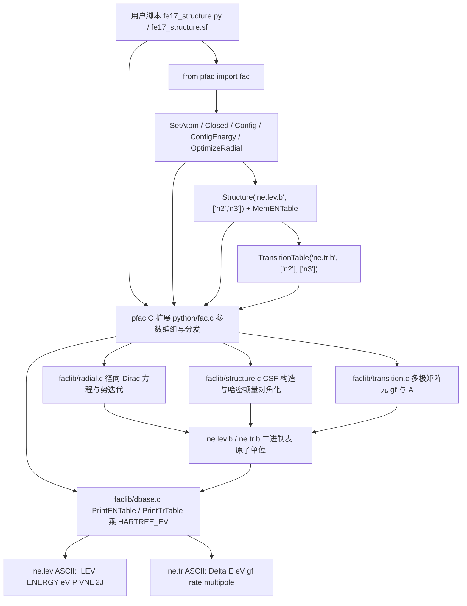
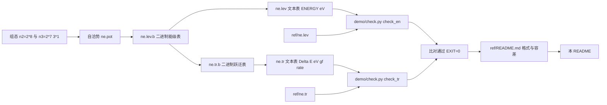

# demo/structure —— Ne-like Fe 原子结构与辐射跃迁率

本文件是 `demo/structure/` 的自包含说明：物理问题、公式出处、源码映射、逐文件说明、完整 pfac API 调用链、两张 Mermaid 图、实际执行记录、`check.py` 比对结果与容差、已知限制，以及构建兼容处理说明。所有路径相对本文件所在的仓库根 `src/fac/`。

## 1. 物理场景与科学问题

- **离子与电荷态**：类氖铁 Fe XVII（Ne-like Fe），核电荷 $Z=26$，束缚电子 10 个，电荷态 $+16$。`1s` 壳层冻结为闭壳层（`fac.Closed('1s')`），显式处理 10 个电子。
- **组态**：基组态 `n2 = 2*8`（即 $2s^2 2p^6$，闭合 $n=2$ 壳层）与激发组态 `n3 = 2*7 3*1`（即 $2s^2 2p^5 3s/3p/3d$）。
- **能级**：对角化后得到 **37 个精细结构能级**（`ne.lev` 中 `NLEV = 37`）。能级表头 `E0 = 0, -3.12294465E+04`，单位 **eV**（见第 9 节单位说明）。
- **跃迁类型**：`n2 → n3` 组态间的**多极辐射跃迁**（E1 为主，`MULTIP = 0` 表示按选择定则自动选择/求和），共 **30 条**（`ne.tr` 中 `NTRANS = 30`）。表中 `GAUGE = 2`、`MODE = 1` 为算符规范与模式编码。
- **能量范围**：激发能相对 `E0` 给出，`n=2→3` 的跃迁能 $\Delta E$ 为数百 eV 量级（Fe XVII 的 EUV/X 射线谱线区）；精确数值以 `ne.lev` 的 `ENERGY` 列与 `ne.tr` 的 `Delta E` 列为准，两列均为 eV。
- **科学问题**：验证相对论自洽场 + 组态相互作用能否稳定复现 Fe XVII 的能级位置与辐射跃迁率 $A$、加权振子强度 $gf$；本例是整个 `demo/` 体系的入口模板，`excitation/`、`ionization/`、`pirr/`、`aidr/` 都复用其“结构计算范式”。

## 2. 涉及的物理效应、LaTeX 公式、出处与源码映射

### 2.1 相对论原子结构：Dirac 自洽场 + 组态相互作用

- **物理效应**：FAC 全程基于 Dirac 方程。径向轨道由自洽的 Dirac–Fock–Slater 平均势迭代得到，再用组态状态函数（CSF）展开并对角化多电子哈密顿量。
- **公式**（出处 `doc/papers/structure.tex:118-130`、`:156-163`、`:254-263`）：

$$
\hat H\Psi_k=E_k\Psi_k,\qquad
H=\sum_{i=1}^{N}H_D(i)+\sum_{i<j}\frac{1}{r_{ij}},
$$

$$
\left(\frac{d}{dr}+\frac{\kappa}{r}\right)P_{n\kappa}
=\alpha\left(\varepsilon_{n\kappa}-V+\frac{2}{\alpha^2}\right)Q_{n\kappa}.
$$

- `fac.ConfigEnergy(0)` 与 `fac.ConfigEnergy(1)` 成对调用对应“单一中心势并非对每个组态都最优”的修正：分别计算各组单独优化的平均能与统一势下的平均能，用差值调整最终能级（出处 `doc/manual.tex:229-245`、`:2664-2681`）。
- **源码映射**：`faclib/structure.c`（CSF 构造与哈密顿量对角化）、`faclib/radial.c`（径向 Dirac 方程与势迭代）、`faclib/mbpt.c`（关联修正）、`faclib/dbase.c:5372-5374`（verbose 输出能量乘 `HARTREE_EV` → eV）；脚本侧 `fe17_structure.py:16-35`。

### 2.2 多极辐射跃迁率与加权振子强度

- **物理效应**：由 CSF 间的多极算符矩阵元得到线强 $S_{fi}$、加权振子强度 $gf$ 与跃迁率 $A$；脚本未给 `TransitionTable` 第四个参数，默认对所有多极求和。
- **公式**（出处 `doc/papers/structure.tex:578-579`，原子单位）：

$$
gf_{fi}=[L]^{-1}\,\omega\,(\alpha\omega)^{2L-2}\,S_{fi},\qquad
gA_{fi}=2\alpha^{3}\omega^{2}\,gf_{fi},\qquad \omega=E_i-E_f,\ [L]=2L+1.
$$

由此 $A_{ji}=2\alpha^{3}\omega^{2}gf_{ji}/g_j$。长度/速度规范示意：$\mathbf D_{\rm length}=-e\sum_i\mathbf r_i$，$\mathbf D_{\rm velocity}\propto \mathbf p/(m_ec\,\omega)$（通用辐射理论；FAC 侧见 `doc/papers/structure.tex:434-442` 对二阶量子化算符的表述；具体 `GAUGE=2` 编码按源码表格定义核对）。
- **源码映射**：`faclib/transition.c`（多极矩阵元、$gf$、$A$）、`faclib/dbase.c:5527-5546`（`PrintTrTable` 输出 `Delta E gf rate` 并乘 `HARTREE_EV`）；解析 `python/rfac.py:690 read_tr()`；比对 `demo/check.py:122 check_tr()`。

### 2.3 单位约定（关键）

- ASCII 表中的 `ENERGY`、`E0`、`Delta E` 均为 **eV，不是 Hartree**：`faclib/dbase.c:5371-5374` 在 verbose 打印前执行 `e -= mem_en_table[iground].energy; e *= HARTREE_EV;`，`dbase.c:4816-4818` 对 `E0` 同样乘 `HARTREE_EV`。二进制 `.b` 表内部仍以原子单位存储。
- **源码映射**：`faclib/dbase.c:5371-5374`、`:4816-4818`；读取约定见 `python/rfac.py:511 read_lev()`、`:690 read_tr()`。

### 2.4 映射总表

| 物理环节 | 用户 API | pfac 层 | faclib 核心文件 | 输出 |
|---|---|---|---|---|
| 组态/自洽势 | `Config`, `ConfigEnergy`, `OptimizeRadial` | `python/fac.c` | `faclib/config.c`, `faclib/radial.c` | `ne.pot` |
| 能级对角化 | `Structure`, `MemENTable` | `python/fac.c` | `faclib/structure.c`, `faclib/dbase.c` | `ne.lev.b`, `ne.lev` |
| 辐射跃迁 | `TransitionTable` | `python/fac.c` | `faclib/transition.c`, `faclib/dbase.c` | `ne.tr.b`, `ne.tr` |
| 解析/比对 | — | `python/rfac.py` | — | `demo/check.py` |

## 3. 逐文件说明

- **[fe17_structure.py](fe17_structure.py)**：Python（pfac）版主脚本。冻结 `1s`，定义 `n2`/`n3`，自洽优化径向势后对角化得到 37 能级，再算 30 条跃迁。Python 版特有 `fac.GetPotential('ne.pot')`（第 32 行）与 `openmp` 分支（第 8–14、40–41 行）。无外部输入文件。
- **[fe17_structure.sf](fe17_structure.sf)**：SFAC 命令解释器等价脚本（`sfac fe17_structure.sf`）。函数裸调用、无 `fac.` 前缀、无 `GetPotential`、无条件/循环与 MPI 分支；物理内容逐行等价。
- **[Makefile](Makefile)**：`RESULTS = ne.lev ne.tr`，`SCRIPTS = fe17_structure.py`，`include ../Make.common`。目标 `all`/`openmp`/`check`/`ref`/`clean` 定义在 [../Make.common](../Make.common)。
- **[ref/](ref/README.md)**：参考结果 `ne.lev`（Type=1，`NELE=10`、`NLEV=37`）与 `ne.tr`（Type=2，`NTRANS=30`），文件头打印 `FAC 1.1.5`（`demo/README` 文字称源自 FAC=1.1.4）。

## 4. 完整 pfac API 调用链（真实函数名与参数含义）

```python
from pfac import fac
# 可选：sys.argv[1] == 'openmp' 时 fac.InitializeMPI(2)  # 2 核 MPI/OpenMP
fac.SetAtom('Fe')                       # 元素符号，Z=26
fac.Closed('1s')                        # 冻结 1s 闭壳层
fac.Config('2*8', group='n2')            # 组态 2s^2 2p^6，命名组 n2
fac.Config('n3', '2*7 3*1')              # 组态 2s^2 2p^5 3l，组名可作第一位置参数
fac.ConfigEnergy(0)                      # 各组单独优化平均能
fac.OptimizeRadial(['n2'])               # 用最低组态 n2 优化中心径向势（仅一两个最低组态）
fac.ConfigEnergy(1)                      # 统一势下平均能，做能量修正
fac.GetPotential('ne.pot')               # 导出优化势（Python 版特有）
fac.Structure('ne.lev.b', ['n2','n3'])   # 对 n2+n3 构造 CSF 并对角化，写二进制 Type=1 表
fac.MemENTable('ne.lev.b')               # 把能级表载入内存，供后续跃迁计算引用
fac.PrintTable('ne.lev.b', 'ne.lev', 1)  # 参数 1 = verbose：输出 eV 的 ASCII 表
fac.TransitionTable('ne.tr.b', ['n2'], ['n3'])  # 下组→上组多极跃迁，写 Type=2 表
fac.PrintTable('ne.tr.b', 'ne.tr', 1)    # verbose ASCII：Delta E(eV) gf rate multipole
# 可选：fac.FinalizeMPI()
```

`Make.common` 的 `openmp` 目标把字符串 `openmp` 传给脚本，触发 `fac.InitializeMPI(2)` / `fac.FinalizeMPI()`；不传参时为单进程。

## 5. Mermaid FAC 使用流程图



## 6. Mermaid 数据流图



## 7. 执行记录与命令

**实测环境**：WSL Ubuntu-22.04；gcc 9.5；gfortran 11.4；Python 3.10；PFAC 四个扩展模块 `pfac.fac`、`pfac.crm`、`pfac.pol`、`pfac.util` 均编译成功。构建兼容处理见第 10 节。

**实测命令**（在 `demo/structure/` 中）：

```bash
python fe17_structure.py
python fe17_structure.py openmp       # 可选，InitializeMPI(2) 双核路径
python ../check.py ne.lev ref/ne.lev
python ../check.py ne.tr  ref/ne.tr
# 或 make / make openmp / make check / make ref / make clean
```

**实测结果**：`fe17_structure.py` 运行 `EXIT=0`；`ne.lev`、`ne.tr` 两条 check 仅打印文件名且未抛异常，均 `EXIT=0`。**耗时未记录**，不推断墙钟时间。

**输出清单**：`ne.pot`（优化中心势）、`ne.lev.b`/`ne.tr.b`（二进制 Type=1/2）、`ne.lev`（37 能级 ASCII，eV）、`ne.tr`（30 条跃迁 ASCII）。

## 8. 与 ref 的 check.py 比对结果与容差

`demo/check.py:231` 按文件名后三位分派：`lev` → `check_en()`（第 96 行），`tr` → `check_tr()`（第 122 行）。`_check_header` 只检查 `NBlocks` 相等与 `E0` 相对误差 ≤1%，忽略版本与时间戳；字符串列逐字一致。

| 文件 | 检查函数 | 关键容差 | 结果 |
|---|---|---|---|
| `ne.lev` | `check_en()` | `ENERGY` `atol=10`、`rtol=0.01`；`E0` `rtol=0.01`；`NBlocks` 相等 | 通过（2 项检查之一） |
| `ne.tr` | `check_tr()` | 先按 `lower_index`/`upper_index` 排序；`Delta E` `atol=1`/`rtol=0.01`；`gf` `atol=1e-4`/`rtol=0.02`；`rate` `atol=1e4`/`rtol=0.05`；`multipole` `atol=1e-5`/`rtol=0.05` | 通过（2 项检查之二） |

`make check` 全部通过时打印 `Tests passed!`（`demo/Make.common:9-11`）。本例共 **2 项检查，全部通过**。

## 9. 已知限制与注意事项

1. `demo/README` 称基准由 FAC=1.1.4 生成，而 `ref/` 文件头打印 `FAC 1.1.5`；`check.py` 忽略版本/`TSess`，不影响回归。
2. 能量单位：ASCII 的 `ENERGY`/`E0`/`Delta E` 已是 eV（`faclib/dbase.c:5371-5374`），不要再次乘 27.2114；二进制 `.b` 内部才是 Hartree。
3. `VNL`、`GAUGE=2`、`MULTIP=0` 的具体编码以 `python/rfac.py:690 read_tr()` 与 FAC 手册表格为准，需按源码表格定义核对。
4. `OptimizeRadial` 只应放最低的一两个组态（脚本第 25–29 行注释与 `doc/manual.tex:199-202` 一致），不要加入 n=4,5,6… 高激发组态。
5. OpenMP 下输出行序可能变化；`check_tr` 会先按上下能级索引重排，不要手工调整 `ref/` 的行序。
6. `make clean` 只删 `$(RESULTS)` 与 `*.b`，`ne.pot` 残留需手工清理。
7. PFAC 非线程安全：并行通过进程级 MPI/OpenMP 实现，不要用 Python 多线程并发调用同一 pfac 实例。

## 10. 构建兼容处理说明（不涉及物理）

实测 Linux/WSL 构建采用两项兼容处理，**原始源码树未修改**：

1. **构建脚本 CRLF→LF**：仅把 Windows 换行改为 Unix 换行，使 `configure`、`Makefile` 等 shell 脚本能在 WSL 下正确执行；只影响脚本执行，不改变物理模型、数值算法或编译选项。
2. **`sysdef.h` 中 `#define f2cFortran 1`**：该宏只选择 C 与 Fortran 之间的 f2c 风格符号改名与参数传递约定（`cfortran.h` 桥接层），解决 `gcc 9.5`/`gfortran 11.4` 混编时的链接/调用匹配问题；不涉及 Dirac 方程、势迭代或跃迁率公式。

两项处理的效果已用 `ref/ne.lev`、`ref/ne.tr` 的 `check.py` 比对验证通过（见第 8 节）。