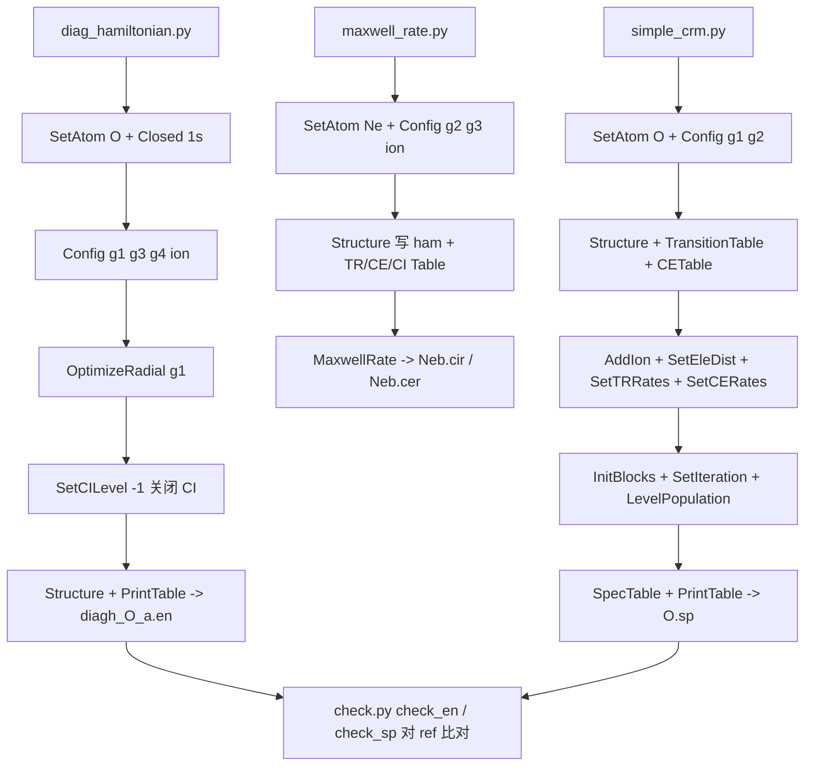
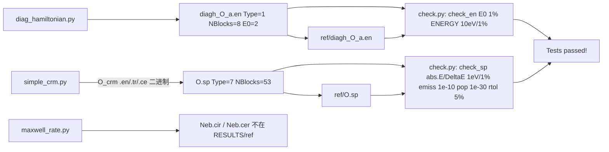

# demo/tests —— 哈密顿量对角化 / Maxwell 速率 / 简单 CRM 测试

本文件为完整重写的中文说明，面向 Agent 精确执行与复核。所有相对链接以本目录 `demo/tests/` 为基准。

## 1. 物理场景

本目录汇集三个面向底层函数与模块行为的测试/验证脚本：

1. [diag_hamiltonian.py](diag_hamiltonian.py)：中性氧（关闭 CI）的能级结构，检验哈密顿量对角化 $H\psi=E\psi$ 与 `SetCILevel(-1)` 的 CI 开关行为。
2. [maxwell_rate.py](maxwell_rate.py)：Ne-like 离子的 Maxwell 速率系数转换（不产出 `ref/` 基准表）。
3. [simple_crm.py](simple_crm.py)：氧 I 的简单碰撞–辐射模型（CRM）稳态布居与谱表。

`../Makefile` 的 `DIRS` 包含 `tests`，`make check` 会进入本目录；这是 demo 健康自检的一部分（`../README.md`）。

## 2. 物理效应：简介 + LaTeX 公式 + 出处 + 源码映射

### 2.1 哈密顿量对角化 Hψ=Eψ

- 简介：`SetCILevel(-1)` 关闭组态相互作用，使哈密顿量按组态块对角化，检验单组态 Dirac–Fock（DC）能级计算的确定性；FAC 原子结构基于 Coulomb/Dirac–Fock–Slater 哈密顿量并含 Breit、自能、真空极化等高阶 QED 修正（`../../doc/manual.tex:94-98`）。
- 公式（出处 `ref/README.md:27-30`；`diag_hamiltonian.py:15-18`）：

$$
\hat H_{\rm DC}\,\psi_i=E_i\,\psi_i,\qquad
\text{CI 关闭时}\quad E_i\approx\langle\Phi_i|\hat H|\Phi_i\rangle .
$$

`diagh_O_a.en` 中多条能级能量严格为 0 是关闭 CI 的预期结果。
- 源码映射：[diag_hamiltonian.py](diag_hamiltonian.py):15-18；`maxwell_rate.py:23` 的 `Structure(..., ham, ...)` 额外输出哈密顿量矩阵；`../../python/rfac.py:511 read_lev()`；`../check.py:96 check_en()`。

### 2.2 Maxwell 速率分布与速率系数

- 简介：`MaxwellRate` 对截面按 Maxwell 电子能量分布求平均（`manual.tex:2853-2860`）；CRM 中 `EDIST=0` 为 Maxwellian、`T_e` 单位 eV（`manual.tex:1197-1215`）。脚本本身不显式写 $f(E)$，此为 `MaxwellRate` 内部假设。
- 公式（出处 `ref/README.md:45-47`）：

$$
f(E)=\frac{2}{\sqrt{\pi}}\,(kT)^{-3/2}\sqrt{E}\,e^{-E/kT},\qquad
\langle\sigma v\rangle=\sqrt{\frac{8}{\pi m_e}}\,(kT)^{-3/2}\int_0^{\infty}\sigma(E)\,E\,e^{-E/kT}\,dE .
$$

归一化常数与单位换算按 `fac.MaxwellRate()` 源码核对。
- 源码映射：[maxwell_rate.py](maxwell_rate.py):40-41 的 `MaxwellRate('Neb.ci','Neb.cir',-1,-1,1000)` 与 `MaxwellRate('Neb.ce','Neb.cer',-1,-1,1000)`（`-1` 遍历所有索引，`1000` 为温度列表）。

### 2.3 CRM 稳态方程与谱线发射率

- 简介：`../../faclib/crm.c` 的 `crm` 模块用迭代线性方程求解器反演光薄等离子体能级布居（`manual.tex:3902-3908`、`LevelPopulation` 见 `manual.tex:4119-4121`）。
- 公式（出处 `ref/README.md:36-39`）：

$$
\frac{dN_i}{dt}=\sum_{j\neq i}N_j R_{j\to i}-N_i\sum_{j\neq i}R_{i\to j}=0,
$$

其中 $R$ 含辐射跃迁率与电子碰撞速率系数；辐射率 $A_{ji}\propto\omega^{2k+1}|\langle j\|D^{(k)}\|i\rangle|^2$，激发截面 $\sigma_{ij}=\pi a_0^2\Omega_{ij}/(g_i E_i)$。
- **谱线发射率**：$\varepsilon_{ij}=N_i A_{ij}$，单位 **photons/s**（`../../faclib/crm.c:4495` 的 `r.strength = c*(a+b)`，随后 `s = r.strength*e`；`manual.tex:1141-1143`），`SpecTable` 的 `strength` 不含 $\hbar\omega$；若需能量发射率须另乘 $h\nu_{ij}$。
- 源码映射：[simple_crm.py](simple_crm.py):42-50（`AddIon`→`SetBlocks`→`SetEleDist`→`SetTRRates(0)`→`SetCERates(1)`→`SetEleDensity`→`InitBlocks`→`SetIteration`→`LevelPopulation`）；`../../python/rfac.py:1085 read_sp()`；`../check.py:197 check_sp()`。

## 3. 逐文件说明（含相对链接）

- [diag_hamiltonian.py](diag_hamiltonian.py)：`from pfac.fac import *`；`SetAtom('O')`、`Closed('1s')`；`Config('g1','2*6')`/`('g3','2*5 3*1')`/`('g4','2*5 4*1')`/`('ion','2*5')`；`OptimizeRadial('g1')`；`SetCILevel(-1)` 关闭 CI；`Structure('diagh_O.en',['g1','g3','g4','ion'])` → `MemENTable` → `PrintTable(...,'diagh_O_a.en')`。输出 `diagh_O_a.en` 与中间 `diagh_O.en.b`。
- [maxwell_rate.py](maxwell_rate.py)：`SetAtom('Ne')`；`Config('g2','1s2 2*1')`/`('g3','1s2 3*1')`/`('ion','1s2')`；`Structure(a+'b.en', a+'b.ham', ...)` 同时写哈密顿量；`TRTable`/`CETable`/两次 `CITable`；两次 `MaxwellRate`。输出 `Neb.en/.ham/.tr/.ce/.ci` 及 `Neb.cir`、`Neb.cer`；**后两者既不在 `ref/` 也不在 `Makefile` 的 `RESULTS` 中**。脚本顶部 `z=10, nele=3, nmax=5`（`nmax` 未用），`a='Ne'` 硬编码。
- [simple_crm.py](simple_crm.py)：结构/速率部分 `from pfac.fac import *`，CRM 部分 `from pfac.crm import *`；自建 `O_crm/` 目录存 `.en/.tr/.ce` 二进制；输出 `O.sp`（Type=7）。可选命令行参数 `openmp`（对 fac 与 crm 分别 `InitializeMPI(2)`/`FinalizeMPI()`）。脚本第 8 行 `print('running crm_OI.py')` 沿用旧名。
- [Makefile](Makefile)：`RESULTS = diagh_O_a.en O.sp`，`SCRIPTS = simple_crm.py diag_hamiltonian.py maxwell_rate.py`，`include ../Make.common`。
- [ref/README.md](ref/README.md)：参考结果格式与容差说明；基准文件 [ref/diagh_O_a.en](ref/diagh_O_a.en)、[ref/O.sp](ref/O.sp)（文件头 `FAC 1.1.5`）。
- 上游依赖（相对链接）：`../check.py`、`../Make.common`、`../README.md`、`../../python/rfac.py`、`../../doc/manual.tex`、`../../faclib/crm.c`。本目录仅提供 `.py`，无 `.sf` 版本。

## 4. 真实 pfac API 调用链

`diag_hamiltonian.py`：

```
from pfac.fac import *
SetAtom('O'); Closed('1s')
Config('g1','2*6'); Config('g3','2*5 3*1'); Config('g4','2*5 4*1'); Config('ion','2*5')
ConfigEnergy(0); OptimizeRadial('g1'); ConfigEnergy(1)
SetCILevel(-1)
Structure('diagh_O.en', ['g1','g3','g4','ion'])
MemENTable('diagh_O.en'); PrintTable('diagh_O.en','diagh_O_a.en')
```

`maxwell_rate.py`：

```
from pfac.fac import *
SetAtom('Ne')
Config('g2','1s2 2*1'); Config('g3','1s2 3*1'); Config('ion','1s2')
ConfigEnergy(0); OptimizeRadial('g2'); ConfigEnergy(1)
Structure('Neb.en','Neb.ham',['g2','g3']); Structure('Neb.en','Neb.ham',['ion'])
MemENTable('Neb.en'); PrintTable('Neb.en','Neb.a.en')
TRTable('Neb.tr',['g2'],['g3']); CETable('Neb.ce',['g2'],['g3'])
CITable('Neb.ci',['g2'],['ion']); CITable('Neb.ci',['g3'],['ion'])
MaxwellRate('Neb.ci','Neb.cir',-1,-1,1000); MaxwellRate('Neb.ce','Neb.cer',-1,-1,1000)
```

`simple_crm.py`：

```
from pfac.fac import *; from pfac.crm import *
SetAtom('O'); Closed('1s')
Config('g1','2s2 2p4'); Config('g2','2s2 2p3 3s1')
ConfigEnergy(0); OptimizeRadial('g1'); ConfigEnergy(1)
Structure('O_crm/O.en',['g1','g2']); MemENTable('O_crm/O.en')
TransitionTable('O_crm/O.tr',['g1','g2'],['g1','g2'])
CETable('O_crm/O.ce',['g1','g2'],['g1','g2'])
AddIon(8,1,'O_crm/O'); SetBlocks(-1); SetEleDist(0,1.0,-1,-1)
SetTRRates(0); SetCERates(1); SetEleDensity(1.0)
InitBlocks(); SetIteration(1e-6,0.5); LevelPopulation()
SpecTable('O.b.sp',0); PrintTable('O.b.sp','O.sp')
```

可选 `openmp` 分支：`fac.InitializeMPI(2)`（结构/速率后 `fac.FinalizeMPI()`）、`crm.InitializeMPI(2)`（结束 `crm.FinalizeMPI()`）。

## 5. Mermaid FAC 使用流程图



## 6. Mermaid 数据流图



## 7. 执行记录与命令

**实测环境**：WSL Ubuntu-22.04；gcc 9.5.0；gfortran 11.4.0；Python 3.10.12；PFAC 模块编译成功。构建兼容处理见第 10 节。

**实测命令**（在 `demo/tests/` 中，`PYTHONPATH` 指向已构建的 PFAC 模块）：

```bash
python simple_crm.py
python diag_hamiltonian.py
python maxwell_rate.py
python ../check.py diagh_O_a.en ref/diagh_O_a.en
python ../check.py O.sp  ref/O.sp
# 或 make / make check / make ref / make clean
```

**实测结果**：三条 RUN 与两条 CHECK 均 `EXIT=0`。**耗时未记录**，不推断墙钟时间。`simple_crm.py` 自建的 `O_crm/` 需手工删除。

## 8. 输出清单与单位

| 文件 | 类型 | 头部关键字段 | 主要列 / 单位 |
|---|---|---|---|
| `diagh_O_a.en` | Type=1 能级表 | `NBlocks=8`，`E0=2, -5.24760131E+02`；块1 `NELE=7,NLEV=5`（O II `2p3`），含多条 `ENERGY=0` | `ILEV IBASE ENERGY P VNL 2J` + 组态名串；`ENERGY`、`E0` 为 **eV**（ASCII verbose 乘 `HARTREE_EV`，`dbase.c:5371-5374`）；多条 0 能量源于关闭 CI |
| `O.sp` | Type=7 谱表 | `NBlocks=53`；每块 `NELE/NTRANS/TYPE/IBLK/ICOMP/FBLK/FCOMP` | 实际每数据行 **8 列** `upper lower energy strength rrate trate wimp wstk`（`faclib/dbase.c:6959-6964`）；`rfac.read_sp()` 仅解析前 6 列且错名为 `block/level/abs. energy/population/Delta E/emissivity`（见 [`NeL/README.md`](../NeL/README.md) §7）；`TYPE≠0` 线发射块 `strength`=$N_iA_{ij}$ 为 **photons/s**（`crm.c:4495`，不含 $h\nu$），`TYPE=0` 布居块 `strength`=$N_i$；`energy` 为 eV（二进制 Hartree，ASCII 打印时 ×`HARTREE_EV`） |
| `Neb.cir` / `Neb.cer`（及 `Neb.en/.ham/.tr/.ce/.ci`） | 速率/中间表 | 由 `maxwell_rate.py` 生成 | Maxwell 速率系数 `⟨σv⟩`；**不在 `RESULTS` 与 `ref/` 中**，不参与 `make check` |

参考文件：[ref/diagh_O_a.en](ref/diagh_O_a.en)、[ref/O.sp](ref/O.sp)。版本/时间戳被 `check.py` 忽略。

## 9. check.py 比对结果

- 分派：`../check.py:232` 后缀 `.en` → `check_en()`（第 96 行）、`.sp` → `check_sp()`（第 197 行）。
- `check_en()`：`NBlocks` 相等、`E0` 相对 1%；`ENERGY` `atol=10`、`rtol=0.01`；字符串列逐字一致。误开 CI 会使多条本应为 0 的 `ENERGY` 变化而比对失败。
- `check_sp()`：`abs. energy`(=energy)/`Delta E`(=rrate) `atol=1`、`rtol=0.01`；`emissivity`(=trate) `atol=1e-10`、`rtol=0.05`；`population`(=strength) `atol=1e-30`、`rtol=0.05`（极小绝对容差配合 5% 相对容差，弱线数值噪声需关注；键名为 `read_sp` 历史误命名，见 §8 与 [`NeL/README.md`](../NeL/README.md) §7）。
- **实测**：`diagh_O_a.en`、`O.sp` 两项均通过（`EXIT=0`），本目录合计 **2 项检查通过**；`maxwell_rate.py` 产物无基准、不比对。

## 10. 限制与构建兼容处理说明

- 限制：`maxwell_rate.py` 属测试脚本但不产生参考数据，`RESULTS` 仅两项；本目录无 `.sf` 版，如需 SFAC 版可按手册（`manual.tex:2390-2395`）把 `fac`/`crm` 调用一一转为 `sfac`/`scrm`。`diagh_O_a.en` 多条能量为 0 是关闭 CI 的预期结果。字段/单位不确定处以 `../../python/rfac.py` 与 `manual.tex` 表格定义为准。
- 基准版本：`../README` 称基准来自 FAC=1.1.4，实际文件头为 `FAC 1.1.5`；比对脚本忽略版本/时间戳。
- **构建兼容处理（不改变物理，仅构建/ABI）**：实测 Linux/WSL 构建采用两类处理：
  1. `configure`、`install.sh`、`mkinsdir.sh`、`config.guess`、`config.sub` 由 CRLF 归一为 LF，修复 `#!/bin/sh` 执行失败；
  2. `sysdef.h` 中 `#undef f2cFortran` 改为 `#define f2cFortran 1`，固定 C/Fortran 的 f2c 风格函数名修饰与 LOGICAL 约定；
  **原始源码树未修改**。这些处理只影响编译与链接 ABI，不触碰物理模型或数值；本目录 2 项 `ref/` 比对全部通过。